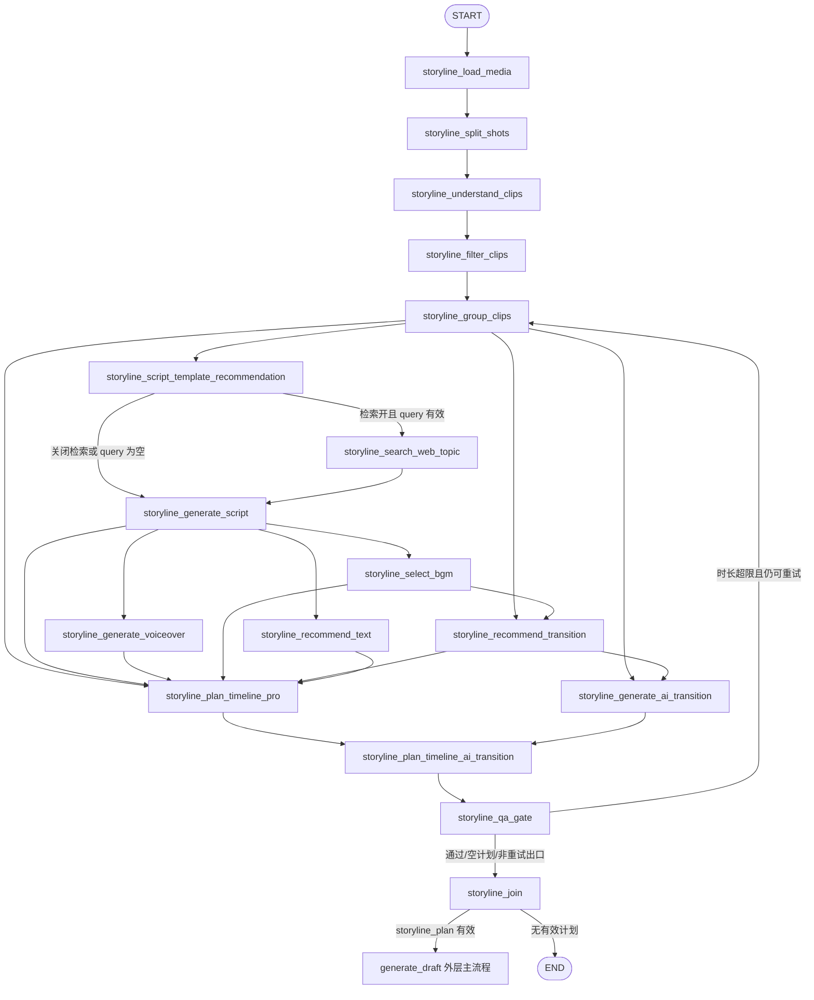

# auto-video-editor：OpenStoryline 子图边审计与精简设计执行计划

> **审计日期：** 2026-11-13（Asia/Singapore）  
> **代码仓库：** [`wayyet/auto-video-editor`](https://github.com/wayyet/auto-video-editor)  
> **分支：** `main`  
> **核验基线：** `a41e45e034b77008d468775d0313f01233ee64d5`（2026-11-12 16:07:34 UTC）  
> **分析范围：** `graph.py` 中 OpenStoryline / Storyline 逻辑子流程，从 `storyline_load_media` 到 `storyline_join`，并包含其与外层 `generate_draft` 的交接边。  
> **报告性质：** 基于当前源码、节点实现和测试代码的静态审计；本文不代表本轮已经修改仓库或在本机重新执行了完整测试套件。

---

## 1. 结论摘要

### 1.1 核心结论

当前 `main` 分支的 Storyline 逻辑子流程一共注册了 **17 个 `storyline_*` 节点**。其中 AI 转场的两个节点 `storyline_generate_ai_transition`、`storyline_plan_timeline_ai_transition` 由 `STORYLINE_ENABLE_AI_TRANSITION` 控制是否接入运行路径。

**当前边并不是简单地“连得太多”。绝大多数边都有明确的数据依赖或控制流意义。** 节点数量、分支数量、并行任务数量和边数量不是一回事：素材加工主链、可选网页检索、配音/文字/BGM/转场并行任务、时间线 fan-in、AI 转场可选链路、QA 重试回路，都会增加连接关系。

当前源码已经实现了上一轮边治理的大部分改动：

- BGM 与普通转场的多来源触发已改为 fan-in 屏障，避免节点被上游单源边重复触发。
- `plan_timeline_pro` 已等待六个真实产物生产节点。
- AI 转场生成只等待它实际需要的分组和普通转场计划。
- QA 已精简为只等待最终时间线；QA 非重试出口直接进入 `storyline_join`。
- 文案模板推荐已经前置到文案生成之前；网页检索变成模板推荐后的条件分支。
- 旧 `storyline_render_video` 节点及其边已被彻底删除。

**本次发现一处需要继续核验和精简的依赖：** 当前 `[storyline_generate_script, storyline_generate_voiceover] -> storyline_select_bgm` 屏障要求配音节点完成后才运行 BGM，但 `node_select_bgm.py` 实际没有读取 `storyline_voiceover_artifact`。它目前使用的是分组、脚本文案中的 narration 文本和用户配乐要求。也就是说，等待真实配音完成并不是当前 BGM 节点的数据依赖。

### 1.2 最终处理建议

| 处理级别 | 当前关系 | 建议 | 判断 |
|---|---|---|---|
| 必须保留 | 素材加载、镜头切分、视觉理解、筛选、分组主链 | 保留 | 串行数据生产链，不能删除 |
| 必须保留 | `group_clips -> template_recommendation -> 条件路由` | 保留 | 模板必须先于文案生成；条件路由保证检索可跳过 |
| 必须保留 | `search_web_topic -> generate_script` | 保留 | 检索结果是文案上下文的可选来源 |
| 必须保留 | 文案到配音、文字推荐的 fan-out | 保留 | 两个下游任务分别消费文案 |
| **建议精简** | `[generate_script, generate_voiceover] -> select_bgm` | 若 BGM 不做真实配音时长对齐，改成 `generate_script -> select_bgm` | 当前 `select_bgm` 节点没有读取配音 artifact；配音等待是冗余调度约束 |
| 必须保留 | `[group_clips, select_bgm] -> recommend_transition` | 保留 | 转场推荐确实同时读取分组和 BGM 选择结果 |
| 必须保留 | 六源屏障 -> `plan_timeline_pro` | 保留 | 六个来源分别生产时间线需要的六类输入 |
| 必须保留 | `[group_clips, recommend_transition] -> generate_ai_transition` | 保留 | AI 转场读取分组和普通转场提示 |
| 必须保留 | `[plan_timeline_pro, generate_ai_transition] -> plan_timeline_ai_transition` | 保留 | AI 时间线合并需要基础时间线和真实转场产物 |
| 必须保留 | `PTP/PTAT -> QA -> (重试或 join)` | 保留 | QA 只校验最终时间线；重试和正常收尾是两种控制流 |
| 必须保留 | `join -> generate_draft / END` | 保留 | 条件判断是否存在可交付的 `storyline_plan` |
| 低优先级清理 | AI 开关关闭时，两个 AI 节点仍被注册但不接边 | 可将节点注册也放到开关分支内 | 仅改善关闭状态下的图可视化，不是当前运行路径的边错误 |

### 1.3 对“子图”的边界说明

当前 Storyline 流程**是主 `StateGraph` 中的一组逻辑节点和边，并不是单独构建、单独 `compile()` 的嵌套 StateGraph 子图**。`graph.py` 同时装配 Storyline 流程、剪映草稿流水线、双语处理和交付节点。

因此，本文把 `storyline_load_media` 至 `storyline_join` 称为“Storyline 逻辑子流程”；`storyline_join -> generate_draft` 是它向外层草稿生成主流程交接的条件边，不应误画成独立子图内部的普通处理节点。

---

## 2. 代码基线与审计范围

### 2.1 当前代码基线

| 项目 | 核验结果 |
|---|---|
| 分支 | `main` |
| HEAD | `a41e45e034b77008d468775d0313f01233ee64d5` |
| HEAD 提交时间 | 2026-11-12 16:07:34 UTC |
| 主图构建入口 | `graph.py::_build_state_graph()` |
| 当前 Storyline 节点注册 | 17 个 `storyline_*` 节点 |
| AI 转场接线 | 建图时读取 `STORYLINE_ENABLE_AI_TRANSITION` |
| 网页检索接线 | `storyline_script_template_recommendation` 运行后按开关和 query 条件路由 |
| QA 最终时间线来源 | AI 开启时为 PTAT；AI 关闭时为 PTP |

### 2.2 本次重点源码

| 文件 | 审计用途 |
|---|---|
| [`graph.py`](https://github.com/wayyet/auto-video-editor/blob/main/graph.py) | 节点注册、普通边、条件边、fan-in 屏障、QA 重试路由 |
| [`nodes/storyline/node_script_template_recommendation.py`](https://github.com/wayyet/auto-video-editor/blob/main/nodes/storyline/node_script_template_recommendation.py) | 模板推荐的真实输入和输出 |
| [`nodes/storyline/node_generate_script.py`](https://github.com/wayyet/auto-video-editor/blob/main/nodes/storyline/node_generate_script.py) | 是否消费模板 artifact 和网页检索 artifact |
| [`nodes/storyline/node_search_web_topic.py`](https://github.com/wayyet/auto-video-editor/blob/main/nodes/storyline/node_search_web_topic.py) | 检索节点的条件执行、缓存与输出 |
| [`nodes/storyline/node_select_bgm.py`](https://github.com/wayyet/auto-video-editor/blob/main/nodes/storyline/node_select_bgm.py) | BGM 节点实际读取的 state 字段 |
| [`nodes/storyline/node_recommend_transition.py`](https://github.com/wayyet/auto-video-editor/blob/main/nodes/storyline/node_recommend_transition.py) | 普通转场推荐的数据依赖 |
| [`nodes/storyline/node_recommend_text.py`](https://github.com/wayyet/auto-video-editor/blob/main/nodes/storyline/node_recommend_text.py) | 文字样式推荐的数据依赖 |
| [`nodes/storyline/node_plan_timeline_pro.py`](https://github.com/wayyet/auto-video-editor/blob/main/nodes/storyline/node_plan_timeline_pro.py) | PTP 实际读取的六类上游结果 |
| [`nodes/storyline/node_generate_ai_transition.py`](https://github.com/wayyet/auto-video-editor/blob/main/nodes/storyline/node_generate_ai_transition.py) | AI 转场生成的输入依赖 |
| [`nodes/storyline/node_plan_timeline_ai_transition.py`](https://github.com/wayyet/auto-video-editor/blob/main/nodes/storyline/node_plan_timeline_ai_transition.py) | AI 转场如何并入 Canonical Timeline |
| [`nodes/storyline/qa_gate.py`](https://github.com/wayyet/auto-video-editor/blob/main/nodes/storyline/qa_gate.py) | QA 校验输入、重试信号和条件路由 |
| [`nodes/storyline/join_storyline.py`](https://github.com/wayyet/auto-video-editor/blob/main/nodes/storyline/join_storyline.py) | Timeline 到 `storyline_plan` 的交接 |
| [`tests/unit/test_storyline_edge_governance_topology.py`](https://github.com/wayyet/auto-video-editor/blob/main/tests/unit/test_storyline_edge_governance_topology.py) | 当前边结构、屏障形状和方向断言 |
| [`tests/integration/test_unreachable_nodes_wiring.py`](https://github.com/wayyet/auto-video-editor/blob/main/tests/integration/test_unreachable_nodes_wiring.py) | 可达性、邻居、运行顺序、重试和 AI 分支回归测试 |

### 2.3 历史设计文档与当前源码的关系

仓库中已经存在 2026-11-12 的《子图边有效性审计与精简设计执行计划》及阶段 0-3、阶段 4-7 执行记录。这些文档记录的是治理前问题、修改方案和当日执行情况。

本报告以当前 `main` 的源码为最终依据，而不是把历史计划中的“待修改”事项重复列为当前缺陷。例如：模板推荐已前置、AI 转场已从 Stub 改为真实 Provider 生成并物化、render 节点已删除、QA 已改为单源最终时间线入口。这些历史问题不应再按“当前仍未实现”处理。

---

## 3. 为什么这个流程会有这么多边

边多的根本原因不是节点“互相乱连”，而是它不是简单串行流水线。它包含六种不同的连接目的。

### 3.1 素材分析主链：前后节点存在确定的数据依赖

```text
START
  -> storyline_load_media
  -> storyline_split_shots
  -> storyline_understand_clips
  -> storyline_filter_clips
  -> storyline_group_clips
```

这些边对应不同阶段产物：

| 节点 | 主要产物/作用 | 下游为什么需要它 |
|---|---|---|
| `load_media` | 媒体清单、媒体元数据 | 镜头切分需要原始媒体和时长等信息 |
| `split_shots` | 镜头切分结果 | 视觉理解需要按镜头处理素材 |
| `understand_clips` | 片段视觉描述、整体概述 | 筛选和主题分组需要内容语义 |
| `filter_clips` | 筛选后的片段 | 分组不能基于未筛选的全部片段 |
| `group_clips` | 分组、主题、片段顺序 | 文案、配乐、转场、时间线均消费这些分组 |

这四条主链边应保留。删除任何一条都会破坏数据生产顺序，或者使后续节点读取未生产的 artifact。

### 3.2 文案模板和网页检索：一个必经节点加一个可选条件节点

当前路径是：

```text
group_clips
    |
    v
script_template_recommendation
    |
    +-- 检索开关开启且 query 非空 --> search_web_topic --> generate_script
    |
    +-- 检索关闭或 query 为空 ---------------------> generate_script
```

模板推荐现在是文案生成的前置主链节点。它读取分组主题、素材整体概述和用户文案/风格需求，输出 `storyline_script_template_artifact`。`node_generate_script.py` 会读取模板正文并注入 prompt；用户提供 `custom_script` 时则优先使用用户文案。

网页检索节点不是必经节点。`_storyline_route_after_template_rec()` 会同时检查 `STORYLINE_ENABLE_WEB_TOPIC` 和 `build_web_topic_query(state)`：只有检索开关开启、并且确实能构造非空检索词时才进入 `search_web_topic`，否则直接去 `generate_script`。

`search_web_topic` 完成后通过普通边进入 `generate_script`；文案节点再读取 `storyline_web_topic_artifact`，把检索结果作为单独的 `web_research` 上下文。检索失败或没有结果时，文案生成仍可软降级继续。

**因此以下连接都必须保留：**

- `group_clips -> script_template_recommendation`
- `script_template_recommendation -> (conditional) search_web_topic`
- `script_template_recommendation -> (conditional) generate_script`
- `search_web_topic -> generate_script`

不能额外增加 `group_clips -> generate_script` 普通边，否则可能绕过模板推荐并造成文案节点提前运行；也不能把 `search_web_topic` 放进固定 fan-in 屏障。

### 3.3 文案后的 fan-out：一个结果派生多个任务

```text
                       +--> generate_voiceover
                       |
generate_script --------+
                       |
                       +--> recommend_text
```

`generate_voiceover` 根据文案生成配音结果；`recommend_text` 根据分组和脚本内容生成文字样式建议。两者都消费文案，但它们互相不需要等待对方，因此从文案节点并行派发是合理的。

`generate_script -> generate_voiceover` 和 `generate_script -> recommend_text` 两条边均应保留。它们是两个独立任务的入口，不是重复连接。

### 3.4 BGM、普通转场和时间线：真正的多来源汇合

时间线不是单一节点就能构建。它要读取素材分组、脚本、配音、BGM、普通转场和文字样式，因此图中会出现多个来源汇合。

- `select_bgm` 读取分组、脚本以及用户配乐要求。
- `recommend_transition` 读取分组和 BGM 选择结果。
- `recommend_text` 读取分组和脚本。
- `plan_timeline_pro` 读取上述结果并生成 Canonical Timeline。

多个来源必须全部完成时，应使用一个列表形式的 fan-in，而不是对同一目标分别调用多个普通单源 `add_edge()`。

### 3.5 AI 转场：可选增强链，不是必经基础链

```text
[group_clips, recommend_transition]
                |
                v
generate_ai_transition
                |
                +------------------------+
                                         |
plan_timeline_pro -----------------------+--> plan_timeline_ai_transition --> QA
```

AI 转场生成节点需要分组衔接点，以及普通转场建议提供的 `transition_in/out` 提示。PTAT 则需要基础时间线和 AI 转场生成结果，把成功生成且满足相邻关系的 MP4 物化成 `SourceMedia + Clip`，写回最终 Timeline。

此链路有两个屏障是正常的：第一道等待分组与普通转场，第二道等待基础时间线与 AI 转场结果。AI 功能关闭时，这两个节点不接入执行路径，QA 改为直接校验 PTP 输出。

### 3.6 QA 重试：一条回边和一条正常收尾边

```text
PTP 或 PTAT
     |
     v
  qa_gate
   |   \
   |    +-- 达标 / 空计划 / 非时长重试失败 / 重试耗尽 --> join_storyline
   |
   +------- 时长超限且仍可重试 -----------------------> group_clips
```

QA 发现总时长超过目标阈值时，会把流程退回 `group_clips`，重新组织分组并重建下游产物；达到重试上限后走正常收尾路径，不会无限循环。

这条回边不是多余边，而是业务规则。它也决定了哪些节点可以进入 fan-in 屏障：重试回路会重新执行的节点可以再次参与本轮汇合；重试起点上游、不会重新执行的节点则不能被设置为必须重新完成的屏障来源。

---

## 4. LangGraph 边的语义：为什么不能把所有箭头当成普通依赖

### 4.1 普通单源边

```python
g.add_edge("A", "C")
```

含义是 A 完成后，C 可以进入下一步调度。它只说明 C 等待 A，不说明 C 还需要等待其他节点。

### 4.2 多源 fan-in 屏障

```python
g.add_edge(["A", "B"], "C")
```

含义是 C 必须等待 A 和 B **全部完成**后才执行。

### 4.3 为什么不能用两条单源边模拟一个屏障

```python
# 不代表 C 等待 A 和 B 都完成
# A 完成时，C 就可能被调度；B 完成时又可能再次触发 C
g.add_edge("A", "C")
g.add_edge("B", "C")

# 正确表达“两个来源都就绪后执行一次”
g.add_edge(["A", "B"], "C")
```

本项目早期的 BGM 和普通转场问题就是这种误用：BGM 会在脚本完成时先执行，配音完成后再次执行；普通转场推荐会在分组完成时提前执行，BGM 完成后又执行。重复执行不仅浪费 LLM/能力调用，还可能重复覆盖 state 或 artifact。

### 4.4 条件边

```python
g.add_conditional_edges("A", route, {
    "branch_x": "X",
    "branch_y": "Y",
})
```

条件边由路由函数决定走哪个目标。它表达互斥选择或动态分支，不等于两个目标都执行。

### 4.5 术语

| 术语 | 含义 |
|---|---|
| fan-out | 一个节点完成后，同时触发多个下游任务 |
| fan-in | 多个上游任务的结果汇合到一个下游节点 |
| barrier | fan-in 屏障；目标等待列出的所有来源完成 |
| conditional edge | 条件边；路由函数根据 state 选择目标 |
| retry loop | 重试回路；质量检查未通过时返回上游重新执行 |
| super-step | LangGraph 的调度轮次；同一轮可以并行运行多个节点 |

LangGraph 当前 API 对 `add_edge(start_key, end_key)` 的说明明确区分单源与多源：单源等待一个节点，多源等待列表中的所有节点。参考：[StateGraph.add_edge 官方 API](https://reference.langchain.com/python/langgraph/graph/state/StateGraph/add_edge)、[LangGraph Graph API](https://docs.langchain.com/oss/python/langgraph/graph-api)。

---

## 5. 当前实际边清单与逐条审计

以下按当前 `graph.py` 的真实接线审计。表中的“保留”指当前实现正确、应该维持；“精简”指边的等待条件目前超出了节点实际消费的数据。

### 5.1 素材主干边

| 当前边 | 类型 | 判定 | 处理建议 | 原因 |
|---|---|---|---|---|
| `START -> storyline_load_media` | 普通 | 有效 | **保留** | 当前 auto-only 素材入口 |
| `storyline_load_media -> storyline_split_shots` | 普通 | 有效 | **保留** | 镜头切分依赖媒体加载结果 |
| `storyline_split_shots -> storyline_understand_clips` | 普通 | 有效 | **保留** | 视觉理解依赖镜头切分产物；旧 ASR 旁支已经删除 |
| `storyline_understand_clips -> storyline_filter_clips` | 普通 | 有效 | **保留** | 片段筛选依赖视觉理解结果 |
| `storyline_filter_clips -> storyline_group_clips` | 普通 | 有效 | **保留** | 分组需要已筛选片段 |

### 5.2 模板推荐和网页检索边

| 当前边 | 类型 | 判定 | 处理建议 | 原因 |
|---|---|---|---|---|
| `storyline_group_clips -> storyline_script_template_recommendation` | 普通 | 有效 | **保留** | 模板检索需要分组主题，模板节点必须在文案生成之前 |
| `STR -> search_web_topic` | 条件边 | 有效 | **保留** | 检索开关开启且 query 有效时才走检索 |
| `STR -> generate_script` | 条件边 | 有效 | **保留** | 关闭检索或 query 为空时直接生成文案 |
| `search_web_topic -> generate_script` | 普通 | 有效 | **保留** | 检索结果进入文案 prompt |
| `generate_script -> STR` | 当前不存在；历史方向错误 | 无效方向 | **继续禁止** | 模板必须先于文案；反向边无法影响已经生成的文案 |
| `group_clips -> generate_script` | 当前不存在；不应新增 | 错误旁路 | **禁止新增** | 会绕过模板节点，并可能导致文案提前执行或重复执行 |
| `search_web_topic` 作为 fan-in 来源 | 当前不存在 | 正确排除 | **继续禁止** | 检索是条件触发节点，QA 重试轮可能跳过，固定屏障会永远等不到它 |

### 5.3 文案派生任务

| 当前边 | 类型 | 判定 | 处理建议 | 原因 |
|---|---|---|---|---|
| `generate_script -> generate_voiceover` | 普通 | 有效 | **保留** | 配音节点以文案为输入 |
| `generate_script -> recommend_text` | 普通 | 有效 | **保留** | 文字样式推荐读取脚本；分组数据在文案主链之前已就绪 |

### 5.4 BGM 屏障：当前唯一建议优先精简的边

当前代码：

```python
g.add_edge(
    ["storyline_generate_script", "storyline_generate_voiceover"],
    "storyline_select_bgm",
)
```

从图结构看，这是一个正确的双源 barrier：BGM 节点会等脚本和配音两个节点都完成。但**图结构正确不代表两个来源都是必要输入**，还要检查目标节点是否真的读取了两个产物。

当前 `nodes/storyline/node_select_bgm.py` 的实际逻辑是：

1. 通过 `_read_groups(state)` 读取 `storyline_groups_artifact`；
2. 通过 `_read_script(state)` 读取 `storyline_script_artifact` 中的 `group_scripts`；
3. 聚合脚本文案的 narration；
4. 调用 `select_bgm(user_request, groups, narration_text)`；
5. 写入 `storyline_bgm_selection`。

它**没有读取 `storyline_voiceover_artifact`**，也没有把真实配音文件时长、波形或语音时间轴传入 BGM 选择算法。虽然模块注释提到“供 generate_voiceover 时长对齐”，但当前节点函数没有实现这个读取和消费过程。

因此，现有双源屏障中的 `storyline_generate_voiceover` 是一个未被实际消费的等待依赖。配音节点结束得晚时，BGM 会被无业务必要地延后。

**推荐默认改法：**

```python
# 当前：等待脚本和配音都完成
# g.add_edge(
#     ["storyline_generate_script", "storyline_generate_voiceover"],
#     "storyline_select_bgm",
# )

# 建议：BGM 只等待脚本
# generate_script 的上游已经是 group_clips，分组数据在此之前已就绪
g.add_edge("storyline_generate_script", "storyline_select_bgm")
```

这不会使 BGM 重复运行，因为它只保留一个触发来源。配音仍会由 `generate_script -> generate_voiceover` 独立运行；最终 PTP 仍有自己的六源屏障，继续等待配音产物后才生成时间线。

**保留双源屏障的替代条件：** 如果产品明确要求 BGM 依据真实 TTS 时长、语音停顿或配音音频节拍做对齐，则不要删除 `generate_voiceover` 来源；应先修改 `node_select_bgm.py`，让它读取并使用 `storyline_voiceover_artifact` 中明确的时长/音频元数据，再保留 `[generate_script, generate_voiceover] -> select_bgm`。不能仅因为注释写了“对齐”，就保留代码中不存在的数据依赖。

| 评价维度 | 当前实现 | 推荐状态 |
|---|---|---|
| 图结构 | 双源屏障合法 | 合法，但来源过多 |
| BGM 数据输入 | groups + script narration + user request | 维持 |
| voiceover 消费 | 未读取 | 当前不构成真实依赖 |
| 执行时序 | 必须等待 VO 完成 | 可提前并行 |
| PTP 对 voiceover 的等待 | 六源屏障中仍等待 GV | 必须保留 |

### 5.5 普通转场推荐屏障

当前代码：

```python
g.add_edge(
    ["storyline_group_clips", "storyline_select_bgm"],
    "storyline_recommend_transition",
)
```

`node_recommend_transition.py` 明确读取：

- `storyline_groups_artifact`；
- `storyline_bgm_selection`；
- 用户转场要求和语言配置。

两个来源都是真实输入生产者，所以应当保留为双源屏障。不能拆成两条独立单源边，否则会重新出现“分组完成时先执行一次、BGM 完成后再执行一次”的重复触发问题。

| 当前边 | 类型 | 判定 | 处理建议 | 原因 |
|---|---|---|---|---|
| `[group_clips, select_bgm] -> recommend_transition` | 双源 barrier | 有效 | **保留** | 转场推荐需要分组和配乐选择结果 |

### 5.6 文字推荐和 PTP 六源屏障

文字推荐当前通过 `generate_script -> recommend_text` 启动。文字节点读取 `storyline_groups_artifact` 和 `storyline_script_artifact`，因此这条边有效。

PTP 当前使用：

```python
g.add_edge(
    [
        "storyline_group_clips",
        "storyline_generate_script",
        "storyline_generate_voiceover",
        "storyline_select_bgm",
        "storyline_recommend_transition",
        "storyline_recommend_text",
    ],
    "storyline_plan_timeline_pro",
)
```

六个来源与 PTP 当前的实际输入一一对应：

| fan-in 来源 | PTP 读取的数据 | 是否需要等待 |
|---|---|---|
| `group_clips` | `storyline_groups_artifact` | 是 |
| `generate_script` | `storyline_script_artifact` | 是 |
| `generate_voiceover` | `storyline_voiceover_artifact` | 是 |
| `select_bgm` | `storyline_bgm_selection` | 是 |
| `recommend_transition` | `storyline_transition_plan` | 是 |
| `recommend_text` | `storyline_text_style_plan` | 是 |

**六源屏障应保留。** 这不是重复边，而是六个不同 artifact 的生产完成条件。尤其普通转场和文字样式这两个来源不能漏掉，否则 PTP 可能在它们还未写入 state 时读取空字典，造成时间线缺失转场或文字配置。

从图论角度看，部分来源可能通过其他路径被“间接保证已执行”，但这里仍建议保留直接生产者集合：它清楚表达 PTP 的 state 输入契约，未来重构上游调度时也不容易把隐式依赖破坏掉。当前没有必要为了减少图上的几个箭头而牺牲数据契约的可读性。

### 5.7 AI 转场生成和时间线合并

当前 AI 开启时：

```python
g.add_edge(
    ["storyline_group_clips", "storyline_recommend_transition"],
    "storyline_generate_ai_transition",
)
g.add_edge(
    ["storyline_plan_timeline_pro", "storyline_generate_ai_transition"],
    "storyline_plan_timeline_ai_transition",
)
```

| 当前边 | 类型 | 判定 | 处理建议 | 原因 |
|---|---|---|---|---|
| `[group_clips, recommend_transition] -> generate_ai_transition` | 双源 barrier | 有效 | **保留** | GAT 读取分组衔接点和普通转场提示 |
| `[plan_timeline_pro, generate_ai_transition] -> plan_timeline_ai_transition` | 双源 barrier | 有效 | **保留** | PTAT 必须同时有基础时间线和 AI 转场生成结果 |

PTAT 会检查真实生成状态、MP4 文件是否存在、两端 clip 是否在最终时间线上相邻，再将转场视频加入 `source_media` 并插入一个普通视频 clip。生成失败、未批准、素材不相邻或文件缺失时，PTAT 会保留基础时间线并留下审计记录。

AI 开关在建图时读取。关闭时不接入 GAT/PTAT，QA 改为直接等待 PTP。默认 provider/审批双门禁用于避免未授权的真实 Provider 外呼；图中存在 AI 节点不等于一定会调用付费服务。

### 5.8 QA 和 Join 边

当前 QA 入边：

```python
_plan_for_qa = (
    "storyline_plan_timeline_pro"
    # AI 开启时改为 "storyline_plan_timeline_ai_transition"
)
g.add_edge(_plan_for_qa, "storyline_qa_gate")
```

QA 只读取最终 `storyline_timeline_plan`，检查 Canonical Timeline 合约、片段源区间、片段速度和目标时长。因此只等待最后一个时间线生产节点就够了：

- AI 开启：`PTAT -> QA`；
- AI 关闭：`PTP -> QA`。

QA 不需要再直接等待 `recommend_transition`、`recommend_text` 或其他早期节点，因为 PTP 已经等待并消费它们。重复等待上游来源没有增加数据正确性。

QA 条件出口：

- `storyline_qa_retry_signal` 对应重试：回到 `storyline_group_clips`；
- 通过、空计划、非时长错误或重试耗尽：进入 `storyline_join`。

Join 条件出口：

- `storyline_plan` 或兼容用的 `shot_plan` 存在：进入外层 `generate_draft`；
- 没有可用计划：进入 `END`。

| 当前边 | 判定 | 处理建议 | 原因 |
|---|---|---|---|
| `PTP/PTAT -> QA` | 有效 | **保留** | QA 只需检查最终时间线 |
| `QA -> group_clips`（条件） | 有效 | **保留** | QA 时长超限且仍允许重试时回退 |
| `QA -> join_storyline`（条件） | 有效 | **保留** | 非重试出口统一收尾 |
| `join_storyline -> generate_draft`（条件） | 有效 | **保留** | 有效计划交给外层剪映草稿生成 |
| `join_storyline -> END`（条件） | 有效 | **保留** | 无有效计划时终止，避免生成空草稿 |

---

## 6. 哪些边应该保留，哪些边应该删除

### 6.1 当前必须保留的边

| 类别 | 必须保留的连接 |
|---|---|
| 素材主链 | `START -> load_media -> split_shots -> understand_clips -> filter_clips -> group_clips` |
| 模板与检索 | `group_clips -> template_recommendation -> (conditional) [search_web_topic | generate_script]`；`search_web_topic -> generate_script` |
| 文案 fan-out | `generate_script -> generate_voiceover`；`generate_script -> recommend_text` |
| 普通转场 | `[group_clips, select_bgm] -> recommend_transition` |
| 时间线汇合 | `[group_clips, generate_script, generate_voiceover, select_bgm, recommend_transition, recommend_text] -> plan_timeline_pro` |
| AI 转场 | `[group_clips, recommend_transition] -> generate_ai_transition`；`[plan_timeline_pro, generate_ai_transition] -> plan_timeline_ai_transition`（AI 开启时） |
| QA 和重试 | `PTP/PTAT -> QA`；`QA -> group_clips` 或 `QA -> join_storyline`（条件） |
| 外层交接 | `join_storyline -> generate_draft` 或 `END`（条件） |

### 6.2 当前唯一建议优先删除/替换的依赖

| 当前结构 | 建议结构 | 原因 | 优先级 |
|---|---|---|---|
| `[generate_script, generate_voiceover] -> select_bgm` | `generate_script -> select_bgm` | BGM 节点当前不读取 voiceover artifact；等待 VO 只增加时延 | P2（先确认不要求音频对齐） |

注意：这里不是在现有代码里删除一条独立 `GV -> SB` 普通边；当前它是双源 barrier 的一部分。实施时必须**整体替换该 barrier**，不能保留旧 barrier 又额外新增 `GS -> SB`，否则会引入双重调度路径。

### 6.3 当前源码中已经删除、禁止恢复的错误边

| 历史结构/节点 | 当前状态 | 禁止恢复的原因 |
|---|---|---|
| `GS -> STR` | 已移除 | 文案生成后才推荐模板，不能影响本轮文案 |
| `GS -> SB` 与 `GV -> SB` 两条独立单源边 | 已替换为双源 barrier | 两条独立触发边会造成 BGM 提前执行和重复执行 |
| `GC -> RTR` 与 `SB -> RTR` 两条独立单源边 | 已替换为双源 barrier | 会造成普通转场推荐多次触发 |
| PTP 旧四源屏障（不含 RTR/TXT） | 已扩展为六源屏障 | 时间线规划会读取转场与文字样式产物，旧屏障可能过早执行 |
| GAT 旧四源屏障 | 已调整为 `[GC, RTR]` | GAT 的真实输入是分组和普通转场提示，不应等待无关节点，也不能漏掉 RTR |
| QA 旧三源屏障（再等 RTR/TXT 等上游） | 已精简为最终时间线单源 | PTP 已负责等待时间线所需来源；QA 不应重复等待上游 |
| `QA -> render_video -> join` | `render_video` 节点和边已删除 | 子流程交付物是 Canonical Timeline；最终 MP4 由外层导出节点负责 |
| 条件触发的 `search_web_topic` 进入任意固定 fan-in | 当前不存在 | QA 重试时它可能不执行，屏障可能永远无法完成 |

### 6.4 可选清理，不应与边正确性修复混为一谈

AI 关闭时，当前建图逻辑仍先注册 `storyline_generate_ai_transition` 和 `storyline_plan_timeline_ai_transition`，然后只在 AI 开启分支里给它们接边。关闭时它们不会执行，也不影响基础时间线，但在图构建器中可能表现为已注册、未接线的节点。

可以把两个 `add_node()` 调用也移动到 `if is_ai_transition_enabled():` 分支中，使关闭状态下图结构完全不出现 AI 节点。该项只是图可视化和节点注册卫生优化：

- 不是当前运行时边错误；
- 不应该为了它删除 AI 开启时的两道 fan-in 屏障；
- 需要同步调整 AI flag off 的图结构测试和节点注册断言。

---

## 7. 推荐目标拓扑

### 7.1 默认推荐拓扑（当前逻辑 + BGM 等待精简）

以下方案假设：BGM 选择目前只根据脚本文本、素材分组和用户偏好完成，不要求读取真实 TTS 文件时长。



**AI 关闭时：** 不接入 GAT/PTAT，改为 `PTP -> QA`。  
**AI 开启时：** 使用 `PTP + GAT -> PTAT -> QA`，QA 检查物化后的最终时间线。

### 7.2 当前拓扑与推荐拓扑的差异

只有 BGM barrier 有差异：

```diff
- g.add_edge(["storyline_generate_script", "storyline_generate_voiceover"],
-            "storyline_select_bgm")
+ g.add_edge("storyline_generate_script", "storyline_select_bgm")
```

其余主干、条件边和 fan-in 屏障保持当前 `main` 的结构。

---

## 8. 分阶段设计与执行计划

> 建议先做低风险的依赖核验和测试调整，再改图边。不要同时改节点业务逻辑、QA 路由和多个屏障，否则失败时难以定位。

### 阶段 0：冻结当前拓扑基线

| 项目 | 内容 |
|---|---|
| 目标 | 把当前有效的节点、边、条件分支和屏障形状固定下来 |
| 文件 | `graph.py`、`tests/unit/test_storyline_edge_governance_topology.py` |
| 任务 | 记录 17 个 Storyline 节点；记录 AI 开/关两种拓扑；分别记录普通边、条件边、waiting edges |
| 验收 | 所有已注册且应运行的节点可从 START 到达；AI off 时 GAT/PTAT 不执行；条件检索节点不进入 fan-in |
| 回滚 | 纯测试/文档阶段，无生产行为变更 |

### 阶段 1：确认 BGM 是否需要真实配音输入

| 项目 | 内容 |
|---|---|
| 目标 | 明确 `[GS, GV] -> SB` 是真实数据依赖，还是没有实现的预留等待 |
| 文件 | `nodes/storyline/node_select_bgm.py`、`storyline_capabilities/select_bgm.py`、`graph.py` |
| 任务 A（推荐） | 若不需要真实音频对齐，确认 BGM 算法只依赖 groups/script/user request，并把 BGM 屏障替换成 `GS -> SB` |
| 任务 B（替代） | 若要按 TTS 时长/波形对齐，补充读取 `storyline_voiceover_artifact`，把配音时长或可用音频元数据真正传进 BGM 能力层，保留双源屏障 |
| 验收 | BGM 每轮只执行一次；BGM 读取的每个字段都有实际生产者；没有为了等待而等待的节点 |
| 优先级 | P2；先确认需求，避免误删预留的业务要求 |

### 阶段 2：拓扑单测更新

| 项目 | 内容 |
|---|---|
| 目标 | 确保图结构与选定的 BGM 依赖保持一致 |
| 文件 | `tests/unit/test_storyline_edge_governance_topology.py` |
| 任务 | 若采用任务 A，断言 BGM 的普通入边恰为 `storyline_generate_script`，且不存在 `storyline_generate_voiceover -> storyline_select_bgm` 的 barrier 来源；若采用任务 B，增加对 voiceover artifact 被 BGM 节点读取的测试 |
| 同步 | 更新 `test_unreachable_nodes_wiring.py` 中 `NEIGHBORS`（如涉及邻居表）和 `GOLDEN_STEPS` 的超步预期 |
| 验收 | 单元测试可准确捕获旧 barrier 被误加回来、BGM 多次触发、或输入依赖未闭合的问题 |

### 阶段 3：运行时回归测试

至少覆盖以下场景：

| 场景 | 测试输入/开关 | 必须验证 |
|---|---|---|
| 网页检索正常路径 | `STORYLINE_ENABLE_WEB_TOPIC=true`，query 非空 | STR 后运行 WT，再运行 GS；检索内容确实进入 script prompt |
| 网页检索关闭 | `STORYLINE_ENABLE_WEB_TOPIC=false` | STR 后直接 GS；WT 不执行 |
| 网页检索无 query | 开关开启但 query 为空 | WT 不执行；GS 仍正常运行 |
| BGM 调整后 | BGM 依赖只等 GS | SB 每轮只运行一次；可与 GV 并行；PTP 仍等待 GV |
| 普通转场 | groups 和 BGM 均产出 | RTR 每轮只运行一次，且读取到 BGM selection |
| QA 重试 | 强制 QA 连续触发重试 3 次 | GC、GS、GV、TXT、SB、RTR、PTP 以及 AI 开启时 GAT/PTAT 均按设计重新执行；不能静默 END |
| AI 关闭 | `STORYLINE_ENABLE_AI_TRANSITION=false` | GAT/PTAT 不执行；PTP 直接进入 QA |
| AI 未批准 | provider 未配置或未批准 | 不发生真实 Provider 外呼；基础时间线仍能进入 QA |
| AI 成功 | 测试注入 fake Provider | GAT 产物由 PTAT 物化为 SourceMedia + Clip，最终 Timeline 合约通过 |
| AI Provider 失败 | fake Provider 返回失败 | 基础时间线保留，主流程和 QA 重试继续 |

### 阶段 4：全量测试和交付验收

建议执行：

```powershell
.venv\Scripts\python.exe -m pytest tests/unit -q
.venv\Scripts\python.exe -m pytest tests/integration/test_unreachable_nodes_wiring.py -q
.venv\Scripts\python.exe -m pytest tests/integration/test_graph_compiles.py -q
.venv\Scripts\python.exe -m pytest tests/integration/test_workflow_graph_schema.py -q
```

如果项目实际使用的虚拟环境目录不是 `.venv`，应按项目启动脚本使用的 Python 解释器执行，不要在 CI 和本地混用不同依赖版本。

验收重点：

1. `storyline_script_template_recommendation` 只能在 `group_clips` 后、`generate_script` 前运行；
2. `search_web_topic` 只能由模板推荐条件边触发，不得进入 fan-in；
3. BGM、普通转场和 PTP 不得被多个独立普通边重复触发；
4. PTP 的六个真实输入生产者全部完成后才执行；
5. QA 只等待 PTP 或 PTAT 其中一个最终时间线来源；
6. QA 重试时不能因为上游条件节点未重跑而使 barrier 永远不满足；
7. 所有预期的 Storyline 产物能被 `join_storyline` 和外层 `generate_draft` 正确消费。

### 阶段 5：文档、拓扑图和运行态说明同步

| 文件 | 同步内容 |
|---|---|
| `graph.py` | 更新 BGM 屏障注释，避免注释描述未实现的配音时长对齐 |
| `tests/unit/test_storyline_edge_governance_topology.py` | 当前目标拓扑的结构断言 |
| `tests/integration/test_unreachable_nodes_wiring.py` | GOLDEN_STEPS、NEIGHBORS 和重试次数预期 |
| `web/node_map/workflow.json`（如包含静态流程快照） | 同步最新 BGM 调度关系和条件分支 |
| Storyline 边审计文档 | 明确区分“当前源码”“推荐目标”“已删除历史边” |

---

## 9. 测试覆盖情况与本轮审计限制

### 9.1 当前仓库已有的结构测试

`tests/unit/test_storyline_edge_governance_topology.py` 已覆盖：

- 不允许 `generate_script -> script_template_recommendation` 反向边；
- STR 入边必须来自 group_clips，普通出边为空，条件出口必须是 `search_web_topic | generate_script`；
- web topic 条件入边必须来自 STR，普通出边必须进入 GS，且不得进入 fan-in 屏障；
- render_video 节点、边、开关和状态字段全部不存在；
- QA 只等待最终时间线，条件出口为 GC 或 join；
- AI 关闭时 QA 直接等待 PTP；
- BGM、RTR、PTP、GAT、PTAT 的屏障形状锁定。

### 9.2 当前仓库已有的运行时测试

`tests/integration/test_unreachable_nodes_wiring.py` 不只检查静态边，还通过真实编译图和可控假节点检查运行轨迹，包括：

- 所有正常启用的节点从 START 可达；
- 所有应运行节点都存在下游，不成为静默死胡同；
- 新接入节点的入边/出边邻居准确；
- 开关全关时与历史黄金轨迹一致；
- 默认开启时新增节点按预期运行；
- QA 重试 3 次后，各轮 PTP/AI 节点都能重新触发，不会提前 END；
- AI 假 Provider 成功时，转场文件可以物化进 Timeline；Provider 失败时保留基础时间线。

仓库中的 2026-11-12 阶段 4-7 执行记录也记载了此前的结构和运行时回归结果。但那些属于仓库已有的历史执行记录，不等于本轮在当前运行环境重新执行了 pytest。

### 9.3 本轮核验限制

本报告完成了当前 `main` 的源码读取、节点输入/输出核验、拓扑测试审查和执行记录对照；**没有在本轮本地执行 Python 测试套件，也没有对真实媒体、真实剪映客户端和真实 AI Provider 做端到端实机验证**。

因此，本文可以确认“源码中的边定义与测试预期是否一致”，但不能把它表述为“本轮所有测试已经通过”或“真实视频剪辑链路已验收”。执行阶段必须按第 8 章重新运行测试。

---

## 10. 风险与回滚策略

| 风险 | 触发原因 | 影响 | 控制措施 |
|---|---|---|---|
| BGM 调度过早 | 移除 GV barrier，但 BGM 实际又需要真实配音时长 | 配乐节拍或时长无法按音频对齐 | 阶段 1 先明确需求；如需要则先补节点读取，再保留 barrier |
| BGM 重复执行 | 同时保留旧 barrier 和新增 GS 普通边 | BGM 一轮被触发多次 | 替换而不是叠加；测试精确锁定执行次数 |
| PTP 过早执行 | 删除六源屏障中的真实产物生产者 | Timeline 缺配音、转场或文字配置 | 不缩减六源屏障；逐个核对 state 输入字段 |
| QA 重试静默结束 | 把条件节点或重试起点上游加入屏障 | 第二轮无法凑齐 barrier，任务提前 END | 维持 D10 约束；增加重试场景测试 |
| AI 分支输出不完整 | AI Provider 失败或文件不存在 | 转场不能物化 | PTAT 保留基础时间线；失败写 error_log，不阻断主链 |
| 图结构测试过度绑定内部实现 | 测试直接依赖 LangGraph builder 的内部字段 | 升级 LangGraph 后测试需调整 | 同时保留公开行为级运行时测试，不只依赖 `waiting_edges` 内部表示 |

### 回滚建议

如阶段 1 的 BGM 精简引发问题，优先恢复原来的 `[GS, GV] -> SB` 屏障，不要回滚模板前置、六源 PTP 屏障、GAT/PTAT 链和 QA 单源出口。这些修改解决的是独立问题，回滚范围应保持最小。

---

## 11. 最终决策清单

### 必须保留

- 素材主干所有串行边；
- `group_clips -> template_recommendation` 以及模板节点后的条件路由；
- `search_web_topic -> generate_script`；
- `generate_script -> generate_voiceover` 和 `generate_script -> recommend_text`；
- `[GC, SB] -> RTR`；
- PTP 六源屏障；
- AI 开启时的 `[GC, RTR] -> GAT` 和 `[PTP, GAT] -> PTAT`；
- QA 到重试目标 GC、正常出口 JOIN 的条件路由；
- JOIN 到外层 `generate_draft` 或 END 的条件路由。

### 建议删除/替换

- **优先核验并精简**：如果 BGM 不消费真实配音产物，将 `[GS, GV] -> SB` 替换为 `GS -> SB`；如果确实要做配音音频对齐，则先实现消费逻辑再保留双源 barrier。

### 禁止恢复

- `GS -> STR`；
- `GS -> SB` 与 `GV -> SB` 两条独立单源边同时存在；
- `GC -> RTR` 与 `SB -> RTR` 两条独立单源边同时存在；
- 将 `search_web_topic` 加入固定 fan-in；
- 将 QA 改回等待 RTR/TXT 等已被 PTP 消费的上游来源；
- 恢复 `storyline_render_video` 生产路径。

### 可选优化

- AI 关闭时，将 GAT/PTAT 的节点注册也放入开关分支，避免图中存在已注册但不接线的节点；这项不影响当前路径正确性，优先级低于 BGM 依赖确认。

---

## 12. 参考资料

### 仓库源码与测试

- [`graph.py`](https://github.com/wayyet/auto-video-editor/blob/main/graph.py)
- [`node_select_bgm.py`](https://github.com/wayyet/auto-video-editor/blob/main/nodes/storyline/node_select_bgm.py)
- [`node_recommend_transition.py`](https://github.com/wayyet/auto-video-editor/blob/main/nodes/storyline/node_recommend_transition.py)
- [`node_recommend_text.py`](https://github.com/wayyet/auto-video-editor/blob/main/nodes/storyline/node_recommend_text.py)
- [`node_plan_timeline_pro.py`](https://github.com/wayyet/auto-video-editor/blob/main/nodes/storyline/node_plan_timeline_pro.py)
- [`node_generate_ai_transition.py`](https://github.com/wayyet/auto-video-editor/blob/main/nodes/storyline/node_generate_ai_transition.py)
- [`node_plan_timeline_ai_transition.py`](https://github.com/wayyet/auto-video-editor/blob/main/nodes/storyline/node_plan_timeline_ai_transition.py)
- [`qa_gate.py`](https://github.com/wayyet/auto-video-editor/blob/main/nodes/storyline/qa_gate.py)
- [`test_storyline_edge_governance_topology.py`](https://github.com/wayyet/auto-video-editor/blob/main/tests/unit/test_storyline_edge_governance_topology.py)
- [`test_unreachable_nodes_wiring.py`](https://github.com/wayyet/auto-video-editor/blob/main/tests/integration/test_unreachable_nodes_wiring.py)
- [当前基线提交](https://github.com/wayyet/auto-video-editor/commit/a41e45e034b77008d468775d0313f01233ee64d5)

### LangGraph 官方文档

- [StateGraph.add_edge API](https://reference.langchain.com/python/langgraph/graph/state/StateGraph/add_edge)
- [LangGraph Graph API：Edges、Conditional Edges、Fan-out/Fan-in](https://docs.langchain.com/oss/python/langgraph/graph-api)

