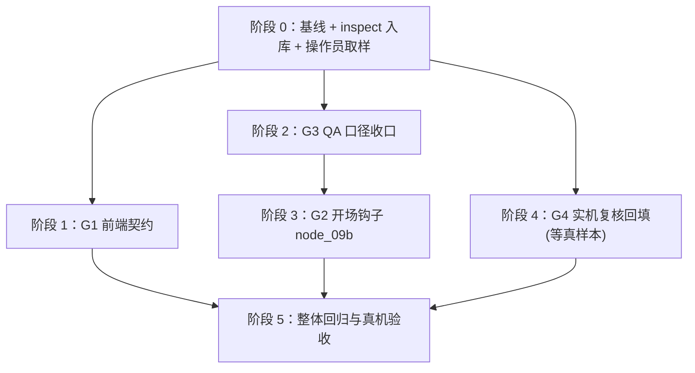

# 剪映草稿缺失内容补全：现状复验 · 设计方案 · 分阶段执行任务

| 项目 | 内容 |
|---|---|
| 分析对象 | `wayyet/auto-video-editor`，`main` 分支 |
| 复验基线 | commit `a41e45e`（2026-11-13，工作区 clean）。**本文所有 `文件:行号` 均指这个提交** |
| 上游文档 | 《剪映草稿缺失转场/动画/文案/配音：原因分析与设计执行计划》（同目录，已随 `a41e45e` 入库；下文简称**原计划**，其基线为 `ca885e4`，2026-11-08） |
| 文档日期 | 2026-11-13 |
| 性质 | 只读复验 + 设计与执行计划。没有修改你的仓库、剪映草稿或任何运行数据 |
| 定位（已确认） | ① **现状复验 + 聚焦剩余项**：已交付项只给结论与证据，不再展开设计；② 开场钩子按**方案 A**（开场特效 + 大字标题，不切分镜头） |

## 0. 阅读指南

### 0.1 一句话结论

原计划立项的 8 个根因（RC1–RC8）里，**6 个已在此后四批提交中真实修复**（文案、配音、转场、文字动画、贴纸、音量/淡入淡出、交付 QA 阻断门禁），**真正剩下的编码工作只有 3 项**：

- **G1** 前端 SSE 契约（RC8d，交付状态四态卡恒「待发生」）；
- **G2** 开场钩子（RC7，无节点实现）；
- **G3** QA 口径收口 + 独立检查脚本（原计划 WP1 残留）。

另有 1 项「实机复核回填」（G4，依赖操作员取样）和 4 项操作员前置（G5）。**编码合计约 4–6 人日**（原计划 17.5 人日，其余已随四批提交交付）。

### 0.2 证据标签

| 标签 | 含义 |
|---|---|
| 【代码】 | 阅读当前工作区源码得到，附 `文件:行号`（基线 `a41e45e`） |
| 【测试】 | 以仓库现有测试的断言为依据 |
| 【未验证】 | 必须在你的 Windows + 剪映 5.9.0.11632 上确认（汇总在 §6） |

原计划的【截图】【实测】标签针对 `ca885e4` 时代的三张截图与沙箱复现，本文不重复引用；本文只回答「**现在**还缺什么」。

### 0.3 行号使用警告（重要）

- **原计划的所有 `文件:行号` 基于 `ca885e4`，此后四批提交已使行号全部偏移，请勿照抄**。实例：原计划写 `FINAL_EXPORT_ENABLED` 在 `config.py:481-483`，当前实际在 `config.py:543-544`。
- 原计划 §5.3 逐节点表中的「渲染视频 `storyline_render_video`」一行已过时——该节点已被边治理阶段 5 **彻底删除**（2026-11-12），图校验测试锁定了它的不存在（`tests/unit/test_storyline_edge_governance_topology.py:146-162`）【测试】。
- 本文引用当前代码一律用 `a41e45e` 行号；引用原计划一律用章节号（如 §7.10、附录 B）。

### 0.4 术语

沿用原计划 §0.2 的术语表（草稿 / 素材桶 / 轨道与片段 / 引用 / 孤儿素材 / 原生格式 / sidecar / 契约 / SSE / 平铺 / fixture / 金标准）。本文补充 4 个：

| 术语 | 一句话解释 |
|---|---|
| 信封字段 / payload 还原 | SSE 帧把业务字段平铺在 `data` 顶层；「还原」指前端把平铺字段重新装回 `payload` 对象，让读 `event.payload.xxx` 的代码恢复工作（机制见原计划 §6.2） |
| schema bump | 监控图的拓扑契约有版本号 `SCHEMA_VERSION`（`monitoring/workflow_graph.py:72`，当前 5）；增删节点或边必须版本 +1 并同步 schema 定义，否则锁定测试变红 |
| 角色化 | node_13 按轨道名把音频片段分为 voiceover / bgm / main 三角色分别处理（2026-11-09 重写后，`nodes/node_13_adjust_volume.py:54-82`） |
| fail-closed | 资源不合法（如占位 ID）时**不写任何东西**并留下可观测的降级记录，而不是把坏数据写进草稿 |

## 1. 现状复验结论

### 1.1 四批修复提交索引（原计划发布之后发生了什么）

| 批次（日期） | 提交（均已推送 origin/main） | 交付内容 | 覆盖原计划 |
|---|---|---|---|
| 效果修复 阶段 0-2（11-09） | `f5dd584` / `4dd3864` / `5d52c87` | node_08 成为中文字幕**唯一原生写入口**；配音双落点；TTS 生产门禁 | WP2 + WP3 |
| 效果修复 阶段 3-5（11-09） | `956f4a5` / `f2f7894` / `5a80a9f` / `d8bfdc5` | `jy_common/native_fx.py` 原生构造器；转场/动画/fade 走 `extra_material_refs`；node_13 角色化重写；贴纸 fail-closed | WP4 + WP5 + WP6 |
| 效果修复 阶段 6-7（11-09） | `d0f1aac` / `77c0240` / `5700091` | 交付前 QA 引用级检查 + required_features 门禁 + repair 一次 + raise 终止；`draft_mutations` jsonl 审计 | WP1（主体） |
| 贴纸护栏（11-10） | `74f6fec` / `3cb7e05` | 占位贴纸 fail-fast 400 + 前端禁用 + 回填脚本 | WP5 补强 |
| noop 治理 阶段 0-6（11-12） | `94e3df0` → `6e6a13e` | 文案模板推荐真实现（BM25 + prompt 注入）；AI 转场真实现（MiniMax HTTP 链 + ffmpeg 首尾帧）；删 13 死键；零出边守卫 | RC8a（空操作治理） |
| 边治理 阶段 0-7（11-12） | `6f9c232` → `3a669e8` | 删除 `storyline_render_video`；qa_gate 直连 join；双源屏障；`SCHEMA_VERSION=5`；qa_route 观测事件 | 拓扑治理（原计划未涉及） |

### 1.2 复验总表（RC1–RC8 × WP0–WP8 的当前状态）

| 原 RC / WP | 当前状态 | 关键证据（`a41e45e`） |
|---|---|---|
| RC1 文案 → WP2 | ✅ 已交付 | node_08 文件头自述「中文字幕原生落草稿的唯一写入口」（`nodes/node_08_add_subtitles.py:1`）；数据来源 `storyline_script_artifact` 的 `group_scripts[].narration`（`:170-183`）；组内按标点切句、按字符比例分摊组区间（`:139-167`）；组定位双通道 = voiceover_id 桥优先、`subtitle_style.group_id` 兜底（`:302-318`）；写入点 `:889-895`；同步为**定向替换**（只动 `text-zh-` 前缀与 `track-text-1`，`:383-408`）；测试覆盖写路径与各跳过分支（`tests/unit/test_node_08_add_subtitles.py:541-843`）。**缺口：`test_zh_subtitles_preserves_foreign_texts_and_replaces_own`（`:775`）只有 fixture 搭建、无调用无断言（空壳测试）** |
| RC2 配音 → WP3 | ✅ 已交付（FireRed 链） | 契约新增结构化 `voiceovers[].path`（真实 WAV 本机路径，`storyline/contract.py:113-128`）；组装进契约（`storyline_capabilities/plan_timeline_pro.py:170-182`）；双落点：第一落 mapper 按计划时间铺（`storyline/mapper.py:118-132`、`:197-219`），第二落 node_08 在 snapshot2 后按当前组区间重铺 `Voiceover_zh` 轨（`node_08_add_subtitles.py:451-522`）；FireRed 真实后端（`jy_common/tts_client.py:97-110`、适配器 `nodes/storyline/_tts_adapter.py:32-100`）；生产 fail-closed 门禁：`APP_ENV=production` 且 `TTS_BACKEND!=firered` 直接 raise（`nodes/storyline/node_generate_voiceover.py:40-67`；`start_production.ps1:365,378` 默认注入）。**残留：MiniMax 真实客户端未实现（`tts_runner.py:13-15` 自述，默认仍回落 Stub）；FireRed :8010 服务本机从未部署 = 操作员前置（G5③）** |
| RC2 BGM → WP3 | 🟡 设计变更（可用） | 真实 BGM 走**人工关卡②**拖入 + 整轨镜像英文草稿（`nodes/node_12_human_add_bgm.py:45-78`、`:95-175`）；自动链只传 `bgm_ref` 元数据，`bgm_meta_ref.yaml` path 仍全空但注释明示有意（`storyline_capabilities/resource/bgm_meta_ref.yaml:3-9,18-58`）；`select_bgm` 的 `bgm_path` 当前无下游消费者。**（可选）要启用自动选 BGM 才需要注入音频文件（G5④）** |
| RC3 转场/特效 → WP4 | ✅ 已交付 | 转场挂**后一段** `extra_material_refs`（`nodes/node_09_inject_fx.py:220-249`，`_bind_ref` 在 `:175`）；duration 微秒并钳制到相邻两段较短者（`:234-241`）；语义来源优先契约 `transition_out/in`（`:67-93`）；原生构造器（`jy_common/native_fx.py:50-73`）；免费资源库语义路径可用（fade/dissolve→「叠化」为 `is_vip:false`）。**残留：`category_id` 空串占位、无 platform 键（`native_fx.py:67`、`:92-94`，待实机复核）；style_tag=default 兜底仍指 VIP「闪屏故障」（`nodes/node_09_inject_fx.py:114` → 模板库兜底；D5 待决策）** |
| RC4 文字动画 → WP5 | ✅ 已交付 | 原生 `material_animations` 条目 + 字幕片段 `extra_material_refs` 绑定（`nodes/node_10_inject_text_fx.py:107-133`、构造器 `jy_common/native_fx.py:109-153`）；确定性 id + 重放幂等 + 孤儿动画清理（`:56-81`）；私有 `style.entrance_animation` 已废除（有测试断言） |
| RC5 贴纸 → WP5 | ✅ 已交付（fail-closed） | 19 位 resource_id 校验不过（含全部 `PLACEHOLDER_*`）→ 零素材零引用 + `degraded_placeholder` 计数 + 回填指引（`nodes/node_11_inject_sticker.py:173-181`）；回填脚本 `scripts/backfill_sticker_library.py`（dry-run / `--apply`）；护栏 fail-fast 400（`web/api_console.py:307-315`）+ 前端禁用复选框（`web/console.html:693-707`）。**残留：`templates/sticker_template.json` 仍全占位 → 现状草稿零贴纸，回填是操作员前置（G5②）**；引用挂视频片段（非 sticker 轨）为设计内（`native_fx.py:16-18` docstring） |
| RC6 音量/淡入淡出 → WP6 | ✅ 已交付 | node_13 角色化重写：voiceover 按轨名（`Voiceover_zh`/`en_voiceover`）、bgm=其余 audio 轨、main=video 轨（`nodes/node_13_adjust_volume.py:54-82`）；音量写**片段** `volume` + `last_nonzero_volume`（`:85-89`）；淡入淡出走 `materials.audio_fades` + 片段 refs、经 `build_native_audio_fade_material`（`:92-119`、`jy_common/native_fx.py:183-201`）；缺省值 `config.py:168-172`（bgm 0.35 + 2s/3s）；跳过场景均留痕非静默。**残留：fade 曲线类型 `linear` 待实机复核（G4）；node_13 会覆盖人工调过的 BGM 音量（头部注释明示的已知取舍）** |
| RC7 开场钩子 → WP7 | ❌ 未实现 | 全仓库（排除 tests/docs/vendor/web/.worktrees）搜索 `开头3秒`/`最炸`/`大字标题`/`hook_title`/`opening_title`/`opening_hook` 零命中；首个镜头开头无开场转场、无大字标题节点。原设计在原计划 §7.10 完整保留，本文 §3.2 按当前 HEAD 对位后落地 |
| RC8a 空操作 → WP1/WP3 | ✅ 大部交付 | noop 治理：模板推荐真实现、AI 转场真实现、13 死键删除、零出边守卫（§1.1 第 5 行）；node_09/10/11/13 均有 degraded/skip 状态留痕 |
| RC8b QA 口径 → WP1 | ✅ 大部交付 | 交付前 QA = 9 类 required + 4 类恒检查：尾链四项对中英两份草稿、**贴纸「素材在、无段引用=挂载失败」**、我方字幕入场动画绑定、BGM 音轨引用 + 淡入淡出绑定（`nodes/node_join_before_delivery.py:75-191`，贴纸 unbound 在 `:103-119`）；类别判据 `draft_ops/draft_integrity.py:840-954`；required_features 复选框 + 智能默认（`draft_integrity.py:670-693`、`web/api_console.py:228-236`）。**残留：转场/视频特效仍只数条数 >0（`:91-97`），孤儿转场/特效不被发现（G3）** |
| RC8c QA 不阻断 → WP1 | ✅ 已交付 | `route_after_join_qa` 条件边：通过 → export；失败 → `delivery_qa_repair`（重跑幂等节点 1 次，MAX_REPAIRS=1）→ 回 join 复检；复检仍失败 → `delivery_qa_failed` raise → run.failed（`graph.py:677-688`、`nodes/node_delivery_qa_repair.py:38,130-162`）；写前写后 SHA-256 的 `draft_mutations` jsonl 审计（`nodes/_draft_io.py:126-137`） |
| RC8d 前端契约 → WP8 | ❌ 未实现 | 无 `eventFromSse`；后端平铺协议是测试锁定的契约（`monitoring/workflow_events.py:365-385`；`tests/unit/monitoring/test_workflow_events.py:241-243` 断言 `"payload" not in data`）；前端 `handleEvent` 摊平（`web/console.html:1001-1008`、`web/monitor.html:284-291`）而交付卡读 `event.payload.summary`（`web/console.html:1022-1026`）→ 四态卡恒「待发生」；交付卡内联 JS 无任何单测。原计划 §6.6 方案 A 的修复代码已在其沙箱验证（§6.7），本文 §3.1 按当前 HEAD 对位后落地 |
| WP0 真样本 | ❌ 未做 | 真实样本未入库；`jy_common/native_fx.py:3-18` 的「待实机复核清单」自述目标形状按可信度分层；`scripts/inspect_draft_content.py` 不存在（完整代码在原计划附录 B，`:2124-2520`） |

### 1.3 当前图拓扑快照（与本文设计相关的部分）

- 注册节点 **46** 个（不含 START/END；`graph.py:506-579`）。
- 交付尾链：`node_15_localize_covers_en` 与 `node_17_inject_english_tts` fan-in → `node_09_inject_fx` → `node_11_inject_sticker` → `node_12_human_add_bgm` ⏸② → `node_13_adjust_volume` → `join_before_delivery`（`graph.py:661-670`；`node_12→13` 在 `:668`，`13→join` 在 `:670`）。
- QA 路由：`route_after_join_qa`（`graph.py:257-274`）→ `export_final_video` / `delivery_qa_repair`（回边 `:686`）/ `delivery_qa_failed`（`:687` → END + raise）。
- qa_gate 出边 = 条件边 `{storyline_group_clips(重试), storyline_join(通过/失败)}`（`graph.py:826-838` 区段），join 无普通入边。
- `SCHEMA_VERSION = 5`（`monitoring/workflow_graph.py:72`）；节点登记表 `_NODE_META` 在同文件 `:92`（`node_09_inject_fx` 条目 `:208`）；schema 与真实 builder 拓扑逐边一致由 `tests/integration/test_workflow_graph_schema.py:126-134` 锁定，版本号断言在 `:187-190`。
- 测试基线：unit **1855 通过 / 3 skip**；集成 **3 例存量失败为基线**（对照勿误判，见 §7 R6）。

### 1.4 复验方法与局限

对当前工作区源码 + 现有测试断言做三路静态核对（字幕/动画链、音频链、转场/贴纸/QA/前端/拓扑）；未做真机运行。「剪映是否显示」仍以 §6 真机验收为准【未验证】。

## 2. 剩余差距清单

| # | 差距 | 影响 | 归属 |
|---|---|---|---|
| G1 | 前端读不到 payload：交付状态四态卡恒「待发生」，节点耗时/失败原因/等待详情丢失 | 缺失在界面上看不见（RC8d） | §3.1 |
| G2 | 「开头 3 秒最炸转场 + 大字标题」无节点实现（RC7） | 用户需求不落地 | §3.2 |
| G3 | ① 独立检查脚本未入库；② QA 孤儿检测只覆盖贴纸，转场/特效只数条数；③ 一个空壳测试 | 验收工具缺位；孤儿转场/特效不被发现；人工/我方文本区分行为未被锁定 | §3.3 |
| G4 | native_fx 多处「待实机复核」占位（transition 分类键、特效 apply_target_type、动画 start 偏移口径、fade 曲线类型、sticker 全字段） | 写法与真机可能有偏差 | §3.4 |
| G5 | 操作员前置：WP0 真样本、贴纸 ID 回填、FireRed TTS 部署、（可选）BGM 音频注入 | 决定配音/贴纸/自动 BGM 能否真验收 | §3.5 |

## 3. 设计方案

> 每项按「目标 → 改动清单 → 关键设计 → 验收 → 风险」写。原计划已写明且不受行号偏移影响的设计（如 WP7 的完整流程）不重复展开，只列当前 HEAD 的对位差异。

### 3.1 G1 前端 SSE 契约修复（原计划 WP8，约 0.5–1 人日）

**目标**：后端事件协议不动，前端把平铺的 SSE 帧还原成 `{…信封字段, payload}`；交付状态四态卡、节点耗时、失败原因、等待详情全部恢复显示。

**机制回顾**（当前 HEAD 行号）：后端 `to_sse_frame` 把 `payload` 平铺进 `data`（`monitoring/workflow_events.py:365-385`），平铺本身是测试锁定的协议；前端 `handleEvent` 摊平（`web/console.html:1001-1008`、`web/monitor.html:284-291`），但交付卡读 `event.payload.summary`（`web/console.html:1022-1026`）、归约函数 `applyEvent` 读 `event.payload`（`web/static/workflow_monitor.mjs:135`）——`payload` 恒不存在，所以永远读空。完整机制分析见原计划 §6.2。

**方案**：沿用原计划 §6.6 **方案 A**（代码已在原计划 §6.7 验证），行号按当前 HEAD 对位。

| 文件 | 改什么 |
|---|---|
| `web/static/workflow_monitor.mjs` | 文件末尾追加 `eventFromSse`（代码见下） |
| `web/static/workflow_console.mjs` | `:19` 的 import 列表与 `:24` 的 export 列表各追加 `eventFromSse` |
| `web/console.html` | ① `:266` 前的 import 列表追加；② `:1001-1008` 的 handleEvent 内事件构造 5 行替换为 `eventFromSse(...)` 调用；③ `:837` 起的 `detailOf` 整函数替换为「顶层 ∪ payload」合并读取版（代码见下） |
| `web/monitor.html` | ① `:171` 前的 import 列表追加；② `:284-291` 同样替换 |
| `tests/test_workflow_monitor_frontend.py`、`tests/test_workflow_console_frontend.py` | 各追加一个 pytest 包装用例，把新增的 `web/tests/sse_frame_contract.test.mjs` 纳入 `node --test`（包装写法参照 `tests/test_workflow_console_frontend.py:22-42`：node 缺失时跳过、断言 `pass 0` 不出现） |
| 新增 `tests/unit/monitoring/test_sse_frame_contract.py` | 后端侧契约测试：用真实 `make_event + to_sse_frame` 生成帧，与 fixture 比对（不比原始文本，比解析后内容；完整代码与「重新生成样本」说明见原计划 §6.6 ⑤） |
| 新增 `web/tests/sse_frame_contract.test.mjs` | Node 侧契约测试：同一份 fixture 喂给 `eventFromSse` + `applyEvent`，断言四态卡/耗时/等待详情能读到值 |
| 新增 `web/tests/fixtures/sse_frames.txt` | 由后端契约测试生成（生成命令见该测试文件头） |

`eventFromSse` 代码（与原计划 §6.6 ① 相同；信封字段 = `thread_id/run_id/node_id/attempt/occurred_at`，后端 payload 白名单不含这五个名字，拆分不会串键）：

```javascript
// ---------------------------------------------------------------------------
// SSE 帧 → applyEvent 期望的事件形状
// ---------------------------------------------------------------------------
// 后端 to_sse_frame(monitoring/workflow_events.py)把 payload 的字段平铺进 data:
//   data = {thread_id, run_id, node_id, attempt, occurred_at, ...payload}
// 而 applyEvent 与创作控制台的交付状态卡读取的是 event.payload.xxx。
// 这里把平铺的 data 还原:信封字段留在顶层,其余字段(summary / detail / error /
// duration_ms / waiting_kind / trigger / label / inferred / reason,即后端的
// ALLOWED_PAYLOAD_KEYS)收回 payload。payload 白名单里没有信封字段名,拆分不会串键。
const SSE_ENVELOPE_KEYS = new Set(["thread_id", "run_id", "node_id", "attempt", "occurred_at"]);

/**
 * @param {string|number|null|undefined} lastEventId  EventSource 的 lastEventId(事件表 id)
 * @param {string} eventType                          EventSource 的 type,如 "node.progress"
 * @param {object} data                               JSON.parse(esEvent.data) 的结果
 */
export function eventFromSse(lastEventId, eventType, data) {
  const envelope = {};
  const payload = {};
  for (const [key, value] of Object.entries(data && typeof data === "object" ? data : {})) {
    if (SSE_ENVELOPE_KEYS.has(key)) envelope[key] = value;
    else payload[key] = value;
  }
  return {
    id: lastEventId ? Number(lastEventId) : null,
    event_type: eventType,
    ...envelope,
    payload,
  };
}
```

`detailOf` 替换版（原计划 §6.6 ③；keys 并集保持不变 = 监控页事件流 ∪ 创建台字段，`node_id` 取顶层）：

```javascript
    function detailOf(ev) {
      // 详情列字段 = 监控页事件流(run_id/status/branch/message)∪ 创建台原有(summary/label/reason)的并集
      // 事件已由 eventFromSse 还原成 {…信封字段, payload:{…}}:业务字段在 payload 里,run_id 等在顶层
      const src = { ...ev, ...(ev.payload && typeof ev.payload === "object" ? ev.payload : {}) };
      const keys = ["run_id", "status", "error", "detail", "branch", "message", "summary", "label", "reason"];
      const parts = [];
      if (ev.node_id) parts.push(ev.node_id);
      for (const k of keys) {
        if (src[k] !== undefined && src[k] !== null && src[k] !== "") {
          parts.push(`${k}=${typeof src[k] === "object" ? JSON.stringify(src[k]) : src[k]}`);
        }
      }
      return parts.join("  ");
    }
```

**本次新增补强（原计划没有）**：交付卡的触发判断与 `handleDeliverySummary` 是 `console.html` 内联 JS，**没有任何单测**——这正是 SSE 失配存活至今的原因之一（原计划 §6.5）。执行时把「事件 → 交付卡状态」的纯函数部分抽到 `web/static/` 下可 import 的模块（最低限度：抽取 `progressSummary` 判定 + `handleDeliverySummary` 的状态归并为纯函数），并在 `web/tests/` 覆盖；与 `sse_frame_contract.test.mjs` 一起由 pytest 包装纳入 `pytest tests` 一条命令。

**验收**：

1. `node --test web/tests/sse_frame_contract.test.mjs`（其余前端测试随 pytest 包装一起跑）+ `.\.venv\Scripts\python.exe -m pytest tests\unit\monitoring\test_sse_frame_contract.py tests\test_workflow_monitor_frontend.py tests\test_workflow_console_frontend.py -o addopts="" -q` 全绿；
2. 真机：打开创作控制台跑一次任务，「交付状态」四项随事件依次变为「已发生 / 发现问题（列清单）/ 跳过」，事件表详情列不再为空。**console.html 改完强刷浏览器即生效，无需重启服务。**

**风险**：无后端改动，回滚 = 还原前端文件；`web/tests/` 命名风格与既有 `workflow_monitor.test.mjs`、`workflow_console.test.mjs` 保持一致。

### 3.2 G2 开场钩子 node_09b（原计划 WP7，方案 A，约 2–3 人日）

**承接**：做什么/不做什么、7 步流程、幂等前缀、真机验收，全部沿用原计划 §7.10 的设计。方案 A 的边界不变：**开头 0–3 秒加免费开场特效 + 大字标题（带入场动画），不切分镜头；第 1 个转场仍在镜头 1→2 切点**。本节只列**当前 HEAD 的对位差异**，执行时以本表为准：

| # | 原计划 §7.10 的设计 | 当前 HEAD（`a41e45e`）的对位 |
|---|---|---|
| 1 | 开场特效用「effect 轨 + `build_effect_track`/`build_effect_segment`」（原 WP4 计划产物） | 实际落地的特效写法**没有 effect 轨**：video_effect 素材经 `extra_material_refs` 绑到视频片段（`node_09_inject_fx.py:254-267`、构造器 `native_fx.py:76-106`）。开场特效同模式：`build_native_video_effect` 造 `hook-effect-1` → 绑视频轨 `segments[0]`，**不建轨**；验收指标相应改为 `video_effects_referenced`（原计划的 `effect_segments` 指标不适用） |
| 2 | 入场动画构造器名 `build_native_text_animation` | 实名 `build_native_text_animation_material`（`jy_common/native_fx.py:109-153`） |
| 3 | 标题片段用 `make_text_material`/`make_text_segment` + 自拼 `track-text-hook` 轨 | 函数仍在（`nodes/_subtitle_texts.py:28`、`:76`）；node_08 的 `sync_text_track` 已改为**定向替换**（只动 `text-zh-` 前缀与 `track-text-1`，`node_08_add_subtitles.py:383-408`），不会误删标题轨；但 09b 仍须排在 node_08 之后（图顺序天然满足） |
| 4 | 接线：把 node_09→node_11 换成 node_09→09b→node_11 | 该边在 `graph.py:661-670` 区段；同时更新 `graph.py:35-43` 的文件头拓扑说明 |
| 5 | 监控登记 `_NODE_META` 加一条「开场钩子」 | 登记表在 `monitoring/workflow_graph.py:92`（`node_09_inject_fx` 条目 `:208`）；**并且必须 `SCHEMA_VERSION` 5→6（`:72`）+ 同步 schema 拓扑定义**——新增节点改变逐边比对，`tests/integration/test_workflow_graph_schema.py:126-134`（builder 真值）与 `:187-190`（版本断言）会红。**这是原计划没有的步骤（schema 锁定是 2026-11-12 边治理才建立的）** |
| 6 | state 新键 `hook_title` 声明 | 不变：`state.py` 声明；节点内一律 `state.get("hook_title")`（`tests/integration/test_state_field_compatability.py` 会扫描下标访问） |
| 7 | `config.OPENING_HOOK_ENABLED` 默认开 | 写法参照 `config.py:543-544` 的 `_console_env_bool(...)`（`FINAL_EXPORT_ENABLED` 同款）；关闭时节点只写 `node_09b_inject_opening_hook_noop:disabled` |
| 8 | node_11 跳过 `hook-title-` 前缀文字（标题不被贴贴纸） | **现状没有此前缀过滤**（`nodes/node_11_inject_sticker.py:162-166` 遍历全部 `materials.texts`），本次在文字循环里补：`id` 以 `hook-title-` 开头的条目 `continue` |
| 9 | 幂等清理自己的旧产物 | 前缀沿用原设计：轨道 `track-text-hook`、素材 `hook-effect-` / `hook-title-` / `anim-hook-title-`；09b 在 node_09 **之后**运行，与 node_09 的幂等清理（`node_09_inject_fx.py:139-159` 区段 `_strip_stale_owned_refs` / `_remove_owned_materials`）互不干扰 |
| 10 | node_10 不动标题 | 已天然满足：node_10 只处理 `text-zh-`/`text-en-` 前缀的我方字幕（`node_10_inject_text_fx.py:107-133`），标题动画由 09b 自己写 |
| 11 | 写入入口 | 沿用 `apply_and_write`（`nodes/_draft_io.py`，自动落 `draft_mutations` jsonl 审计） |

**改动清单**：

| 类型 | 文件 |
|---|---|
| 新增 | `nodes/node_09b_inject_opening_hook.py`、`jy_common/hook_title.py`、`tests/unit/test_node_09b_inject_opening_hook.py`、`tests/unit/test_hook_title.py` |
| 修改 | `state.py`（`hook_title`）、`config.py`（`OPENING_HOOK_ENABLED`）、`graph.py`（注册 `:514` 后 + 接线 + 头注释）、`monitoring/workflow_graph.py`（`_NODE_META` + SCHEMA_VERSION 6 + schema 拓扑）、`nodes/node_11_inject_sticker.py`（前缀跳过）、`tests/integration/test_workflow_graph_schema.py`、`tests/unit/test_api_workflow_readonly.py`、`tests/unit/test_storyline_edge_governance_topology.py`（随登记表/拓扑更新） |

**节点流程**（浓缩原计划 §7.10 的 7 步，中文草稿全做、英文草稿只做特效）：

1. 清自己的旧产物（幂等，前缀见对位表 #9）。
2. 开场特效：`build_native_video_effect` 造 `hook-effect-1`（免费档：默认 `CCD闪光`、备选 `闪白`，原计划 §7.10 的资源表），`_bind_ref` 同款绑 `segments[0]`，时间范围 `[0, min(3 秒, 视频总长)]`。
3. `pick_hook_title(state, 第 1 条字幕文本)`：取第一个可用的——① `state["hook_title"]`；② 第 1 条字幕文本切到第一个标点之前（**半角 `,` 与全角 `，` 都要认**），最多 12 字；③ 都没有 → 记 `…_noop:no_title`，特效仍保留。
4. 标题素材：`make_text_material(id_prefix="hook-title", style={"size": 12.0, "bold": True, "transform_y": 0.35}, …)`（字号 12.0 = 标题级，字幕默认 5.0；`transform_y` 0.35 = 上半屏，字幕默认 −0.8 下沉）。
5. 标题轨：`make_text_segment(id_prefix="hook-title-seg")` + 自拼轨道 `id="track-text-hook"`、`name="opening_title"`、`type="text"`，追加在 `tracks` 末尾（**不要用** `sync_text_track`/`build_text_track`，会与字幕轨机制冲突）。
6. 入场动画：`build_native_text_animation_material` 造 `anim-hook-title-1`（默认「冲屏位移」，备选「放大」「渐显」），id 追加到标题片段 `extra_material_refs`。
7. `apply_and_write` 原子写回；中英两份草稿经 `dual_draft_targets(state)`（`nodes/_dual_draft.py:61`）顺序处理，各留完成标记 `node_09b_inject_opening_hook_done` / `…_en_done`。

**验收**（对位原计划 §7.10 验收 1-6，指标名对齐 G3 的 inspect 脚本）：

1. 中文草稿：`text_segments = 字幕数 + 1`、`text_animations_referenced` 同数、`video_effects_referenced ≥ 1`、`orphan_materials = 0`、`misplaced_references = 0`；
2. 连续跑两遍，轨道数与素材桶条数不变（幂等）；
3. 英文草稿：特效 ≥ 1 且**没有**标题轨；
4. 切句用例：第 1 条字幕 `马六甲海上清真寺,日落时分海面金光闪烁。` → 标题 `马六甲海上清真寺`（半角逗号）；
5. 图校验：

```powershell
.\.venv\Scripts\python.exe -m pytest tests\integration\test_workflow_graph_schema.py tests\unit\test_api_workflow_readonly.py tests\integration\test_reorder_topology.py tests\unit\test_storyline_edge_governance_topology.py -o addopts="" -q
```

6. 真机：播放前 3 秒可见开场特效 + 大字标题入场动画，3 秒后标题消失，字幕正常（G4 回填后复核）。

**风险**：默认开启改变此后每次成品（env 可关）；标题质量取决于文案（长期：让 `generate_script` 产标题，原计划 §7.12）；监控页节点数 +1 属预期；停在关卡的老任务恢复后新节点是否执行未验证【未验证】→ 一律用新建任务验收。

### 3.3 G3 QA 口径收口 + 检查脚本（原计划 WP1 残留，约 0.5–1 人日）

| # | 项 | 设计 |
|---|---|---|
| 1 | `scripts/inspect_draft_content.py` 入库 | 原计划附录 B 完整代码原样入库（被引用口径统计 + 孤儿/错位引用/悬空引用/占位值/形状告警 + `--min/--max` 阈值退出码 2 的判定）；单一实现放 `draft_ops/draft_content_audit.py`（脚本只留命令行外壳，QA 与脚本共用同一口径，原计划 WP1 的同一思想）；`REQUIRED_KEYS` 形状假设在 G4 真样本到位后修正 |
| 2 | QA 孤儿检测扩展 | 现状：贴纸已有「素材在、无段引用 = 挂载失败」（`node_join_before_delivery.py:103-119`），但转场/视频特效只数条数 >0（`:91-97`），**孤儿转场/特效照样过闸**。设计：同口径扩展——对 `transitions`/`video_effects` 各加一条「条目存在但被引用数 = 0 → issue（类别 required、判 failed）」，统计函数复用 `draft_content_audit.inspect()`（收集全部片段的 `material_id` + `extra_material_refs`）；改动点 `node_join_before_delivery.py`（`_tail_chain_structured`）+ `draft_ops/draft_integrity.py`（类别判据，`:840-954` 区段） |
| 3 | 空壳测试补全 | `tests/unit/test_node_08_add_subtitles.py:775` `test_zh_subtitles_preserves_foreign_texts_and_replaces_own` 现在只有 fixture 搭建、无调用无断言（平凡通过）。补：预置草稿含 1 条人工文本 + 1 条我方旧 `text-zh-1` → 调用 `add_subtitles` → 断言人工文本条目原样保留、我方旧条目被新产物替换、`track-text-1` 重建、字幕句数正确 |
| 4 | （可选，决策 D5）node_09 兜底免费档 | style_tag=default 兜底仍指向 VIP「闪屏故障」（回落点 `node_09_inject_fx.py:114` 的 `pick_transition(_DEFAULT_STYLE_TAG)`；该条目 `templates/fx_resource_library.json:3685-3691` `is_vip:true`）；而非会员账号下 VIP 资源表现未验证（§6 第 9 项）。建议：兜底选取改为优先 `is_vip:false` 条目（「叠化」即免费，`:193-199`），改 `jy_common/template_library.py` 的兜底函数；**待操作员确认账号权限后定（§4 D5）** |

**验收**：① inspect 对任一现有任务草稿跑通并产出与 §1.3 口径一致的指标；② 构造「转场条目存在、引用被摘」的草稿跑 `join_before_delivery` → 产出 issue 且 `gate_failed=True`；③ 空壳测试补全后真实断言通过；④ 全量 unit 不破 1855/3skip 基线。

### 3.4 G4 实机复核回填（约 0.5 人日，依赖 G5① 样本）

权威清单就是 `jy_common/native_fx.py:3-18` 文件头的「待实机复核清单」【代码】：

| 待复核项 | 当前占位（`a41e45e`） | 真样本要回答 | 回填落点 |
|---|---|---|---|
| transition 分类键 | `category_id: ""`（`native_fx.py:67`）、`category_name/is_overlap` 未按真样本核对 | 转场条目真实键集与取值（原计划 Q1） | `build_native_transition_material` |
| video_effect 键 | `apply_target_type: 0`、`category_id/category_name: ""`（`:92-94`） | 特效条目真实键集（原计划 Q6） | `build_native_video_effect_material` |
| 文字动画键 | `animations[].start` 的偏移口径、`category_id`（`:137`、`:143`） | 动画条目真实形状（原计划 Q2） | `build_native_text_animation_material` |
| fade 曲线类型 | `fade_in_type/fade_out_type: "linear"`（`:183-201`，注释明示待复核） | 曲线类型枚举真值（原计划 Q4） | `build_native_audio_fade_material` |
| sticker material 字段 | 「全部字段待实机复核」（`:156-180` docstring） | 贴纸素材/片段形状 + 免费 `resource_id`（原计划 Q3） | `build_native_sticker_material` |

方法：WP0 真样本 diff（原计划 §7.3 的 Q1–Q10 表逐项回答），逐项更新构造器 + `tests/unit/test_native_fx.py` 形状断言；inspect 的 `REQUIRED_KEYS` 同步修正。

### 3.5 G5 操作员前置项（非编码）

| # | 事项 | 做法 | 解锁什么 |
|---|---|---|---|
| ① | WP0 真样本 | 按原计划 §7.3 步骤：剪映新建草稿 → 加转场（免费+VIP 各一份）/文字+入场动画/视频特效/贴纸/本地音频（音量 −9 dB、淡入 2 s、淡出 3 s）→ 关闭剪映落盘 → 拷贝 `draft_content.json` 入 `tests\fixtures\jianying_5_9_0\`（素材 `path` 脱敏）→ 回答 Q1–Q10 写「真样本差异表」 | G4 全部回填 + inspect 形状基准 + 原计划 Q8/Q9（剪映是否丢孤儿、是否改写我方 id） |
| ② | 贴纸 ID 回填 | 剪映建含贴纸的样本草稿 → `.\.venv\Scripts\python.exe scripts\backfill_sticker_library.py <样本草稿目录>`（先 dry-run 看清单）→ 确认后 `--apply` 回填 `templates/sticker_template.json` | node_11 从 fail-closed 降级变为真实写入；创建台「贴纸」复选框解除禁用 |
| ③ | FireRed TTS 部署 | 本机 `:8010` 从未部署过（历史验收记录）；部署后 `TTS_BACKEND=firered`（管理员 pwsh7 启动脚本已默认注入，`start_production.ps1:378`） | 配音真实产出（第二落点 `Voiceover_zh` 轨）；`default_required_features()` 的配音门禁默认值翻转 |
| ④ | （可选）BGM 音频注入 | 向 `storyline_capabilities/resource/bgms/` 放音频文件并填 `bgm_meta_ref.yaml` 各条目 `path` | `select_bgm` 退出 stub、自动选 BGM；不注入则维持「人工关卡②」现状（可用） |

## 4. 决策记录

| 编号 | 决策 | 状态 |
|---|---|---|
| D1 | 原生写法 = 自写构造函数（原方案 A，不引运行时依赖） | ✅ 已随 `jy_common/native_fx.py` 落定 |
| D2 | 文案来源 = `group_scripts` 旁白按组切句（原方案 A，不回退 ASR） | ✅ 已落定（node_08，§1.2 第一行） |
| D3 | QA 缺失处置 | ✅ 已落定为 required_features 门禁 + repair 1 次 + raise（**强于**原「先告警后阻断」的两步走；必需项复选框 + 智能默认可按运行时能力放宽） |
| D4 | 开场钩子 = 方案 A（开场特效 + 大字标题，不切镜头；第 1 个转场仍在镜头 1→2 切点） | ✅ 2026-11-13 确认（本文 §3.2）；方案 B（第 3 秒切开镜头）维持原计划 §7.12 的「A 验证后再做」 |
| D5 | node_09 兜底档 VIP → 免费条目 | ⬜ 待定（推荐改；前提 = §6 第 9 项确认非会员账号下免费/会员资源实际表现） |

## 5. 分阶段执行开发任务

### 5.1 阶段总览

| 阶段 | 内容 | 前置 | 估时（人日） | 阶段验收（一句话） |
|---|---|---|---|---|
| 0 基线与取证 | T0.1–T0.4（T0.4 = 操作员 G5①，可与阶段 1–3 并行） | 无 | 0.5 | inspect 入库跑通；基线测试存档；真样本 + 差异表 |
| 1 看得见 | G1 前端契约（原计划 WP8） | 阶段 0 | 0.5–1 | 契约测试双端绿；真机四态卡恢复 |
| 2 QA 口径收口 | G3 ①②③（④可选） | 阶段 0 | 0.5–1 | 孤儿转场会被 QA 拦下；空壳测试转正 |
| 3 开场钩子 | G2（原计划 WP7，方案 A） | 阶段 2（验收依赖 inspect） | 2–3 | 前 3 秒特效 + 大字标题；图校验四测试绿 |
| 4 实机复核回填 | G4 | 阶段 0 的真样本 | 0.5 | `native_fx.py` 待实机复核清单清零 |
| 5 整体回归与真机验收 | §6 清单 | 全部 | 含在各包内 | §6 全过 |
| **合计（编码）** | | | **约 4–6** | 不含操作员前置与 TTS 部署 |

依赖说明：G1（前端）与 G2/G3（后端）互不依赖，可并行；G4 的唯一串行点是等操作员真样本；阶段 3 排在阶段 2 之后是因为它的验收命令要用 inspect 脚本（阶段 0 已入库，也可提前并行，但孤儿检测扩展会让 09b 的验收更严格）。



### 5.2 公共命令（每个终端窗口开头先执行）

沿用原计划 §8.2（PowerShell、仓库根目录、UTF-8 输出、草稿目录变量）：

```powershell
Set-Location "<你的仓库根目录>"
[Console]::OutputEncoding = [System.Text.Encoding]::UTF8
$env:PYTHONUTF8 = "1"
$root = "$env:LOCALAPPDATA\JianyingPro\User Data\Projects\com.lveditor.draft"
$thread = "<THREAD_ID>"
$zh = Join-Path $root "AutoVideo_$thread"
```

检查脚本（阶段 0 入库后生效；`--min/--max` 可重复，任一不满足退出码 2）：

```powershell
.\.venv\Scripts\python.exe scripts\inspect_draft_content.py $zh --label "中文草稿" --sidecar
"退出码 = $LASTEXITCODE"
```

英文分支草稿取最新的：

```powershell
$en = Get-ChildItem $root -Directory -Filter "en_branch_*" | Sort-Object LastWriteTime -Descending | Select-Object -First 1
$enDir = $en.FullName
```

### 5.3 阶段 0：基线与取证（0.5 人日）

| 任务 | 做什么 | 完成标准 |
|---|---|---|
| T0.1 | 新建工作分支；确认基线提交 | `git switch -c feature/draft-content-completion`；`git log -1 --format="%h %ci"` 输出的提交号 ≥ 本文基线 `a41e45e`；若不是，本文行号可能偏移 |
| T0.2 | `scripts/inspect_draft_content.py` 入库（原计划附录 B 代码，外壳 + `draft_ops/draft_content_audit.py` 单一实现） | 对任一现有任务草稿跑通上面 §5.2 的命令，输出被引用口径指标 |
| T0.3 | 基线测试存档 | `.\.venv\Scripts\python.exe -m pytest tests --junitxml="$env:TEMP\baseline.xml"`；预期 unit 1855/3skip + 集成 3 例存量失败，失败条数记档（勿当回归） |
| T0.4 | 操作员做 G5①（可与阶段 1–3 并行） | 真样本入库 `tests\fixtures\jianying_5_9_0\draft_content.json` + Q1–Q10 差异表写完 |

### 5.4 阶段 1：看得见（G1 / WP8，0.5–1 人日）

| 任务 | 做什么 | 完成标准 |
|---|---|---|
| T1.1 | `eventFromSse` + `workflow_console.mjs` 导入导出 + 两页接线 + `detailOf`（§3.1 清单，行号已给） | 改动 4 个前端文件 |
| T1.2 | 交付卡读取逻辑抽可测 + 补测试（§3.1 补强） | 纯函数可 import，`web/tests/` 有覆盖 |
| T1.3 | 契约测试 3 文件（后端生成 fixture → Node 消费）+ pytest 包装 | 后端 pytest + 前端 node --test 双绿 |
| T1.4 | 真机验证 | 新任务跑到交付，四态卡随事件变化、事件表详情列有值 |

### 5.5 阶段 2：QA 口径收口（G3，0.5–1 人日）

| 任务 | 做什么 | 完成标准 |
|---|---|---|
| T2.1 | 孤儿检测扩展到转场/特效（§3.3-2） | 摘引用草稿 → issue + `gate_failed=True`；既有 17+ 个 join QA 用例不破 |
| T2.2 | 空壳测试补全（§3.3-3） | `test_zh_subtitles_preserves_foreign_texts_and_replaces_own` 真实调用 + 断言 |
| T2.3 | （可选）D5 免费档兜底（§3.3-4） | 兜底转场条目 `is_vip:false`；VIP 用例改按显式资源指定 |

### 5.6 阶段 3：开场钩子（G2 / WP7，2–3 人日）

| 任务 | 做什么 | 完成标准 |
|---|---|---|
| T3.1 | `jy_common/hook_title.py` + `state.hook_title` 声明 + `config.OPENING_HOOK_ENABLED` | `test_hook_title.py` 绿（切句用例含半角逗号、≤12 字、无标题回落） |
| T3.2 | `node_09b` 节点（§3.2 流程 7 步）+ node_11 `hook-title-` 前缀跳过 | `test_node_09b_*.py` 绿：特效绑 `segments[0]`、标题轨/素材/动画齐全、幂等重放字节一致、`no_title` 分支、英文草稿只做特效 |
| T3.3 | 图接线 + `_NODE_META` + **SCHEMA_VERSION 5→6** + schema 拓扑同步（§3.2 对位表 #4/#5） | §3.2 验收第 5 条的图校验命令四测试全绿 |
| T3.4 | 真机目测 | 前 3 秒特效 + 标题入场动画，3 秒后标题消失，字幕正常 |

### 5.7 阶段 4：实机复核回填（G4，0.5 人日，等真样本）

| 任务 | 做什么 | 完成标准 |
|---|---|---|
| T4.1 | 按真样本 diff 修 §3.4 表 5 处占位 | `test_native_fx.py` 形状断言更新并绿；`native_fx.py:3-18` 待复核清单清零 |
| T4.2 | inspect `REQUIRED_KEYS` 以真样本修正 | 对真样本 `shape_warnings=0` |

### 5.8 阶段 5：整体回归与真机验收

清单见 §6。命令：

```powershell
.\.venv\Scripts\python.exe -m pytest tests -o addopts="" -q
node --test web/tests/
```

### 5.9 分支、提交与回滚

沿用原计划 §8.10 原则：每阶段 1–3 个提交、中文提交风格、阶段验收不过不合入。两点补充：

- G1 纯前端，可单独回滚（还原 4 个前端文件 + 删 3 个新增测试文件）；
- SCHEMA_VERSION 只增不减：阶段 3 若需回滚，连同 schema 拓扑与版本号一起还原代码，而不是把版本号改回 5。

## 6. 真机验收清单（合并原计划附录 D 未验证项）

| # | 验收项 | 操作 | 预期 |
|---|---|---|---|
| 1 | 交付状态四态卡 | 新任务跑到交付 | 草稿生成✔ / 草稿发布✔ / 交付前 QA 列出真实结果 / 最终导出「跳过」或成功（G1；不再恒「待发生」） |
| 2 | 字幕 | 打开草稿目检 + inspect | text 轨逐句字幕与镜头对齐；`text_segments ≥ 1` |
| 3 | 文字动画 | 选中字幕看「动画」面板 | 有入场动画（`material_animations` + 片段 refs） |
| 4 | 转场/特效 | 镜头交界目检 + inspect | 转场可见；`orphan_materials=0`、`misplaced_references=0` |
| 5 | 音量/淡入淡出 | 选中 BGM 音频看右侧面板 | 片段音量 0.35（界面约 −9.1 dB）、淡入 2 s / 淡出 3 s；曲线类型视觉正常（G4 回填后复核） |
| 6 | 配音（依赖 G5③） | `TTS_BACKEND=firered` 新任务 | `Voiceover_zh` 轨真实语音，与组区间对齐 |
| 7 | 贴纸（依赖 G5②） | 回填后新任务 | 贴纸可见；未回填时保持 fail-closed 不出脏数据、QA 有明确降级记录 |
| 8 | 开场钩子（G2 后） | 播放前 3 秒 | 免费开场特效 + 大字标题入场动画；3 秒后标题消失；字幕正常 |
| 9 | VIP 资源表现 | 非会员账号打开含 VIP 兜底转场的历史草稿 | 记录「可预览/可导出/带水印/失败」哪一种 → 决定 D5 |
| 10 | 「加载失败」区分 | 首次打开草稿 | 联网下载超时的「加载失败」≠ 没写入：先 inspect 确认引用在草稿里，再在剪映里重试下载（原计划 R4） |
| 11 | 剪映保存行为（Q8/Q9） | 打开→改→保存→再 inspect | 剪映是否丢弃孤儿素材；我方 `transition-N` 等非 UUID id 是否被改写（改写则幂等清理要改按引用关系，影响面见原计划 Q9） |
| 12 | 老任务恢复 | 恢复停在关卡①/② 的任务 | 不报错但看不到新效果（预期）；新功能验收一律用新建任务 |

## 7. 风险与回滚

| # | 风险 | 对策 |
|---|---|---|
| R1 | 照抄原计划行号（基于 `ca885e4`）改错位置 | §0.3 警告；执行时以本文行号（`a41e45e`）重新对位，动手前先 grep 目标符号确认 |
| R2 | 新增节点漏 bump `SCHEMA_VERSION` / 漏登记 `_NODE_META` | §3.2 对位表 #5；三个锁定测试会红（`test_workflow_graph_schema` / `test_api_workflow_readonly` / `test_storyline_edge_governance_topology`），红即提醒 |
| R3 | 新 state 键未声明被 LangGraph 运行时丢弃 | `state.py` 声明 + 一律 `state.get()`（`test_state_field_compatability` 扫描下标访问） |
| R4 | 「fixture 与真实产物脱节」老病复发（RC1 的教训） | 新测试输入尽量由真实构造器/真实帧生成（原计划 P4 原则）；SSE 契约测试用后端真实 `make_event + to_sse_frame` |
| R5 | console.html 改动「不生效」误判 | 纯前端改动强刷浏览器即生效，勿先去重启服务排查 |
| R6 | 集成 3 例存量失败被当新回归 | 阶段 0 T0.3 存档基线后再动手；失败先与基线对照（必要时 stash 对照）再定因果 |
| R7 | 停在关卡的老任务恢复 | 不指望自动变好；验收用新建任务 |
| R8 | 默认开启的开场钩子改变每次成品 | `AUTO_VIDEO_EDITOR_OPENING_HOOK_ENABLED=0` 可关；不想要英文侧特效也可在节点内开关 |
| R9 | node_13 覆盖人工调过的 BGM 音量 | 既有已知取舍（§1.2 RC6 行）；若验收不可接受，另立小项改「人工调整过则跳过」 |
