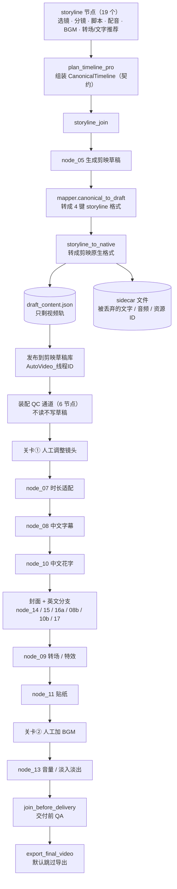
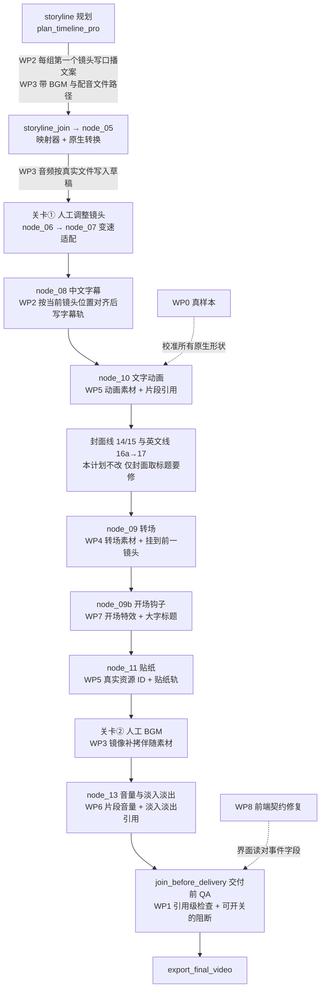
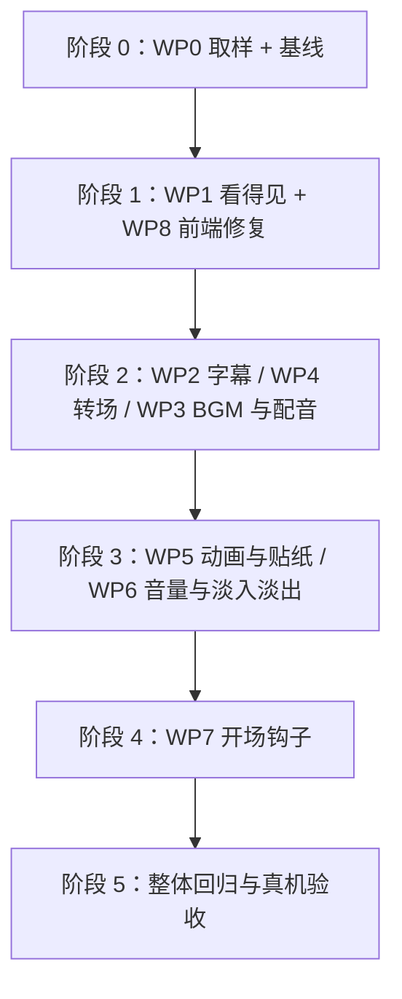

# 剪映草稿缺失转场 / 动画 / 文案 / 配音：原因分析与设计执行计划

| 项目 | 内容 |
|---|---|
| 分析对象 | `wayyet/auto-video-editor`，`main` 分支 |
| 分析基线 | commit `ca885e4`（2026-11-08 20:11:49 +0800）；文中所有 `文件:行号` 都指这个提交 |
| 对应的一次运行 | 创作控制台任务 `console-d103e894da2b`（监控页事件游标 #2136；创建时间 2026-11-08 12:21:17，页面按 UTC 显示） |
| 剪映版本 | 5.9.0.11632（`config.py:430` 的注释；`storyline/native_draft.py:1-30` 头部说明） |
| 文档日期 | 2026-11-12 |
| 性质 | 只读分析 + 设计与执行计划。没有修改你的仓库、剪映草稿或任何运行数据 |

## 0. 阅读指南

### 0.1 证据标签（每条结论都带一个，便于你判断可信度）

| 标签 | 含义 |
|---|---|
| 【截图】 | 来自你提供的 3 张截图 |
| 【代码】 | 阅读源码得到，附 `文件:行号` |
| 【实测】 | 在沙箱里调用**仓库真实函数**或**真实开源库**复现得到（Linux + 合成素材，不是你的 Windows 环境；做法见 §2.4） |
| 【推断】 | 由上述证据推导，没有被直接验证 |
| 【未验证】 | 必须在你的 Windows + 剪映 5.9.0.11632 上确认（汇总在附录 D） |

### 0.2 术语速查（正文里首次出现时也会就地解释）

| 术语 | 一句话解释 |
|---|---|
| 草稿（draft） | 剪映把工程存在磁盘上的一个文件夹，核心文件是 `draft_content.json` |
| 素材桶 | `draft_content.json` 里 `materials` 下的各个列表（`videos`、`audios`、`texts`、`transitions`……），桶里放的是「素材的定义」，不代表它已经出现在时间轴上 |
| 轨道 / 片段 | `tracks` 下的时间轴轨道；片段（segment）是轨道上的一块，用 `material_id` 指向主素材，用 `extra_material_refs` 指向附属素材（转场、动画、淡入淡出等） |
| 引用 | 片段通过 id 指向素材桶里的某个条目。**没有任何片段引用的条目叫「孤儿素材」，剪映不会显示它** |
| 原生格式 | 剪映自己写出来的 JSON 形状（键名、层级）。「非原生」= 项目自创的形状，剪映可能不认，或保存时被丢弃 |
| sidecar | 本项目在草稿目录里多写的一个文件 `autovideo_storyline_source.json`，专门记录「转换时没能写进草稿的内容」 |
| 契约 | 上下游节点约定好的数据结构（这里指 `CanonicalTimeline`）。契约里没有的字段，下游节点就拿不到 |
| SSE | Server-Sent Events：后端持续往浏览器推事件的协议，监控页和创作控制台都用它 |
| 展平 | 把 `payload` 里的字段直接摊到事件顶层 |
| fixture / 金标准 | 测试里用的固定样本；金标准 = 来自真实剪映的样本，用它对照代码写出的形状 |

## 1. 结论速览

### 1.1 两个问题的答案

**问题 4：为什么整套流程跑完，草稿里没有动画、转场、文案、配音？**

因为「节点显示已完成」只表示这个节点的函数没有抛异常，**不表示它的成果写进了草稿**。这次草稿里真正有的只有 3 段视频（时间轴总长 00:00:29:19）【截图】，外加你在关卡②手动拖进去的 BGM「Island Sway 3」——它不是流水线产出的（仓库里没有这个名字，且 BGM 库路径全是空的，见 RC2）【推断】。

其余内容在四个环节掉了：

1. **上游数据在交接处被丢弃**：契约/映射/转换这条链只放行了视频，文字、音频、转场信息要么没读、要么被整轨丢弃（RC1、RC2、RC3）。
2. **写进去的东西剪映不认**：写成孤儿素材（没有片段引用）、占位字段名、占位资源 ID、挂错位置（RC3–RC6）。
3. **有的需求根本没有节点实现**：「开头 3 秒最炸转场 + 大字标题」（RC7）。
4. **质检和界面都没能把缺失暴露出来**：节点「成功」的标准太松，交付前 QA 只数素材桶条目，创作控制台还读错了事件字段（RC8）。

**问题 5：之前跑过的节点的结果，有没有保存到剪映草稿里？**

本次完成的 41 个节点里，成果真正进入草稿且在剪映可见的，只有「选镜 / 分镜 / 时间线规划 → 3 段视频」这一条链。其余节点的结果要么只留在 state、`outputs` 文件或 sidecar 里，要么写成了孤儿素材，要么被丢弃。逐节点明细见 §5。

### 1.2 根因总表

| 编号 | 现象 | 根因（一句话） | 证据 | 修复包 |
|---|---|---|---|---|
| RC1 | 没有任何文案 | 原生转换整轨丢弃 mapper 的字幕轨，理由是「字幕由 node_08 写」；而 node_08 在 B1 改造后不再写任何字幕，理由是「mapper 已经写好」。两个节点互相假设对方做了 | 【代码】【实测】 | WP2 |
| RC2 | 没有配音 / 程序化 BGM | 契约只传资源 ID、不传文件路径；BGM 库路径为空；TTS 默认是静音占位；转换器只保留真实存在的文件 | 【代码】【实测】 | WP3 |
| RC3 | 没有转场 | 契约里有 `transition_in/out` 和 `ai_transitions`，但 mapper 与转换器都不读；node_09 只往素材桶写转场条目，没有任何片段引用它 → 孤儿素材 | 【代码】【实测】 | WP4 |
| RC4 | 没有文字动画 / 花字 | 文字本身不存在；且 node_10 把动画写成素材私有字段 `style`，不是剪映的 `material_animations` + 引用 | 【代码】【实测】 | WP5 |
| RC5 | 没有贴纸 | 资源 ID 是占位符 `PLACEHOLDER_STICKER_*`；写法非原生（引用挂在视频片段上、没有 sticker 轨）；依赖文字 | 【代码】【实测】 | WP5（+WP0） |
| RC6 | 音量 / 淡入淡出没生效 | node_13 的字段名是「设计占位」，选择器匹配不到原生音频片段而静默跳过；强行匹配也写在剪映不读的位置。你截图里的 0.0 dB / 淡入 0.0 s 与此一致 | 【代码】【实测】【截图】 | WP6 |
| RC7 | 没有「开头 3 秒最炸转场 + 大字标题」 | 没有任何节点实现这条需求 | 【代码】 | WP7 |
| RC8 | 缺失却看不出来 | ① 无操作也算 succeeded，`export_final_video` 默认没导出也显示已完成；② 交付前 QA 数桶条目、不查引用、不阻断；③ 创作控制台读错事件字段，四态卡永远「待发生」 | 【代码】【实测】【截图】 | WP1、WP8 |

### 1.3 推荐路线

| 步骤 | 目标 | 内容 | 工作量（经验估算，未经验证） |
|---|---|---|---|
| 第 1 步 | 先「看得见」 | WP0 取真实样本（0.5）+ WP1 检查脚本与门禁（1.5）+ WP8 前端契约修复（0.5） | 约 2.5 人日 |
| 第 2 步 | 再「写得对」 | WP2 文案（2.5）→ WP4 转场（2）→ WP3 BGM/配音（3）→ WP5 动画/花字/贴纸（3）→ WP6 音量（1.5） | 约 12 人日 |
| 第 3 步 | 最后「做得炸」 | WP7 开头 3 秒钩子（3）；每个 WP 自带真机验收，最后再做一次整体回归 | 约 3 人日 |
| 合计 | | | **约 17.5 人日**（一个人顺序做的口径；不含 TTS 服务部署与 BGM 版权确认） |

顺序的理由：不先让缺失「看得见」，后面每修一项都没法客观验收；文案和转场是动画、花字、贴纸的前提，所以放在它们之前；音量要等 BGM 已经在草稿里才有东西可调，所以放在 BGM/配音之后。WP3 排在转场之后，是因为它的第 0 步（准备 BGM 文件、启用真实 TTS）不是编码工作，可以和 WP2、WP4 的编码并行准备。每一步的任务、命令和验收标准见 §8。

### 1.4 需要你决定的 4 件事（每项都给了推荐，不想细看就按推荐走）

| 编号 | 决策 | 选项 | 推荐 |
|---|---|---|---|
| D1 | 原生内容用什么方式写进草稿（影响 WP2–WP6 的代码形态） | **A** 自写「原生构造函数」，用 WP0 真样本和开源库样本做对照测试（沿用 `nodes/_subtitle_texts.py` 的现有写法，不新增运行时依赖）<br>**B** 运行时直接引入开源库 pyJianYingDraft（Apache-2.0）<br>**C** 不改代码，靠人工在剪映里补 | **A**。B 少写代码，但该库按「从空白草稿生成整份草稿」设计，而本项目的节点链是「在已有草稿上就地修改」，改造面更大；C 等于放弃自动化 |
| D2 | 文案从哪来（影响 WP2） | **A** 用 storyline 已生成的口播文案（`group_scripts`）按镜头切句<br>**B** 恢复 ASR 转写字幕<br>**C** A 为主，有真实配音后再按配音时长对齐 | **A** 起步，之后升级到 C。B 要回退 B1（刚移除 ASR），且没有配音时无语音可转 |
| D3 | 交付前 QA 发现缺内容时怎么办（影响 WP1） | **A** 先「醒目告警」，WP6 完成后切换为「阻断交付」<br>**B** 立刻阻断<br>**C** 一直只告警 | **A**。B 会让当前每次运行都被拦住；C 会让「缺失却不知道」继续发生 |
| D4 | 「开头 3 秒最炸转场 + 大字标题」怎么落地（影响 WP7） | **A** 开头 0–3 秒加「开场特效 + 大字标题」，不切分镜头；第 1 个转场仍在镜头 1→2 的切点<br>**B** 在 A 的基础上，把第 1 个镜头在第 3 秒处切开，让转场真的落在第 3 秒（要拆视频片段、重算时间轴）<br>**C** 只加大字标题，不加开场特效 | **A**。你的 3 个镜头每个约 9.87 秒，第 1 个转场落在第 9.87 秒，不在前 3 秒；A 用「开场特效」补上「炸」的效果且不动视频片段，B 改动大、风险高，建议 A 验证后再做 |

## 2. 三张截图解读与证据基线

### 2.1 截图①：剪映时间轴

| 你看到的 | 说明 | 证据 |
|---|---|---|
| 窗口标题 `…ideo console-d103e894da2b`（被截断） | 这是流水线发布到剪映草稿库的那份草稿，目录名规则是 `AutoVideo_<thread_id>` | 【实测】`official_draft_dir_name("console-d103e894da2b")` 返回 `AutoVideo_console-d103e894da2b` |
| 「23:21:10 自动保存本地」 | 剪映已经打开并重新保存过这份草稿。剪映保存时按自己的格式重写文件，认不出的键会被丢弃（`storyline/native_draft.py:20-21` 自己也这么写） | 【截图】+【推断】 |
| 素材面板：0001.mov（00:31）、0002.mov（00:28），均「已添加」 | 2 个源视频 | 【截图】 |
| 播放器总时长 00:00:29:19 | 与时间线规划的 29610 ms 吻合：`beat_align` 取 63 个节拍 × 470 ms = 29610 ms（`storyline_capabilities/timeline_planner.py:209-241`），正好是 3 段 × 9870 ms | 【截图】+【推断】 |
| 视频轨 3 段：00:00:09:27 / 09:25 / 09:26 | 3 个镜头，每段约 9.87 秒 | 【截图】 |
| 音频轨「Island Sway 3」（被选中） | 剪映曲库里的歌。仓库里没有这个名字；BGM 库 5 个条目的 `path` 全是空串（`storyline_capabilities/resource/bgm_meta_ref.yaml:18`、`:28`、`:38`、`:48`、`:58`）。更可能来自关卡②「人工添加 BGM」 | 【推断】 |
| 右侧面板：音量 0.0 dB、淡入 0.0 s、淡出 0.0 s | 剪映默认值：node_13 没有写入任何剪映会读取的音量 / 淡入淡出字段（RC6） | 【截图】+【实测】 |
| 没有文字轨、特效轨、贴纸轨 | 草稿里没有文案、特效、贴纸。转场也没有，与你的描述一致（RC3） | 【截图】 |

### 2.2 截图②：Workflow Monitor（工作流监控页）

- 统计：完成 41 / 执行中 0 / 等待 0 / 失败 0，节点列表全部「已完成 · attempt 1」。含义：**这次没有任何节点抛异常**。
- 节点列表里同时出现 `生成剪映草稿`、`添加中文字幕`、`注入特效`、`注入中文花字`、`注入贴纸`、`音量调节`、`最终 MP4 导出`，全部显示「已完成」，可草稿里并没有对应内容。这就是「节点已完成 ≠ 草稿里有内容」的直接证据。
- `最终 MP4 导出` 显示已完成，但导出开关 `FINAL_EXPORT_ENABLED` 默认是 `False`（`config.py:481-483`，环境变量名 `AUTO_VIDEO_EDITOR_FINAL_EXPORT_ENABLED`）；关闭时节点只发 `export.skipped` 事件就返回（`nodes/node_18_export_video.py:72`），并没有导出视频 【代码】。
- 旁注：另有 5 个老任务（`console-5e8b4e549c15` 等）停在「等待人工关卡」，与本问题无关。

### 2.3 截图③：创作控制台

- 需求文字（摘要）：马来西亚马六甲海上清真寺 vlog；#2 开头 3 秒最炸转场 + 大字标题；#3 网上搜索主题资料（小红书 / 抖音）；#4 不超过 35 秒、9:16、9 个镜头左右、自动切镜 / 智能卡点 / 生成时间轴。
- 素材：`media_0004.mov`（27.4 MB）、`media_0003.mov`（29.5 MB）；目标时长 30 秒；9:16；中文。
- 「交付状态」四项（草稿已生成 / 草稿已发布 / 交付前 QA / 最终导出）全部「待发生」。后端其实发出了相应事件，前端读错了字段（§6）。
- 事件表从 #2021 `run.started` 开始，详情列里 `summary={...}` 出现在事件顶层，与前端读取的 `event.payload.summary` 对不上（§6）。
- 旁注：需求写的是「9 个镜头左右」，时间轴实际只有 3 段。这不在本次 5 个问题范围内，未分析（附录 D）。

### 2.4 证据基线：我是怎么验证的，局限在哪

1. **仓库**：只读克隆，commit `ca885e4`。你的仓库、草稿、运行数据都没动。
2. **输入**：合成 2 个 540×960 的小视频 + 1 个 wav；按你那次运行的形状构造 `CanonicalTimeline`——3 段 × 9870 ms、`bgm_ref` 是资源 ID、`voiceover` 是 JSON 字符串、字幕文案 + 逐段转场 / 字幕样式。**这是「同形状的合成数据」，不是你那次运行的原始数据。**
3. **执行**：按真实图的顺序调用**仓库真实的节点函数**：node_05 → node_07（含快照②）→ node_08 → node_10 → 英文分支（16a / 08b / 10b / 17）→ node_09 → node_11 →（模拟关卡②人工加 BGM）→ node_13 → join_before_delivery。每一步之后统计「轨道 / 片段 / 素材桶 / 被引用 vs 孤儿」。
4. **三个场景**：A = 复现你的运行；B = 把 `bgm_ref` 换成真实 wav 路径（看转换器在「能解析到文件」时的表现）；T = 在 node_08 之后用仓库自带的 `nodes/_subtitle_texts.py` 补写文字轨（模拟「文案修好」），看 node_10 / node_11 的后续表现。
5. **形状对照**：用开源库 pyJianYingDraft 0.3.1（Apache-2.0）生成一份「原生写法」样本，对比本项目节点写出的字段。
6. **前端**：用仓库真实的 `make_event` + `to_sse_frame` 生成 SSE 帧，再用 Node 回放前端的读取逻辑。
7. **局限**：沙箱是 Linux、没有真实剪映，所以「剪映是否真的不显示孤儿素材」是按剪映的引用口径做的推断；你截图里的现象（没有转场、没有文字、音量 0.0 dB）与这个推断一致。真机验证见 WP0 与附录 D。

## 3. 草稿是怎么生成的（读根因之前先看这一节）

### 3.1 数据流：从节点到草稿



图中节点顺序来自 `graph.py` 的连边（`add_node` 在第 481–551 行，边在第 559–775 行）。装配 QC 通道的 6 个节点既不读也不写草稿（在 `nodes/assembly/` 的 6 个文件和 `assembly_capabilities/` 里搜索 `load_draft`、`write_draft`、`safe_write_draft`、`draft_content`、`publish_draft`，结果为空 【代码】），它们产出的 `timeline.json` 和修复结果也不会回写草稿。

### 3.2 契约里哪些是「完整数据」，哪些只是「提示」

契约 `CanonicalTimeline` 定义在 `storyline/contract.py`，由 `plan_timeline_pro` 填充（`storyline_capabilities/plan_timeline_pro.py:106-184`）。

| 契约字段 | 内容 | 进入草稿了吗 |
|---|---|---|
| `clips[*]` 的素材、入点 / 出点、时间线位置 | 完整 | ✅ 变成视频片段 |
| `clips[*].transition_in / transition_out` | 转场提示，如 `fade_in`、`cut`、`fade_out` | ❌ mapper 与转换器都不读（RC3） |
| `clips[*].subtitle_style` | 字幕样式提示 | ❌ 无人消费（RC1） |
| `clips[*].voiceover_id`、`audio.voiceover` | 配音 ID、「分组→配音 ID」的 JSON 字符串 | ❌ 只有 ID，没有文件（RC2） |
| `audio.bgm_ref` | BGM 资源 ID | ❌ 只有 ID，没有文件（RC2） |
| `subtitles.zh` | 所有口播文案拼成的**一整个字符串** | ❌ mapper 把它写成一条横跨全片的文字，随后被转换器整轨丢弃（RC1） |
| `clips[*].transcript` | 本应是每个镜头的文案 | ❌ B1 之后没有任何节点再填它（RC1） |
| AI 转场清单 `ai_transitions` | `storyline_plan_timeline_ai_transition` 节点产出，多为 stub | ❌ 无人消费（RC3） |

「mapper 与转换器都不读」的依据：在 `storyline/mapper.py` 和 `storyline/native_draft.py` 里搜索 `transition_in`、`transition_out`、`subtitle_style`、`voiceover_id`、`ai_transitions`，结果为空 【代码】。`plan_timeline_pro.py` 里甚至有注释直说配音字段「mapper 不读、联调可查」（`storyline_capabilities/plan_timeline_pro.py:161-162`）。

### 3.3 剪映怎么决定「画面里有什么」：看引用，不看素材桶

剪映只渲染「被片段引用的素材」。对照开源库 pyJianYingDraft 0.3.1 生成的原生样本【实测】，一个转场、一段文字动画、一次淡入淡出在草稿里应当长这样：

| 内容 | 素材桶里的条目 | 谁引用它 |
|---|---|---|
| 转场 | `materials.transitions[]`，10 个键：`id, effect_id, resource_id, name, duration`（微秒）`, is_overlap, category_id, category_name, platform, type="transition"` | **前一个**视频片段的 `extra_material_refs` |
| 文字 | `materials.texts[]`（`content` 是 JSON 字符串，含 `text` 与 `styles`） | text 轨片段的 `material_id` |
| 文字动画 | `materials.material_animations[]`：`id, type, multi_language_current, animations[]` | text 轨片段的 `extra_material_refs` |
| 视频特效 | `materials.video_effects[]`，20 个键（含 `type="video_effect"`） | effect 轨片段的 `material_id`（也可挂在视频片段上） |
| 贴纸 | `materials.stickers[]`：`id, resource_id, sticker_id, source_platform, type="sticker"` | sticker 轨片段的 `material_id` |
| 音量 | 不用素材桶，直接是**音频片段自己的** `volume` | — |
| 淡入淡出 | `materials.audio_fades[]`：`id, fade_in_duration, fade_out_duration, fade_type, type="audio_fade"`（微秒） | 音频片段的 `extra_material_refs` |

这张表的可信度：库作者在 README 的功能清单里把上述功能都标为「5.9 ✅」；本项目自己的原生转换器也是参照同一血缘的实现写的（`storyline/native_draft.py:12`）。但仓库头部同时承认「音频 / 文本没有真实样本」，所以最终仍以 WP0 取得的剪映 5.9.0.11632 真实样本为准【未验证】。

另一条来自库 README 的提醒（5.9 上出现较多）：剪映打开草稿时会尝试自动下载未缓存的动画 / 特效 / 转场，可能超时并显示「xx 加载失败」；未缓存的字体需要把草稿打开两次。这与「写对了却没显示」是两种不同问题，WP4 / WP5 的验收里要把它分开看。

## 4. 根因逐项分析

> 每一项都按「现象 → 机制（代码）→ 实测 → 修复方向」写。代码片段由脚本从仓库原样摘出，行号可直接对照。

### RC1 文案：谁都没写

**现象**：草稿里没有文字轨（截图①），也没有任何字幕写入事件。

**机制（三步，缺一不可）**

① mapper 写出的「字幕」只有一条、横跨全片，而且 `materials.texts` 是空的：

**`storyline/mapper.py:190-206`**

```python
    text_track: dict[str, Any] = {
        "type": "text",
        "id": "track-text-1",
        "segments": [],
    }
    if plan.subtitles.zh:
        text_track["segments"].append(
            {
                "id": "subtitle-zh-1",
                "text": plan.subtitles.zh,
                "target_start_us": 0,
                "target_end_us": _ms_to_us(
                    plan.clips[-1].timeline_out_ms if plan.clips else 0
                ),
                "lang": "zh",
            }
        )
```

这条文字的内容是 `subtitles.zh`——所有口播文案拼成的**一整个字符串**，不是逐镜头的字幕；`storyline/mapper.py:213` 另有 `"texts": []`。

② 2026-11-07 的原生转换（提交 `041becf`）把这条文字轨整轨搬进 sidecar、不写进草稿，理由写在注释里：

**`storyline/native_draft.py:463-466`**

```python
        if ttype == "text":
            # mapper 文本轨恒空/私有形状;字幕由 node_08/08b 以原生形状写
            dropped["dropped_text_track"] = track
            continue
```

③ 2026-11-08 的 B1 改造（提交 `d43d692`；B1 = 「ASR 移除」，ASR 即自动语音识别，把语音转成文字）删掉了 node_08 的 ASR 实现，并假定「mapper 已经写好脚本字幕」，于是 node_08 连 `sync_text_track` 都不敢再调用：

**`nodes/node_08_add_subtitles.py:1-6`**

```python
"""节点 8:add_subtitles — 字幕主干兼容节点(B1 ASR 移除后,2026-11-08)。

历史上本节点调用 ASR 客户端把语音转成逐句字幕写进草稿;B1 ASR 移除
(``docs/第三期开发/B1_ASR_移除设计与分阶段执行计划.md`` 阶段 3)后**不再
识别语音、不再注入 ASR 字幕、绝不调用 ``sync_text_track``**(空列表整轨
替换会清空 mapper 已写入的脚本字幕)。
```

`add_subtitles` 里还留着一条承认「中文侧没有草稿落点」的注释：

**`nodes/node_08_add_subtitles.py:379-386`**

```python
    # 换算结果暂无草稿落点(ASR 字幕素材通道已移除),但 scout 报告与换算说明
    # 仍按原契约落到 state / status_log;``_style_from_scout`` 本身仍被 08b 复用。
    scout_report = _run_subtitle_scout(state.get("video_input_path", ""))
    _style, scout_notes = _style_from_scout(scout_report)
    # P4(决定 2 选 A):storyline 推荐(storyline_text_style_plan)叠加在 scout 换算
    # 结果之上 —— 字幕基础样式的单一决策点。B1 后 zh 侧换算结果暂无草稿落点,
    # 叠加说明按契约落 status_log;草稿仍不修改(回归锁 test_add_subtitles_
    # preserves_existing_script_subtitles)。zh 侧样式真实落草稿的通道待后续阶段。
```

**两个节点互相假设对方做了：**

| 环节 | 它的假设 | 实际情况 |
|---|---|---|
| 原生转换 `storyline_to_native`（11-07） | 字幕轨由 node_08 / 08b 以原生形状写 | node_08 在 11-08 之后不再写 |
| node_08（B1，11-08） | mapper 已写入脚本字幕，不能清空 | 转换器已经把它丢进 sidecar |

**实测**【实测】场景 A：node_05 之后 `text_segments=0`；sidecar 的 `dropped_text_track` 里有 1 段文字，内容是三句话拼成的整篇文案（开头预览 `马六甲海上清真寺,日落时分海面金光闪烁。\n涨潮时清真寺仿佛漂…`）。也就是说，**即使这条轨被保留，你看到的也只是一整块横跨 30 秒的文字**，而不是逐镜头字幕。node_08 之后仍是 0。场景 T 用仓库自带的 `nodes/_subtitle_texts.py` 补写 3 条文字后 `text_segments=3`，说明原生文字轨本身是写得进去的，缺的是调用方。

**为什么没被测试发现**：`tests/unit/test_node_08_add_subtitles.py:71` 的回归测试手工造了一份**已经带** `subtitle-zh-1` 文字素材的草稿，来验证 node_08 不会清空它；而真实 mapper 写的是 `"texts": []` 加一条私有格式文字轨，转换器还会再丢掉。两个节点各自的单元测试都是绿的，整条链却丢了文案。**这是本项目最典型的「fixture 与真实产物脱节」**（fixture = 测试用的固定样本）。

**修复方向**：WP2。

### RC2 配音与程序化 BGM：契约只传 ID，不传文件

**现象**：除了你手动拖入的 BGM 外，没有任何音轨；没有配音。

**机制**

① 契约里只有 ID。`plan_timeline_pro` 只取 `bgm_ref`（资源 ID），配音是「分组→配音 ID」的 JSON 字符串：

**`storyline_capabilities/plan_timeline_pro.py:159-166`**

```python
        "audio": {
            "bgm_ref": bgm_selection.get("bgm_ref") if bgm_selection else None,
            # CanonicalTimeline.audio.voiceover 是 Optional[str];空时 None,有映射
            # 时存 JSON 字符串(group_id → voiceover_id),mapper 不读、联调可查。
            "voiceover": json.dumps(voiceover_id_map, ensure_ascii=False)
            if voiceover_id_map
            else None,
        },
```

② 文件路径其实在上游存在，却没往下传。`select_bgm` 的结果里有 `bgm_path` 和 `default_volume`，`plan_timeline_pro` 都没带进契约：

**`storyline_capabilities/select_bgm.py:140-151`**

```python
    bgm_path = str(chosen.get("path") or "")

    return {
        "bgm_ref": str(chosen.get("bgm_id") or "bgm_unknown"),
        "bgm_path": bgm_path,
        "beats": beats,
        "duration_ms": duration_ms,
        "tempo": str(chosen.get("tempo") or "medium"),
        "default_volume": float(chosen.get("default_volume") or 0.35),
        "reason": str(chosen.get("reason") or ""),
        "method": method,
        "stub": (not bgm_path) or method == "default_match",
```

更根本的是：BGM 库 5 个条目的 `path` 全是空串（`storyline_capabilities/resource/bgm_meta_ref.yaml:18`、`:28`、`:38`、`:48`、`:58`），所以 `stub` 恒为 `True`——这台机器上根本没有可选的 BGM 文件。

③ 配音默认也是占位：`generate_voiceover` 的 provider 默认走 `StubTTSClient`，没有 API Key 或依赖时只写一个**静音 wav**（`storyline_capabilities/generate_voiceover.py:10-13`）。

④ 即使有路径，转换器也只保留「路径是真实存在的文件」的音频，其余记进 sidecar：

**`storyline/native_draft.py:438-446`**

```python
        old_id = str(a["id"])
        path = _to_path(a.get("ref") or a.get("path"))
        segs = audio_segments_by_material.get(old_id, [])
        if not path or not Path(path).is_file():
            unresolved_audio[old_id] = str(a.get("ref") or "")
            continue  # 段的丢弃统一由轨道循环完成(避免重复登记)
        span = 0
        for seg in segs:
            try:
```

被丢弃的记录在 sidecar 的 `dropped_audio_segments`（`storyline/native_draft.py:506`）和 `unresolved_audio_refs`（`:557`）里。

**实测**【实测】场景 A：sidecar 的 `unresolved_audio_refs` 为 `{"bgm-1": "bgm_upbeat_energetic", "voiceover-1": "{\"group_0001\": \"voiceover_0001\", ...}"}`，`dropped_audio_segments` 2 段，草稿音轨 0。场景 B（把 `bgm_ref` 换成真实 wav 路径）：BGM 被保留（音频片段 1、素材 1/1），**配音仍被丢**——它的「路径」是一个 JSON 字符串，不是文件。

**你可以直接验证**：对真实草稿运行 `inspect_draft_content.py --sidecar`（命令见 §8.2 与 §8.3 的 T0.2），应能看到 `unresolved_audio_refs`。

**修复方向**：WP3（含「配置真实 BGM 文件」这一非代码前提）。

### RC3 转场：写了素材，没人引用

**现象**：镜头交界处没有转场。

**机制**

① 契约里有转场提示：`plan_timeline_pro.py` 把推荐结果写进每个镜头的 `transition_in / transition_out`：

**`storyline_capabilities/plan_timeline_pro.py:127-134`**

```python
    for clip_out, clip_in_meta in zip(clips, _iter_clip_with_group(groups)):
        gid = clip_in_meta["group_id"]
        if gid in transition_by_group:
            clip_out["transition_in"] = transition_by_group[gid].get("transition_in")
            clip_out["transition_out"] = transition_by_group[gid].get("transition_out")
        style = text_by_group.get(gid) or default_text_style
        if style:
            clip_out["subtitle_style"] = style
```

但 mapper 与转换器都不读这些字段（§3.2）。`storyline_plan_timeline_ai_transition` 产出的 `ai_transitions` 同样无人消费。

② node_09 自己从资源库选转场，往素材桶里写条目，**但没有任何一行代码把它挂到视频片段上**：

**`nodes/node_09_inject_fx.py:104-128`**

```python
    materials = draft.setdefault("materials", {})
    transitions = materials.setdefault("transitions", [])
    video_effects = materials.setdefault("video_effects", [])

    video_track = find_video_track(draft)
    n_boundaries = _boundary_count(video_track, shot_plan)

    for i in range(n_boundaries):
        style_tag = (
            (shot_plan or {}).get("shots", [{}])[i].get("style_tag", "default")
            if isinstance(shot_plan, dict)
            else "default"
        )
        trans_obj = _resolve_vip_transition(template_lib, style_tag)
        if not trans_obj:
            warning_msgs.append(f"[{tag}] boundary {i + 1} 未找到可用转场,跳过")
            continue
        if not _VIP_ID_PATTERN.match(trans_obj.get("resource_id", "")):
            warning_msgs.append(
                f"[{tag}] boundary {i + 1} resource_id 不是 19 位数字 "
                f"({trans_obj.get('resource_id')!r}),沿用占位"
            )
        trans_obj = dict(trans_obj)
        trans_obj["id"] = f"transition-{i + 1}"
        upsert_by_id(transitions, trans_obj)
```

③ 资源库本身全是 VIP 条目：`templates/fx_resource_library.json` 里转场 303 条、视频特效 462 条，`is_vip` 全为 `true`（README 第 407 行也写明「均为 VIP」）。而上游元数据里其实有免费资源：转场 130 个、视频特效（场景特效）635 个（`vendor/pyJianYingDraft/metadata/` 下按 `is_vip` 统计【实测】）。VIP 资源在非会员账号下能否正常预览 / 导出【未验证】。

**形状对照**【实测】

| 项 | node_09 写出的（场景 T） | 剪映原生样本（开源库 0.3.1） |
|---|---|---|
| 转场条目的键 | 8 个：`default_duration_s, effect_id, id, is_overlap, is_vip, md5, name, resource_id`（资源库元数据原样拷贝） | 10 个：`category_id, category_name, duration, effect_id, id, is_overlap, name, platform, resource_id, type`。**缺 `duration`（微秒）、`type`、`platform`、`category_*`** |
| 谁引用它 | **没有** | 前一个视频片段的 `extra_material_refs` |
| 视频特效 | 6 个键、固定 id `vfx-default`、没有 effect 轨 | 20 个键，effect 轨片段引用它 |

**实测**【实测】三个场景里 node_09 之后都是：转场 被引用 0 / 总数 2，视频特效 被引用 0 / 总数 1，此后一直是孤儿素材。

**修复方向**：WP4。

### RC4 文字动画 / 花字：先没有文字，再写错位置

**现象**：没有文字入场动画、没有花字。

**机制**

① 文字不存在，node_10 对 `materials.texts` 的循环一次都不执行，节点照样标记完成。

② 即使有文字，node_10 也只是往每条文字素材上写一个**私有** `style` 字典（里面带 `entrance_animation`）：

**`nodes/node_10_inject_text_fx.py:82-85`**

```python
    texts = draft.get("materials", {}).get("texts", [])
    for text_obj in texts:
        style = text_obj.setdefault("style", {})
        style.update(default_style)
```

剪映原生的文字动画是独立的 `material_animations` 条目，再由文字片段的 `extra_material_refs` 引用（§3.3）；私有键在剪映保存时会被丢弃（`storyline/native_draft.py:20-21`）。

**实测**【实测】场景 T（先补写了 3 条文字）：node_10 之后文字动画 被引用 0 / 总数 0——根本没有 `material_animations` 条目；文字素材有 15 个键，比原生样本多出的 3 个都是私有键：`style`、`target_timerange`、`track_name`。

**修复方向**：WP5。

### RC5 贴纸：占位 ID + 非原生写法 + 依赖文字

**现象**：没有贴纸。

**机制**

① **资源 ID 全是占位符**。贴纸模板文件自己写明「逆向未完成」：

**`templates/sticker_template.json:2-12`**

```json
  "_reverse_engineering_pending": true,
  "_week3_status": "placeholder",
  "_week4_resource_id_field": {
    "sticker_by_keyword": "<keyword>: <resource_id>"
  },
  "_reverse_engineering_steps": [
    "1. 备份 drafts/default/draft_content.json",
    "2. 剪映 v5.9.0 客户端打开,手工选择云端贴纸,导出新草稿",
    "3. diff 新旧 draft_content.json,把真实 resource_id 按 <keyword>: <resource_id> 形式回填",
    "4. 把 _reverse_engineering_pending 设为 false"
  ],
```

`templates/sticker_template.json:16-19` 的四个关键词都映射到 `PLACEHOLDER_STICKER_*`。README 第 407 行也说「贴纸仍是占位」。

② **写法非原生**：node_11 把贴纸条目写进素材桶后，把它的 id 追加到**视频片段**的 `extra_material_refs` 里：

**`nodes/node_11_inject_sticker.py:107-113`**

```python
        sticker_id = _sticker_id_for(text_obj, index)
        sticker_obj = {
            "id": sticker_id,
            "resource_id": resource_id,
            "target_timerange": dict(text_obj.get("target_timerange", {}) or {}),
        }
        upsert_by_id(stickers_material, sticker_obj)
```

**`nodes/node_11_inject_sticker.py:126-127`**

```python
        else:
            _append_ref_once(target_seg.setdefault("extra_material_refs", []), sticker_id)
```

原生做法是单独的 sticker 轨，由 sticker 轨片段的 `material_id` 引用（§3.3）。

③ **依赖文字**：node_11 是遍历 `materials.texts` 按关键词命中贴纸，没有文字就没有贴纸。

**实测**【实测】场景 T：贴纸「被引用 3 / 总数 3」，但引用方是视频片段、没有 sticker 轨，`resource_id` 全是 `PLACEHOLDER_STICKER_DEFAULT`。按渲染口径，附录 B 的脚本判为 `stickers_referenced=0`、`misplaced_references=3`（错位引用）、`placeholder_values=3`。

**修复方向**：WP5，前置 WP0（取真实贴纸 ID）。

### RC6 音量与淡入淡出：字段名是「设计占位」

**现象**：你截图里音频的音量 0.0 dB、淡入 0.0 s、淡出 0.0 s。

**机制**

① node_13 的头部注释自己承认：字段名是占位，需要你在剪映里手工取样后回填（这条「Week 4 用户行动项」在代码里至今仍是占位）：

**`nodes/node_13_adjust_volume.py:6-21`**

```python
# FIXME 字段名逆向 TODO(Week 4 用户行动项):
#   本机当前无法启动剪映 v5.9.0 客户端做 ``draft_content.json`` diff 逆向,
#   因此本文件中 ``materials.audio_fades[]`` 与 audio_material.volume 字段
#   名为**设计占位**。Week 4 用户需:
#     1. 备份 ``drafts/default/draft_content.json``
#     2. 剪映 v5.9.0 客户端内手工给音频片段加淡入 2s / 淡出 3s / 音量 -6dB,保存
#     3. ``diff`` 出真实字段名
#     4. 把 ``_PLACEHOLDER_FADE_IN_KEY`` / ``_PLACEHOLDER_FADE_OUT_KEY``
#        / ``_PLACEHOLDER_VOLUME_KEY`` / ``_PLACEHOLDER_TRACK_ID_KEY`` 替换为
#        实际键名(详见下文)。

设计占位字段名:
- audio_fades[].fade_in_duration_us  →  实际剪映键名待逆向
- audio_fades[].fade_out_duration_us →  实际剪映键名待逆向
- audio_fades[].track_id             →  实际剪映键名待逆向
- audio_material.volume              →  实际剪映键名待逆向
```

② **选择器匹配不到原生音频片段**。节点按片段上的 `name` / `type` / `audio_kind` 去匹配 `audio_bgm` 这类选择器，而原生音频片段上没有这些键；匹配不到就直接返回，**什么都不写**：

**`nodes/node_13_adjust_volume.py:176-185`**

```python
    segments = _find_audio_segments(draft)
    # 优先按 segment.name 匹配;无 name 时退到按 type 字符串匹配 selector
    matched: list[dict] = [
        s for s in segments
        if s.get("name") == track_selector
        or s.get("type") == track_selector
        or s.get("audio_kind") == track_selector
    ]
    if not matched:
        return None, None
```

节点末尾还会记一条 `node_13_adjust_volume_no_audio_track`（`nodes/node_13_adjust_volume.py:319-321`）——凡是「没调整成功」都记这条，哪怕音轨其实存在，提示是误导的。

③ **即使强行匹配，写的位置也不对**。音量写在素材上，淡入淡出用占位键且不挂到音频片段：

**`nodes/node_13_adjust_volume.py:86-88`**

```python
def _apply_volume(audio_material: dict, volume_level: float) -> None:
    """设置 audio material 的 volume 字段(占位字段名)。"""
    audio_material[_PLACEHOLDER_VOLUME_KEY] = float(volume_level)
```

**`nodes/node_13_adjust_volume.py:103-110`**

```python
    entry = {
        "id": f"audio-fade-{audio_segment_id}",
        _PLACEHOLDER_TRACK_ID_KEY: audio_segment_id,
        _PLACEHOLDER_FADE_IN_KEY: int(fade_in_seconds * 1_000_000),
        _PLACEHOLDER_FADE_OUT_KEY: int(fade_out_seconds * 1_000_000),
        "_fade_in_curve_type": "linear",     # FIXME 曲线类型枚举待逆向
        "_fade_out_curve_type": "linear",    # FIXME 曲线类型枚举待逆向
    }
```

**实测**【实测】用场景 B 的草稿做实验（给音频片段手动加 `name=audio_bgm` 让选择器命中，音量 0.35、淡入 2 s、淡出 3 s）：

| 检查项 | 结果 | 剪映原生样本 |
|---|---|---|
| 原样调用（选择器不命中） | 返回 `None`，草稿不变 | — |
| 写入后 `segment.volume` | 仍是 1.0 | 音量在**片段**上（样本中 0.35） |
| 写入后 `audio material.volume` | 0.35（剪映不读这里） | 素材上没有这个键 |
| 淡入淡出条目的键 | `id, track_id, fade_in_duration_us, fade_out_duration_us, _fade_in_curve_type, _fade_out_curve_type` | `fade_in_duration, fade_out_duration, fade_type, id, type` |
| 片段是否引用淡入淡出条目 | **否** | 音频片段的 `extra_material_refs` 引用 |

换算备忘：剪映界面显示 dB，片段上存的是线性倍数；`volume = 0.35` 约等于 −9.12 dB（20·log10(0.35)）。

**修复方向**：WP6（前置 WP0）。

### RC7 「开头 3 秒最炸转场 + 大字标题」：没有节点实现

你在创作控制台里写的第 2 条需求（开头 3 秒最炸转场 + 大字标题）没有对应的实现：在仓库的 Python / JSON / YAML 文件里（排除 tests、docs、vendor）搜索 `开头3秒`、`最炸`、`大字标题`、`opening_hook`、`hook_title`、`opening_title`，没有任何结果【代码】。storyline 的文字推荐只产出样式提示（`subtitle_style`），同样无人落进草稿。

**修复方向**：WP7（依赖 WP2 的文字轨、WP4 的转场写入、WP5 的文字动画）。

### RC8 缺失却看不出来：三层「看不见」

**(a) 节点「成功」的标准太松**：没做事也标记完成。

| 节点 | 没做事时的表现 | 位置 |
|---|---|---|
| node_10 花字 | 文字为空时循环不执行，仍完成 | `nodes/node_10_inject_text_fx.py:82-85` |
| node_11 贴纸 | 同上（依赖 `materials.texts`） | `nodes/node_11_inject_sticker.py:99-101` |
| node_13 音量 | 选择器不命中 → 返回 `None` → 仍「通过」，还误报「无音轨」 | `nodes/node_13_adjust_volume.py:184-185`、`:319-321` |
| node_08 字幕 | B1 后只做样式侦察，草稿不改 | `nodes/node_08_add_subtitles.py:383-386` |
| export_final_video | 开关默认关闭 → 发 `export.skipped`，监控页仍显示已完成 | `nodes/node_18_export_video.py:70-78`、`config.py:481-483` |

**(b) 交付前 QA 只数素材桶条目，不查引用，也不查文案 / BGM / 配音**：

**`nodes/node_join_before_delivery.py:71-79`**

```python
    transitions = _count(materials, "transitions")
    video_effects = _count(materials, "video_effects")
    stickers = _count(materials, "stickers")
    if transitions == 0:
        issues.append(f"{label}转场缺失(尾链 node_09 未对{label}生效?)")
    if video_effects == 0:
        issues.append(f"{label}视频特效缺失(尾链 node_09 未对{label}生效?)")
    if stickers == 0:
        issues.append(f"{label}贴纸缺失(尾链 node_11 未对{label}生效?)")
```

- 转场 / 特效 / 贴纸只看桶里条目数是不是 0（孤儿素材也算「有」）。
- 音量只查素材上有没有 `volume` 键（`nodes/node_join_before_delivery.py:97-98`）——恰好是 node_13 写占位的位置，两边互相印证了错误。
- 通用完整性检查 `check_track_references` 只查**悬空引用**（片段引用了不存在的素材），不查**孤儿素材**（`draft_ops/draft_integrity.py:157-175`）。

【实测】场景 A 的 QA 报了 7 条，但**没有一条**是「没有文案」「没有转场」「没有 BGM / 配音」；场景 T 里贴纸 3 个全是占位符且错位引用，QA 的「贴纸缺失」那一条反而消失了（桶里有条目）。完整问题清单见附录 A.3。

**(c) QA 发现问题也不拦截**：`join_before_delivery` 到 `export_final_video` 是无条件连边（`graph.py:647`），问题只写进 `status_log`（如 `delivery_qa_issues:7`）和事件，流程照样走完。

**(d) 界面读错字段**：创作控制台的交付四态卡与监控页的节点耗时 / 等待详情都读不到数据，见 §6。

**修复方向**：WP1（检查脚本、门禁）+ WP8（前端契约）。

## 5. 逐节点：结果有没有进剪映草稿

> 这一节回答你的问题 5。先看结论，再看明细。明细按「图里的真实先后顺序」排列，每行都带代码位置，可以逐条对照。

### 5.1 先看结论

我把仓库注册的 **46 个节点**（不含 START / END）按「它的成果有没有进剪映草稿」分成 6 类：

| 类别 | 含义 | 节点数 |
|---|---|---|
| ✅ 直接写入，剪映里可见 | 节点自己把成果按剪映认的方式写进了草稿 | **2** |
| 🟡 间接决定「有哪些视频片段」 | 自己不写草稿，但它的结果决定了视频轨上有哪几段、各多长 | **7** |
| ⚠️ 写了，但剪映看不到或不使用 | 孤儿素材，或只是草稿目录里的旁路文件 | **3** |
| ❌ 空操作或被丢弃 | 节点照样显示「已完成」，草稿里没有它的成果 | **17** |
| ➖ 不涉及草稿 | 质检、关卡、路由、导出等控制类节点，本来就不写草稿内容 | **16** |
| 👤 人工在剪映里完成 | 草稿里看得见的东西是你手动做的，不是流水线写的 | **1** |
| 合计 | | **46** |

**一句话回答问题 5**：

- **进了草稿、而且你在剪映里看得见的**，只有 3 段视频。它来自「载入媒体 → 分镜切分 → 理解 / 过滤 / 分组 → 时间线规划 → 剧情结果汇合 → 生成剪映草稿」这一条链（7 个间接节点 ＋ 生成草稿）。英文分支草稿是同一份视频轨的副本。另外你在关卡② 手动拖入的 BGM「Island Sway 3」也在草稿里，但那不是流水线产出的。
- **写了但看不见的**（3 个）：转场 / 视频特效是孤儿素材；封面 PNG 躺在草稿目录里，剪映不用。
- **空操作或被丢弃的**（17 个）：文案、配音、程序化 BGM、转场推荐、AI 转场、字幕、花字、贴纸、音量、英文字幕与英文配音……它们在监控页上都会显示「已完成」，但草稿里没有对应内容。
- **本来就不写草稿的**（16 个）：质检、关卡、路由、导出。

各类包含的节点：

- ✅ **直接写入，剪映里可见**（2）：生成剪映草稿（node_05）、复制英文分支草稿
- 🟡 **间接决定「有哪些视频片段」**（7）：载入媒体、分镜切分、理解片段、过滤片段、片段分组、时间线规划、剧情结果汇合
- ⚠️ **写了，但剪映看不到或不使用**（3）：生成封面、封面英文本地化、注入特效
- ❌ **空操作或被丢弃**（17）：网页话题检索、生成文案、文案模板推荐、生成配音、选择 BGM、推荐转场、推荐文本、生成 AI 转场、AI 转场时间线规划、添加中文字幕、注入中文花字、翻译与布局检测、添加英文字幕、注入英文花字、注入英文 TTS、注入贴纸、音量调节
- ➖ **不涉及草稿**（16）：检索素材、渲染视频、剧情 QA 闸门、素材发现与探测、视觉观察、装配时间线、渲染与质量检查、QC 修复回路、写 QC 报告、人工调整镜头顺序①、时长适配、桥接快照2、布局人工复核③、交付前 QA 闸门、最终 MP4 导出、护栏失败升级
- 👤 **人工在剪映里完成**（1）：人工添加 BGM②

> **关于监控页上的「完成 41」**：46 个节点里有 5 个是条件节点（下表里标了「条件节点」：检索素材、网页话题检索、QC 修复回路、布局人工复核③、护栏失败升级），只在特定情形才会运行。如果这次这 5 个都没触发，正好是 46 − 5 = 41，与你截图里的「完成 41」吻合【推断】。监控页是否把 START / END 计入，我无法从截图判断，所以「具体是哪几个没运行」以监控页节点列表为准【未验证】。无论是哪几个，结论不变：**「已完成」只说明函数没抛异常，不说明成果进了草稿。**

### 5.2 怎么读下面的表

- 「进草稿的情况」前面的图标就是 5.1 的类别。
- 「证据」列是 `文件:行号`（基线 commit `ca885e4`）。没有标【推断】的，都是读源码或沙箱实测得到。
- 带「（条件节点）」的行表示：只有满足触发条件才会运行。

### 5.3 storyline 前置链（19 个节点）：决定「有什么」，自己不写草稿

| # | 节点（中文名 · 代码 id） | 它产出什么、放在哪 | 进草稿的情况 | 证据 |
|---|---|---|---|---|
| 1 | **载入媒体**<br>`storyline_load_media` | 媒体清单 JSON，路径存在 state 的 `storyline_media_artifact` | 🟡 源视频路径经契约的 `source_media` 成为草稿里的视频素材 | `nodes/storyline/node_load_media.py:61` |
| 2 | **检索素材（条件节点）**<br>`storyline_search_media` | 把 Pexels 检索结果合并进 `storyline_media_artifact` | ➖ 只有配置了 `STORYLINE_PEXELS_API_KEY` 才会运行；与草稿写入无关 | `graph.py:225-229`、`nodes/storyline/node_search_media.py:55` |
| 3 | **网页话题检索（条件节点）**<br>`storyline_search_web_topic` | `storyline_web_topic_artifact`（死胡同分支，只被「生成文案」软读取） | ❌ 开关 `STORYLINE_ENABLE_WEB_TOPIC` 为真且 `query` 非空才运行；即使运行，也只影响文案内容，而文案本身在交接处丢了（RC1） | `graph.py:205-212`、`nodes/storyline/node_search_web_topic.py:48` |
| 4 | **分镜切分**<br>`storyline_split_shots` | 切镜结果，`storyline_shots_artifact` | 🟡 决定每个镜头的入点 / 出点，最终变成视频片段 | `nodes/storyline/node_split_shots.py:117` |
| 5 | **理解片段**<br>`storyline_understand_clips` | 片段语义理解，`storyline_understanding_artifact` | 🟡 供过滤、分组、文案使用，自己不进草稿 | `nodes/storyline/node_understand_clips.py:69` |
| 6 | **过滤片段**<br>`storyline_filter_clips` | 保留的片段清单，`storyline_filtered_clips` | 🟡 决定哪些镜头留在时间轴上 | `nodes/storyline/node_filter_clips.py:67` |
| 7 | **片段分组**<br>`storyline_group_clips` | 镜头分组，`storyline_groups_artifact` | 🟡 决定镜头的分组与先后顺序 | `nodes/storyline/node_group_clips.py:67` |
| 8 | **生成文案**<br>`storyline_generate_script` | 口播文案，`storyline_script_artifact`（含每组的 `group_scripts`） | ❌ 文案被拼成 `subtitles.zh` 一整个字符串 → mapper 写成私有文字轨 → 转换器整轨丢进 sidecar；草稿里没有文案（RC1） | `nodes/storyline/node_generate_script.py:71`、`storyline/native_draft.py:463-466` |
| 9 | **文案模板推荐**<br>`storyline_script_template_recommendation` | 没有产物（模块文档自述为 noop，只记一条 status_log） | ❌ 空操作 | `nodes/storyline/node_script_template_recommendation.py:4` |
| 10 | **生成配音**<br>`storyline_generate_voiceover` | 配音 wav 与时长，`storyline_voiceover_artifact`；默认 `StubTTSClient` 只写静音 wav | ❌ 契约里只剩「分组→配音 ID」的 JSON 字符串，不是文件；转换器只收真实存在的文件，所以丢弃（RC2） | `nodes/storyline/node_generate_voiceover.py:64`、`storyline_capabilities/generate_voiceover.py:10-13` |
| 11 | **选择 BGM**<br>`storyline_select_bgm` | `storyline_bgm_selection`（含 `bgm_path`、`default_volume`、`stub`） | ❌ 契约只取 `bgm_ref`（资源 ID），路径没传；BGM 库 5 个条目路径全是空串；转换器丢弃（RC2） | `nodes/storyline/node_select_bgm.py:80`、`storyline_capabilities/plan_timeline_pro.py:159-166` |
| 12 | **推荐转场**<br>`storyline_recommend_transition` | `storyline_transition_plan` | ❌ 被写成每个镜头的 `transition_in/out` 提示，mapper 与转换器都不读（RC3） | `nodes/storyline/node_recommend_transition.py:60`、`storyline_capabilities/plan_timeline_pro.py:127-134` |
| 13 | **推荐文本**<br>`storyline_recommend_text` | 字幕样式提示，`storyline_text_style_plan` | ❌ 样式只在 node_08 / node_08b 里叠加到字幕上，而中文侧不再写字幕、英文侧没有字幕段，所以无处落地（RC1） | `nodes/storyline/node_recommend_text.py:63`、`nodes/node_08_add_subtitles.py:383-388`、`nodes/node_08b_add_subtitles_en.py:49-56` |
| 14 | **时间线规划**<br>`storyline_plan_timeline_pro` | `CanonicalTimeline`（契约）JSON，路径存在 `storyline_timeline_plan` | 🟡 3 段视频片段由它定下；同一份契约里的文字 / 音频 / 转场字段不会进草稿（§3.2） | `nodes/storyline/node_plan_timeline_pro.py:99`、`storyline_capabilities/plan_timeline_pro.py:106-184` |
| 15 | **生成 AI 转场**<br>`storyline_generate_ai_transition` | `storyline_ai_transition_artifact`；当前只有 Stub，每个衔接点写一份 500 ms 占位 JSON，不改时间线 | ❌ 没有任何下游消费（RC3） | `nodes/storyline/node_generate_ai_transition.py:20`、`:181` |
| 16 | **AI 转场时间线规划**<br>`storyline_plan_timeline_ai_transition` | 在基础时间线上挂 `ai_transitions` 清单，另存 `timeline_plan_ai.json` | ❌ 清单无人消费（RC3） | `nodes/storyline/node_plan_timeline_ai_transition.py:80` |
| 17 | **渲染视频**<br>`storyline_render_video` | 默认不渲染，只记 `storyline_render_video_skipped`（`STORYLINE_ENABLE_RENDER_SMOKE_TEST=1` 才写占位 mp4） | ➖ 与草稿无关 | `nodes/storyline/node_render_video.py:3-4` |
| 18 | **剧情 QA 闸门**<br>`storyline_qa_gate` | 校验契约合法、总时长不超过目标的 1.05 倍；不过则回到「片段分组」重试，最多 3 次 | ➖ 只读不写 | `nodes/storyline/qa_gate.py:98` |
| 19 | **剧情结果汇合**<br>`storyline_join` | 把 `storyline_timeline_plan` 反序列化成 `storyline_plan`，交给 node_05 | 🟡 它是草稿生成的唯一输入 | `nodes/storyline/join_storyline.py:122` |

### 5.4 生成草稿与装配 QC 通道（7 个节点）

| # | 节点（中文名 · 代码 id） | 它产出什么、放在哪 | 进草稿的情况 | 证据 |
|---|---|---|---|---|
| 20 | **生成剪映草稿（node_05）**<br>`generate_draft` | `draft_content.json`（原生格式，只含视频轨）＋ sidecar `autovideo_storyline_source.json`；发布到剪映草稿库 `AutoVideo_<thread_id>` | ✅ 视频 3 段 ✅；文字轨、音频、资源 ID 进 sidecar；转场 / 动画 / 样式提示没被读取 | `nodes/node_05_generate_draft.py:195-197`、`storyline/native_draft.py:438-446`、`:463-466` |
| 21 | **素材发现与探测**<br>`assembly_discover_and_probe` | 扫描源视频、ffprobe 探测 | ➖ 不读不写草稿 | `graph.py:576-577` |
| 22 | **视觉观察**<br>`assembly_visual_observe` | 关键帧抽帧、contact sheet | ➖ 不读不写草稿 | `graph.py:577-578` |
| 23 | **装配时间线**<br>`assembly_build_timeline` | 产出 `timeline.json`（装配草案，不是剪映草稿） | ➖ 不读不写草稿 | `graph.py:578-579` |
| 24 | **渲染与质量检查**<br>`assembly_validate_render_qc` | 渲染 `preview.mp4` 并做质检 | ➖ 不读不写草稿 | `graph.py:579-587` |
| 25 | **QC 修复回路（条件节点）**<br>`assembly_repair_loop` | 只有质检不过才进入；修复结果只作用于 `timeline.json` | ➖ 不读不写草稿 | `graph.py:580-588` |
| 26 | **写 QC 报告**<br>`assembly_write_report` | Markdown 报告，路径存 `assembly_report_path`，供关卡① 通知引用 | ➖ 不读不写草稿 | `nodes/assembly/node_write_report.py:1-9`、`graph.py:589` |

装配 QC 通道不读不写草稿：在 `nodes/assembly/` 与 `assembly_capabilities/` 里搜索 `load_draft`、`write_draft`、`safe_write_draft`、`draft_content`、`publish_draft`，结果为空【代码】。通道的开关是 `ASSEMBLY_QC_GATE_ENABLED`，关闭时 6 个节点注册了但不接边（`graph.py:573-592`）。

### 5.5 关卡①、时长适配、字幕花字与英文分支（13 个节点）

| # | 节点（中文名 · 代码 id） | 它产出什么、放在哪 | 进草稿的情况 | 证据 |
|---|---|---|---|---|
| 27 | **人工调整镜头顺序①**<br>`node_06_human_reorder` | 暂停，等你在剪映里调整分镜后点继续 | ➖ 本节点自己不写草稿；你在剪映里的改动由后续节点读取 | `nodes/node_06_human_reorder.py:62` |
| 28 | **时长适配**<br>`node_07_speed_fit` | 总时长超过目标才变速，写 `materials.speeds` 与片段 `speed` | ➖ 本次总长约 29.61 s，不超过目标 30 s，走「已达标」直接返回，草稿不变【推断】 | `nodes/node_07_speed_fit.py:104-109` |
| 29 | **桥接快照2**<br>`bridge_snapshot2` | 把快照② 路径写进 state | ➖ 与草稿内容无关 | `graph.py:272-275` |
| 30 | **添加中文字幕**<br>`node_08_add_subtitles` | B1 之后只做样式侦察，不再写任何字幕 | ❌ 草稿没有变化（RC1） | `nodes/node_08_add_subtitles.py:1-6`、`:383-386` |
| 31 | **注入中文花字**<br>`node_10_inject_text_fx` | 遍历 `materials.texts` 加样式 / 入场动画 | ❌ 文字为空，循环一次都不执行，仍记「完成」（RC4） | `nodes/node_10_inject_text_fx.py:82-85` |
| 32 | **复制英文分支草稿**<br>`fork_draft_for_english_branch` | 把快照② 复制成 `en_branch_<session>_<时间戳>` 并注册到剪映首页（第 2 份草稿） | ✅ 内容是中文草稿在快照② 时刻的视频轨副本；之后只有关卡② 的 BGM 会镜像进来 | `nodes/node_fork_english_branch.py:102-140` |
| 33 | **生成封面**<br>`node_14_make_covers` | 3 张 PNG（9:16 / 16:9 / 4:3）写到 `<草稿目录>/covers/`；标题取 `materials.texts[0]`，没有文字就用「默认标题」 | ⚠️ 文件在草稿目录里，但剪映不使用它们；剪映自己的封面 `draft_cover.jpg` 是发布时从第一个视频抽帧生成的 | `nodes/node_14_make_covers.py:62-73`、`:148-159`、`draft_ops/draft_publisher.py:157-169` |
| 34 | **封面英文本地化**<br>`node_15_localize_covers_en` | 英文封面 PNG；标题同样回落到「默认标题」，英文版是 `[EN] 默认标题` | ⚠️ 同上，只是旁路文件 | `nodes/node_15_localize_covers_en.py:32`、`:42` |
| 35 | **翻译与布局检测**<br>`node_16a_translate_and_check` | 把中文字幕段翻成英文并检测布局 | ❌ 没有中文字幕段（`asr_segments_zh` 为空），记 `skipped_no_source_subtitles` 后直接跳过（B1 之后的常态） | `nodes/node_16a_translate_and_check.py:195-202` |
| 36 | **添加英文字幕**<br>`node_08b_add_subtitles_en` | 把英文字幕写进英文分支草稿 | ❌ 没有英文字幕段，记 `node_08b_skipped_no_en_segments` 后跳过 | `nodes/node_08b_add_subtitles_en.py:36-39` |
| 37 | **注入英文花字**<br>`node_10b_inject_text_fx_en` | 对英文草稿的文字加花字（与中文共用 `apply_text_fx`） | ❌ 英文草稿里没有文字，空循环，仍记「完成」 | `nodes/node_10_inject_text_fx.py:116-135`、`:82-85` |
| 38 | **布局人工复核③（条件节点）**<br>`node_checkpoint3_layout_review` | 只有布局检测命中才触发 | ➖ 本次没有字幕，不会命中；与草稿写入无关 | `graph.py:238-249` |
| 39 | **注入英文 TTS**<br>`node_17_inject_english_tts` | 英文配音写进英文草稿的 `en_voiceover` 轨 | ❌ 没有英文文本，记 `empty_text`，`en_audio_path=None`，仍记 `node_17_inject_english_tts_done` | `nodes/node_17_inject_english_tts.py:177-185` |

### 5.6 尾链与交付（7 个节点）

| # | 节点（中文名 · 代码 id） | 它产出什么、放在哪 | 进草稿的情况 | 证据 |
|---|---|---|---|---|
| 40 | **注入特效**<br>`node_09_inject_fx` | 往 `materials.transitions` / `materials.video_effects` 写条目（中英两份草稿） | ⚠️ 没有任何片段引用它们，是孤儿素材，剪映不显示（RC3） | `nodes/node_09_inject_fx.py:104-128` |
| 41 | **注入贴纸**<br>`node_11_inject_sticker` | 按关键词在文字里命中贴纸，写 `materials.stickers` | ❌ 没有文字就没有贴纸；有文字时也是占位 ID＋挂在视频片段上（RC5） | `nodes/node_11_inject_sticker.py:99-101`、`:107-113` |
| 42 | **人工添加 BGM②**<br>`node_12_human_add_bgm` | 关卡提示「请从剪映 VIP 音乐库选取 BGM 并拖入音轨」；恢复后把中文草稿的音轨整轨镜像到英文草稿 | 👤 你截图里的「Island Sway 3」最可能就是这一步手动拖入的，是草稿里唯一的音频【推断】 | `nodes/node_12_human_add_bgm.py:51`、`:98-148` |
| 43 | **音量调节**<br>`node_13_adjust_volume` | 给音频设音量 / 淡入淡出 | ❌ 选择器匹配不到原生音频片段，什么都不写，仍「通过」（RC6） | `nodes/node_13_adjust_volume.py:176-185` |
| 44 | **交付前 QA 闸门**<br>`join_before_delivery` | 数素材桶条目并做完整性检查，问题记入 `join_qa_issues` / `error_log` | ➖ 不改草稿；发现问题也不阻断，下一步无条件连到导出 | `nodes/node_join_before_delivery.py:71-79`、`graph.py:647` |
| 45 | **最终 MP4 导出**<br>`export_final_video` | 开关 `FINAL_EXPORT_ENABLED` 默认关闭，只发 `export.skipped` | ➖ 没有导出视频，监控页仍显示「已完成」 | `nodes/node_18_export_video.py:70-78`、`config.py:481-483` |
| 46 | **护栏失败升级（条件节点）**<br>`escalate_guardrail_failure` | 只有 node_07 重试超限才进入，写 `error_log` 并终止 | ➖ 与草稿内容无关 | `graph.py:255-267` |

### 5.7 这张表揭示的三个规律

1. **链条的前半段是「只做、不交」**：storyline 的 19 个节点把文案、配音、BGM、转场、文字样式都算出来了，但交给草稿的接口（契约 → mapper → 转换器）只放行视频。算出来的东西停在 state 和 `outputs` 文件里（§3.2）。
2. **链条的后半段是「等着、没货」**：node_08 / 10 / 11 / 13 / 16a / 08b / 10b / 17 这些节点都假设「前面已经把字幕 / 音频放进草稿了」，实际上前面一件没放，于是它们对着空草稿空转，照样记成功。
3. **有「写了」的节点，写法剪映也不认**：node_09 写孤儿素材，node_11 / 13 用占位字段，node_10 写私有字段（RC3–RC6）。

## 6. 创作控制台与监控页：为什么「交付状态」永远是「待发生」

> 这一节和「草稿缺什么」是两个独立的问题，但它直接导致**你看不出草稿缺什么**（RC8 的第 3 点）：就算草稿全是对的，界面也会这样显示。好消息是它只需要改前端，改动很小。

### 6.1 现象

- 截图③：创作控制台「交付状态」四项（草稿已生成 / 草稿已发布 / 交付前 QA / 最终导出）全部显示「待发生」，但任务已经跑完。
- 截图③ 的事件表里，详情列显示着 `summary={...}`，说明事件**已经到了浏览器**，只是卡片没读到内容。
- 后端对这四件事其实都发了事件：`draft.generated`（`nodes/node_05_generate_draft.py:183`）、`draft.published`（`nodes/node_05_generate_draft.py:206`）、`delivery.qa_passed` / `delivery.qa_issues`（`nodes/node_join_before_delivery.py:207`）、`export.skipped`（`nodes/node_18_export_video.py:72`）【代码】。前端卡片也认识这些事件名（`web/console.html:840-878`）。
- 所以如果前端读对了，这次你本该看到：草稿生成 ✔、草稿发布 ✔、**交付前 QA ✖「发现 N 个问题」并列出清单**、最终导出「跳过」。也就是说，缺失本来在界面上就能被看见【推断】。

### 6.2 机制：后端把字段「平铺」，前端却去读「嵌套」

先解释两个词：事件里有一层叫 `payload`（载荷，放业务字段，如 `summary`、`duration_ms`）；**平铺**是指把 `payload` 里的字段直接摊到事件最外层，不再保留 `payload` 这一层。**归约函数**（reducer）是把事件流逐条折叠成界面状态的函数，这里指 `applyEvent`。

**第 1 步：后端平铺。** SSE 帧的 `data` 里没有 `payload` 这一层，字段直接摊在最外面。这是协议的设计，后端有测试把它当作协议样例（`tests/unit/monitoring/test_workflow_events.py` 里的 `test_to_sse_frame_with_id_matches_protocol_example`）。

**`monitoring/workflow_events.py:365-385`**

```python
def to_sse_frame(event: dict[str, Any]) -> str:
    """把事件渲染成 SSE 文本帧;payload 字段平铺进 data(对齐 §7.2 示例)。

    ``event["id"]`` 存在时输出 ``id:`` 行(SSE 断线重连的 Last-Event-ID 游标,
    值 = 事件表 BIGSERIAL id);不存在(尚未落库)时省略 id 行。
    """
    validate_event(event)
    lines: list[str] = []
    if event.get("id") is not None:
        lines.append(f"id: {event['id']}")
    lines.append(f"event: {event['event_type']}")
    data = {
        "thread_id": event["thread_id"],
        "run_id": event.get("run_id"),
        "node_id": event.get("node_id"),
        "attempt": event["attempt"],
        "occurred_at": event["occurred_at"],
        **event["payload"],
    }
    lines.append("data: " + json.dumps(data, ensure_ascii=False))
    return "\n".join(lines) + "\n\n"
```

**第 2 步：页面照单全收。** 页面用 `...data` 把平铺的字段原样摊进 `event`，所以 `event` 上**没有** `payload` 这个键。创作控制台是 `web/console.html:879-886`，监控页 `web/monitor.html:261-268` 的写法完全相同。

**`web/console.html:879-886`**

```html
    function handleEvent(esEvent) {
      let data = {};
      try { data = JSON.parse(esEvent.data); } catch (e) { return; }
      const event = {
        id: esEvent.lastEventId ? Number(esEvent.lastEventId) : null,
        event_type: esEvent.type,
        ...data,
      };
```

**第 3 步：读取的地方却去找 `event.payload`。** 交付状态四态卡（`web/console.html:898-905`）和归约函数 `applyEvent`（`web/static/workflow_monitor.mjs:135`）都读 `event.payload`：

**`web/console.html:898-905`**

```html
      appendEventRow(event);
      // 阶段 4:交付状态四态卡归约(node.progress 的 summary.event 是业务事件名)
      const progressSummary = event.payload && typeof event.payload === "object"
        ? event.payload.summary : null;
      if (event.event_type === "node.progress" && progressSummary && progressSummary.event) {
        handleDeliverySummary(progressSummary);
      }
      const { applied } = applyEvent(monitor, event);
```

**`web/static/workflow_monitor.mjs:135`**

```javascript
const payload = event.payload && typeof event.payload === "object" ? event.payload : {};
```

`event.payload` 不存在，所以 `payload` 永远是空对象 `{}`，后面所有 `payload.summary`、`payload.duration_ms` 都是 `undefined`。

**事件表为什么还能显示？** 因为事件表的详情函数 `detailOf` 是按「平铺」写的，读的是顶层的 `ev.summary`（`web/console.html:763-774`）。同一个页面里两套读法并存，于是你看到的就是「表里有 `summary`，卡片却没反应」：

**`web/console.html:763-774`**

```html
    function detailOf(ev) {
      // 详情列字段 = 监控页事件流(run_id/status/branch/message)∪ 创建台原有(summary/label/reason)的并集
      const keys = ["run_id", "status", "error", "detail", "branch", "message", "summary", "label", "reason"];
      const parts = [];
      if (ev.node_id) parts.push(ev.node_id);
      for (const k of keys) {
        if (ev[k] !== undefined && ev[k] !== null && ev[k] !== "") {
          parts.push(`${k}=${typeof ev[k] === "object" ? JSON.stringify(ev[k]) : ev[k]}`);
        }
      }
      return parts.join("  ");
    }
```

### 6.3 实测：用真实 SSE 帧回放

做法：用仓库真实的 `make_event` + `to_sse_frame` 生成帧（字段值是我按真实运行的形状编的），再用 Node 把页面里那几行读取逻辑原样回放。第 1 帧原文如下，注意 `summary` 在最外层，没有 `payload`【实测】：

```text
id: 2021
event: node.progress
data: {"thread_id": "console-d103e894da2b", "run_id": "run-x", "node_id": "generate_draft", "attempt": 1, "occurred_at": "2026-11-09T17:10:32.467Z", "summary": {"monitor_event": "progress", "event": "draft.generated", "draft_dir": "AutoVideo_x"}}
```

| 帧 | 后端发出的关键字段 | 修复前（实测） | 修复后（实测） |
|---|---|---|---|
| `node.progress` | `summary.event = "draft.generated"` | 交付卡**不更新**；节点 `lastProgress = null` | 交付卡会更新；`lastProgress` 读到 `summary` |
| `node.succeeded` | `duration_ms = 1250` | `durationMs = null` | `durationMs = 1250` |
| `node.waiting_input` | `waiting_kind = "web_file_handshake"`、`detail.checkpoints = ["②"]` | `waitingKind = "interrupt"`、`waitingDetail = null` | `waitingKind = "web_file_handshake"`、`waitingDetail = {"checkpoints":["②"]}` |

节点**状态**（运行中 / 已完成 / 等待）和监控页的「完成 41」是对的，因为状态由事件类型 `event_type` 决定，它在最外层，不受影响。这也解释了为什么你看到节点都「已完成」，却看不到任何细节。

### 6.4 影响面：哪些信息被读丢了

| 事件 | 丢失的字段 | 页面上的后果 |
|---|---|---|
| `node.progress` | `summary` | 交付状态四态卡永远「待发生」；节点「最近进展」为空 |
| `node.succeeded` | `duration_ms` | 节点耗时与历史耗时缺失 |
| `node.failed` | `error`、`duration_ms` | 失败节点看不到失败原因 |
| `node.waiting_input` | `waiting_kind`、`detail` | 一律当作 `interrupt`，分不清是「网页文件交接」还是「人工关卡」，也看不到关卡编号 |
| `branch.selected` | `label`、`inferred`、`detail.from` | 分支的来源节点、标签、推断标记读不到（对流程图「已走边」高亮的影响未验证） |

依据：`web/static/workflow_monitor.mjs:157-162`（分支）、`:190-207`（节点事件）。后端 payload 白名单里没有 `thread_id`、`run_id`、`node_id`、`attempt`、`occurred_at` 这五个信封字段名（`monitoring/workflow_events.py:97-107`），所以「信封字段留在顶层、其余收回 `payload`」的拆法不会串键。

### 6.5 为什么单元测试没发现

两侧的测试各自正确，拼起来却不通：

- 前端 Node 测试用的 `ev()` 辅助函数直接造**嵌套**的 `payload`（`web/tests/workflow_monitor.test.mjs:26-27`），正好是 `applyEvent` 期望的形状；
- 后端测试只验证「`payload` 平铺进 `data`」，不关心前端怎么读。

没有任何测试把「后端真实帧」喂给「前端读取逻辑」。这和 RC1 是同一类问题：**测试样本不是真实产物**。

### 6.6 修复方案（WP8）

| 方案 | 做法 | 优点 | 缺点 | 推荐 |
|---|---|---|---|---|
| **A** | 前端新增函数 `eventFromSse`，把平铺的帧还原成 `{…信封字段, payload}`，两个页面都改用它 | 只改前端；后端帧格式（设计文档 §7.2 的约定）不变；一处还原、各处共用 | 要同步改 3 处调用点和事件表的 `detailOf` | ✅ |
| B | 后端 `to_sse_frame` 同时输出嵌套的 `payload` | 前端几乎不用改 | 改协议；已有后端协议测试要改；帧体积翻倍 | |
| C | `applyEvent` 里兼容两种形状（没有 `payload` 就取顶层其余字段） | 改动集中在一个函数 | 交付卡的读取点还在页面里，仍要另改；两种形状长期并存，容易再出偏差 | |

推荐 A。要改 5 个现有文件、新增 3 个文件（2 个测试 + 1 个样本）。下面所有代码都在**仓库副本**上跑通了，见 6.7。

**① `web/static/workflow_monitor.mjs`：在文件末尾追加**

```javascript
// ---------------------------------------------------------------------------
// SSE 帧 → applyEvent 期望的事件形状
// ---------------------------------------------------------------------------
// 后端 to_sse_frame(monitoring/workflow_events.py)把 payload 的字段平铺进 data:
//   data = {thread_id, run_id, node_id, attempt, occurred_at, ...payload}
// 而 applyEvent 与创作控制台的交付状态卡读取的是 event.payload.xxx。
// 这里把平铺的 data 还原:信封字段留在顶层,其余字段(summary / detail / error /
// duration_ms / waiting_kind / trigger / label / inferred / reason,即后端的
// ALLOWED_PAYLOAD_KEYS)收回 payload。payload 白名单里没有信封字段名,拆分不会串键。
const SSE_ENVELOPE_KEYS = new Set(["thread_id", "run_id", "node_id", "attempt", "occurred_at"]);

/**
 * @param {string|number|null|undefined} lastEventId  EventSource 的 lastEventId(事件表 id)
 * @param {string} eventType                          EventSource 的 type,如 "node.progress"
 * @param {object} data                               JSON.parse(esEvent.data) 的结果
 */
export function eventFromSse(lastEventId, eventType, data) {
  const envelope = {};
  const payload = {};
  for (const [key, value] of Object.entries(data && typeof data === "object" ? data : {})) {
    if (SSE_ENVELOPE_KEYS.has(key)) envelope[key] = value;
    else payload[key] = value;
  }
  return {
    id: lastEventId ? Number(lastEventId) : null,
    event_type: eventType,
    ...envelope,
    payload,
  };
}
```

**② `web/static/workflow_console.mjs:19-27`：import 和 export 两个列表各追加 `eventFromSse`**（控制台页面从这个文件取 `applyEvent` 等函数）

```javascript
import {
  API_PATHS, applyEvent, createMonitorState, computeCounts, deriveRunState,
  NODE_STATUS, RUN_STATE, eventFromSse,
} from "./workflow_monitor.mjs";

export {
  API_PATHS, applyEvent, createMonitorState, computeCounts, deriveRunState,
  NODE_STATUS, RUN_STATE, eventFromSse,
};
```

**③ `web/console.html`**

- 第 257 行的 import 列表：在 `CONSOLE_API_PATHS, applyEvent, createMonitorState, computeCounts,` 这一行末尾追加 ` eventFromSse,`，改完是：

```javascript
      CONSOLE_API_PATHS, applyEvent, createMonitorState, computeCounts, eventFromSse,
```

- 第 882–886 行（5 行）替换为一行：

```javascript
      const event = eventFromSse(esEvent.lastEventId, esEvent.type, data);
```

- 第 763–774 行的 `detailOf` 整个函数替换为下面的版本（改成读 `payload`，否则事件表的详情列会变空）：

```javascript
    function detailOf(ev) {
      // 详情列字段 = 监控页事件流(run_id/status/branch/message)∪ 创建台原有(summary/label/reason)的并集
      // 事件已由 eventFromSse 还原成 {…信封字段, payload:{…}}:业务字段在 payload 里,run_id 等在顶层
      const src = { ...ev, ...(ev.payload && typeof ev.payload === "object" ? ev.payload : {}) };
      const keys = ["run_id", "status", "error", "detail", "branch", "message", "summary", "label", "reason"];
      const parts = [];
      if (ev.node_id) parts.push(ev.node_id);
      for (const k of keys) {
        if (src[k] !== undefined && src[k] !== null && src[k] !== "") {
          parts.push(`${k}=${typeof src[k] === "object" ? JSON.stringify(src[k]) : src[k]}`);
        }
      }
      return parts.join("  ");
    }
```

**④ `web/monitor.html`**

- 第 168 行的 import 列表：在 `API_PATHS, applyEvent, createMonitorState, computeCounts,` 这一行末尾追加 ` eventFromSse,`，改完是：

```javascript
      API_PATHS, applyEvent, createMonitorState, computeCounts, eventFromSse,
```

- 第 264–268 行（5 行，与上面第 882–886 行写法相同）同样替换为一行：

```javascript
      const event = eventFromSse(esEvent.lastEventId, esEvent.type, data);
```

**⑤ 新增契约测试，让「后端真实帧」和「前端读取逻辑」互相约束**

后端一侧，新文件 `tests/unit/monitoring/test_sse_frame_contract.py`：

```python
r"""SSE 帧契约(后端一侧):to_sse_frame 产出的帧,是前端 eventFromSse 的输入样本。

本测试用真实的 make_event + to_sse_frame 生成帧,解析后的内容必须与
web/tests/fixtures/sse_frames.txt 一致(不比原始文本:后端对 payload 键的遍历顺序
取决于进程的哈希种子,同一事件在不同进程里 JSON 键顺序可能不同);Node 侧
(web/tests/sse_frame_contract.test.mjs)读的是同一份文件。
后端改了帧格式 → 本测试失败,提醒同步前端;前端改了读取逻辑 → Node 用例失败。

重新生成样本(在仓库根目录执行):
    .\.venv\Scripts\python.exe -m tests.unit.monitoring.test_sse_frame_contract
"""
from __future__ import annotations

import json
from pathlib import Path

from monitoring.workflow_events import make_event, to_sse_frame

FIXTURE = Path(__file__).resolve().parents[3] / "web" / "tests" / "fixtures" / "sse_frames.txt"
TID = "console-contract-0001"
AT = "2026-11-10T08:00:00.000Z"


def build_frames() -> str:
    events = [
        make_event(
            "node.progress", thread_id=TID, run_id="run-1", node_id="generate_draft", occurred_at=AT,
            payload={"summary": {"monitor_event": "progress", "event": "draft.generated",
                                 "draft_dir": "AutoVideo_x"}},
        ),
        make_event(
            "node.succeeded", thread_id=TID, run_id="run-1", node_id="generate_draft", occurred_at=AT,
            payload={"duration_ms": 1250},
        ),
        make_event(
            "node.failed", thread_id=TID, run_id="run-1", node_id="node_13_adjust_volume", occurred_at=AT,
            payload={"error": {"type": "ValueError", "message": "boom"}, "duration_ms": 80},
        ),
        make_event(
            "node.waiting_input", thread_id=TID, run_id="run-1", node_id="node_12_human_add_bgm", occurred_at=AT,
            payload={"waiting_kind": "web_file_handshake", "detail": {"checkpoints": ["②"]}},
        ),
        make_event(
            "branch.selected", thread_id=TID, run_id="run-1", node_id="node_06_human_reorder", occurred_at=AT,
            payload={"label": "join:a+b:gate", "inferred": True, "detail": {"from": ["a", "b"]}},
        ),
        make_event(
            "node.progress", thread_id=TID, run_id="run-1", node_id="join_before_delivery", occurred_at=AT,
            payload={"summary": {"monitor_event": "progress", "event": "delivery.qa_issues", "issue_count": 1,
                                 "issues": [{"severity": "error", "check": "转场", "draft": "zh",
                                             "detail": "素材桶无转场"}]}},
        ),
    ]
    return "".join(to_sse_frame({**e, "id": 2000 + i}) for i, e in enumerate(events, start=1))


def parse_frames(text: str) -> list[tuple[str, str, dict]]:
    """按 SSE 规范拆帧,返回 [(id, event, data 的 dict)];与键顺序无关。"""
    frames: list[tuple[str, str, dict]] = []
    for block in text.replace("\r\n", "\n").split("\n\n"):
        if not block.strip():
            continue
        frame_id, event_type, data = "", "", {}
        for line in block.split("\n"):
            if line.startswith("id: "):
                frame_id = line[4:]
            elif line.startswith("event: "):
                event_type = line[7:]
            elif line.startswith("data: "):
                data = json.loads(line[6:])
        frames.append((frame_id, event_type, data))
    return frames


def test_sse_frames_match_fixture() -> None:
    assert FIXTURE.exists(), f"缺少契约样本 {FIXTURE};先运行本模块生成"
    assert parse_frames(FIXTURE.read_text(encoding="utf-8")) == parse_frames(build_frames())


if __name__ == "__main__":
    FIXTURE.parent.mkdir(parents=True, exist_ok=True)
    FIXTURE.write_text(build_frames(), encoding="utf-8", newline="\n")
    print(f"已写入 {FIXTURE}")
```

前端一侧，新文件 `web/tests/sse_frame_contract.test.mjs`：

```javascript
// /web/tests/sse_frame_contract.test.mjs
//
// SSE 帧契约(前端一侧):后端 to_sse_frame 产出的真实帧(fixtures/sse_frames.txt,
// 由 tests/unit/monitoring/test_sse_frame_contract.py 生成并校验),
// 经 eventFromSse 还原后,必须能被 applyEvent 正确归约。
import test from "node:test";
import assert from "node:assert/strict";
import { readFileSync } from "node:fs";
import { dirname, join } from "node:path";
import { fileURLToPath } from "node:url";

import {
  NODE_STATUS,
  applyEvent,
  createMonitorState,
  eventFromSse,
} from "../static/workflow_monitor.mjs";

const HERE = dirname(fileURLToPath(import.meta.url));

/** 按 SSE 规范把文本拆成 EventSource 风格的对象:{lastEventId, type, data} */
function parseFrames(text) {
  return text.replace(/\r\n/g, "\n").split("\n\n").filter(Boolean).map((block) => {
    const frame = { lastEventId: "", type: "message", data: "" };
    for (const line of block.split("\n")) {
      if (line.startsWith("id: ")) frame.lastEventId = line.slice(4);
      else if (line.startsWith("event: ")) frame.type = line.slice(7);
      else if (line.startsWith("data: ")) frame.data += line.slice(6);
    }
    return frame;
  });
}

function replay() {
  const frames = parseFrames(readFileSync(join(HERE, "fixtures", "sse_frames.txt"), "utf-8"));
  const state = createMonitorState();
  const events = frames.map((f) => {
    const event = eventFromSse(f.lastEventId, f.type, JSON.parse(f.data));
    applyEvent(state, event);
    return event;
  });
  return { state, events };
}

test("eventFromSse:信封字段留在顶层,业务字段收进 payload", () => {
  const { events } = replay();
  const progress = events[0];
  assert.equal(progress.id, 2001);
  assert.equal(progress.event_type, "node.progress");
  assert.equal(progress.node_id, "generate_draft");
  assert.equal(progress.payload.summary.event, "draft.generated");
  assert.equal(progress.summary, undefined, "summary 不应再留在顶层");
});

test("真实帧经 eventFromSse + applyEvent:耗时、失败原因、等待类型都读得到", () => {
  const { state } = replay();
  assert.equal(state.nodes.generate_draft.durationMs, 1250);
  assert.equal(state.nodes.node_13_adjust_volume.status, NODE_STATUS.FAILED);
  assert.equal(state.nodes.node_13_adjust_volume.lastError.message, "boom");
  assert.equal(state.nodes.node_12_human_add_bgm.waitingKind, "web_file_handshake");
  assert.deepEqual(state.nodes.node_12_human_add_bgm.waitingDetail, { checkpoints: ["②"] });
});

test("交付状态卡的入口条件:node.progress 的 payload.summary.event 读得到", () => {
  const { events } = replay();
  const seen = events
    .filter((e) => e.event_type === "node.progress" && e.payload.summary && e.payload.summary.event)
    .map((e) => e.payload.summary.event);
  assert.deepEqual(seen, ["draft.generated", "delivery.qa_issues"]);
});
```

让 `pytest tests` 一并跑上面的 Node 用例：在 `tests/test_workflow_monitor_frontend.py` 文件末尾追加

```python
SSE_CONTRACT_NODE_TEST = REPO_ROOT / "web" / "tests" / "sse_frame_contract.test.mjs"


@pytest.mark.skipif(shutil.which("node") is None, reason="本机没有 node,跳过前端单测")
def test_sse_frame_contract_node_tests_pass():
    """SSE 帧契约(前端一侧):真实帧经 eventFromSse 还原后必须被 applyEvent 正确归约。"""
    assert SSE_CONTRACT_NODE_TEST.exists(), f"前端测试文件不存在: {SSE_CONTRACT_NODE_TEST}"

    proc = subprocess.run(
        ["node", "--test", str(SSE_CONTRACT_NODE_TEST)],
        cwd=str(REPO_ROOT),
        capture_output=True,
        text=True,
        encoding="utf-8",
        errors="replace",
        timeout=180,
    )

    output = (proc.stdout or "") + (proc.stderr or "")
    assert proc.returncode == 0, "SSE 帧契约前端用例失败:\n" + output[-4000:]
    assert "pass 0" not in output, "SSE 帧契约前端用例一个都没跑:\n" + output[-2000:]
```

样本文件 `web/tests/fixtures/sse_frames.txt` 由上面的后端测试模块生成，命令在 §8.4 里。

### 6.7 我是怎么验证这套修复的

- 在仓库副本上套用以上全部改动，样本生成命令正常；
- Node 用例 40 条全绿（原有 37 条 ＋ 新增 3 条）；pytest 37 条全绿（含新增的 2 条：后端契约测试、Node 用例的 pytest 包装）【实测】；
- 用 3 个不同的 `PYTHONHASHSEED`（0 / 1 / 2）各跑一遍，结果相同。过程中发现并修掉了一处不稳定：后端对 payload 键的遍历顺序随进程哈希种子变化，同一事件的 JSON 键顺序会不同，原先按原始文本比对会偶发失败，现在改为按解析后的内容比对；
- **负对照**：把 `eventFromSse` 换回修复前的构造方式（`...data`），新增的 3 条 Node 用例全部失败（例如期望 `durationMs` 为 1250，实际为空），说明这组测试确实能抓住这个缺陷；
- 局限：没有在真实浏览器里点过页面。页面里的改动只是 5 行替换和一处 import，但「页面真的显示正确」仍要在 WP8 验收时用真机确认【未验证】。

## 7. 修复设计（WP0–WP8）

> 本节讲「改什么、为什么这样改、改完怎么算对」。「谁在什么时候做、具体敲哪些命令」在第 8 节。
> 每个工作包（WP，Work Package，可以独立提交、独立验收的一组改动）都按同一个格式写：目标 → 改动清单 → 关键设计 → 验收 → 副作用与风险 → 会被改写的既有测试。
> 文件路径和函数名都是我在 `ca885e4` 上核对过的；**新增**的文件、函数、环境变量名是设计建议，落地时可以改名，但要保持含义。

### 7.1 设计原则（6 条）

| # | 原则 | 含义 | 防住的问题 |
|---|---|---|---|
| P1 | 以「被引用」为准 | 每次写入 = 素材条目 + 对的轨道 / 片段引用；验收只看「被引用后的数量」，不看素材桶里有几条 | RC3 / RC4 / RC5 的孤儿素材 |
| P2 | 真样本优先 | 字段形状以 WP0 从你的剪映（5.9.0.11632）取得的真实草稿为准；开源库样本（pyJianYingDraft 0.3.1）只作对照 | 写出剪映不认的形状 |
| P3 | 无操作不算成功 | 节点什么都没做时，必须写明原因（状态日志里追加 `<节点>_noop:<原因>`），让 QA 和界面看得见 | RC8① |
| P4 | 测试样本取自真实产物 | 新增测试的输入由「真实转换器 / 真实节点」生成，或直接用 WP0 的真样本，不手写假草稿 | RC1（测试夹具与真实产物脱节） |
| P5 | 重放幂等 | 沿用现有约定：整表 / 整轨替换，或按确定性 id `upsert_by_id`；恢复（resume）重跑不会叠出重复内容 | 重复转场、重复字幕 |
| P6 | 中英两份草稿同口径 | 尾链节点沿用 `nodes/_dual_draft.py::dual_draft_targets` 同时处理中英两份 | 中英不一致 |

### 7.2 目标形态：每个修复包挂在哪



**怎么读这张图**：实线是节点真实执行顺序（来自 `graph.py:612-648` 的连边，英文线细节省略）；虚线是两个「不在流水线上、但决定成败」的包。WP0 是人工取样（不改代码），WP8 只改前端。

### 7.3 WP0　取真实样本（不改代码，0.5 人日）

**目标**：拿到剪映 5.9.0.11632 **真实写出**的 `draft_content.json`，让后面所有「原生形状」有金标准。

**现状**【代码】：`storyline/native_draft.py` 的文件头说明，视频素材 56 键 / 片段 34 键 / 配置 24 键 / 45 个素材桶取自你机器上手工新建草稿的真实样本，但**样本文件没有入库**（仓库里找不到 `draft_content.json` 样本）；音频、文字用的是开源库 pyJianYingDraft 的导出形状，文件头记载「实测可在 5.9 打开」；转场、文字动画、贴纸、淡入淡出这几类**两边都没有真实样本**，目前的写法是设计占位。我在沙箱里用 pyJianYingDraft 0.3.1 生成的样本只能当对照，不能当金标准【未验证：剪映是否完全接受】。

**做法（在装着剪映的 Windows 机器上，约 20 分钟）**

1. 在剪映里新建草稿 `WP0_样本`，导入一段 ≥ 10 秒的本地视频，把它从中间分割成两段。
2. 依次加上：
   - 两段之间加 **转场**（先加一个免费的，再另存一份草稿加一个会员的，对比键的差异）；
   - 一条 **文字**，给它加 **入场动画**，再改成 **大字号**；
   - 一个 **视频特效**（特效轨）；
   - 一个 **贴纸**；
   - 一个**本地音频文件**当 BGM：音量调到 −9 dB，淡入 2 秒，淡出 3 秒。
3. 关闭剪映（确保落盘），把 `%LOCALAPPDATA%\JianyingPro\User Data\Projects\com.lveditor.draft\WP0_样本\draft_content.json` 复制到仓库 `tests\fixtures\jianying_5_9_0\draft_content.json`。提交前把素材 `path` 里的真实盘符路径改成 `D:\fixtures\a.mp4` 这类占位路径。
4. 用检查脚本自测（命令见 §8.3 最后一条，标签是「WP0 真样本」的那条）。若 `shape_warnings` 大于 0，说明脚本里的「必需键」假设和真样本不一致，以真样本为准修正脚本的 `REQUIRED_KEYS`。

**这份样本必须回答的 10 个问题**（写进 `docs/` 下的一页「真样本差异表」，每项给出「真实值 vs 我们现在的假设」）

| # | 问题 | 影响哪个 WP |
|---|---|---|
| Q1 | 转场条目有哪些键？它的 id 挂在**前一个**还是**后一个**镜头的 `extra_material_refs` 里（开源库样本是前一个） | WP4 |
| Q2 | 文字入场动画的容器 `type` 是否为 `sticker_animation`（开源库样本里文字动画就是这个名字，容易被当成笔误） | WP5 |
| Q3 | 贴纸素材的键、贴纸轨道片段的形状；**免费贴纸的真实 `resource_id`** | WP5 |
| Q4 | 音量在片段 `volume` 上是线性值（0.35）还是 dB？淡入淡出在 `audio_fades` 的哪两个键 | WP6 |
| Q5 | 本地音频素材的 `type` / `music_id` 等键；保存后轨道 `name` 会不会保留（决定能否用轨道名区分 BGM 与配音） | WP3 / WP6 |
| Q6 | 特效轨道片段的形状（开源库样本里 effect 片段没有 `clip` 等键） | WP4 / WP7 |
| Q7 | 文字 `content` 的 JSON 结构、文字轨 `render_index` 是否为 15000 | WP2 / WP5 |
| Q8 | **剪映保存时会不会丢弃孤儿素材**：把你现有任务的正式草稿复制一份，用剪映打开、随便改一下、保存，再用检查脚本看 `orphan_materials` 变没变 | 判断现状草稿的损失边界 |
| Q9 | 我们自己起的非 UUID 的 id（如 `transition-1`、`text-1`、`anim-text-1`、`audio-fade-…`）剪映是否照常读取、保存后是否被改写成 UUID（被改写不影响显示，但会让「重放时按 id 前缀清理自己的条目」失效，WP4–WP7 要换成按引用关系清理） | WP2–WP7 |
| Q10 | 文字、贴纸片段的 `extra_material_refs` 里，真实草稿有没有指向变速素材 `speeds` 的引用（开源库样本里文字、贴纸片段各带 1 个**不在任何素材桶里**的变速素材 id，检查脚本对它报 `dangling_references=2`，属于已知假阳性）；真样本若没有这类 id，则新写的文字 / 贴纸片段也不应带 | WP1 / WP5 |

**验收**：①样本入库；②差异表写完，10 个问题都有结论；③脚本对样本输出 `*_referenced` 均 ≥ 1、`orphan_materials=0`、`shape_warnings=0`。

**风险**：5.9.0 之后的剪映会把草稿加密，样本取不到明文（本仓库的版本锁定策略就是为了避开这一点，见 `draft_ops/version_strategy.py`）。取样前先确认剪映版本仍是 5.9.0。

### 7.4 WP1　看得见：检查脚本 + 引用级 QA + 可开关的阻断（RC8，约 1.5 人日）

**目标**：缺东西时，**第一时间**在界面和日志里看到「缺什么」，而不是靠人打开剪映发现。

**改动清单**

| 文件 | 改什么 |
|---|---|
| `scripts/inspect_draft_content.py`（新增） | 附录 B 的检查脚本原样入库，开发、验收、排障都用它 |
| `draft_ops/draft_content_audit.py`（新增） | 把脚本里的 `inspect()` 搬进来作为单一实现，脚本只保留命令行外壳；脚本和 QA 共用同一口径，避免两套规则漂移 |
| `nodes/node_join_before_delivery.py` | 在 `_tail_chain_issues`（`:62`）旁新增 `_content_issues(draft, label, expect)`，用下表的引用级指标产出 issue；中文草稿必查，英文草稿保持现有四项检查不变 |
| `config.py` | 新增开关 `DELIVERY_QA_BLOCKING`，环境变量 `AUTO_VIDEO_EDITOR_DELIVERY_QA_BLOCKING`，默认 **关**；写法沿用同文件 `FINAL_EXPORT_ENABLED`（`config.py:481-483`） |
| `graph.py` | 把 `join_before_delivery → export_final_video` 这条无条件边（`graph.py:647`）改成条件边：开关开且中文内容缺失时，记 `delivery_blocked` 并直接 `END`，否则照旧去导出 |
| `state.py` | 声明新键 `delivery_content_issues`（`list[str]`）。**必须声明**：没声明的键在图运行时会被 LangGraph 丢弃（`node_08b` 的注释里记过同类踩坑） |
| 节点 08 / 09 / 10 / 11 / 13 | 一件事都没做时，除原有 `_done` 标记外**追加** `<节点>_noop:<原因>` 标记；不改 `_done`，因为现有单测直接断言它存在（例如 `tests/unit/test_node_08_add_subtitles.py` 里的 `assert "node_08_add_subtitles_done" in out["status_log"]`） |

**中文草稿的内容检查项**（指标名来自检查脚本，`--json` 输出里同名）

| 检查项 | 判据 | 为什么这样判 |
|---|---|---|
| 有文案 | `text_segments ≥ 1` | 现状只检查「已有的文字条目是否合法」，从不要求必须有文字（`draft_ops/draft_integrity.py:213-250`） |
| 有音频 | `audio_segments ≥ 1`；`plan.options.enable_voiceover` 为真时还要求存在配音轨 | 区分「有 BGM」和「有配音」 |
| 有转场 | 镜头数 ≥ 2 时 `transitions_referenced ≥ 1` | 现状数的是桶里条目，孤儿也算数 |
| 有文字动画 | 有字幕时 `text_animations_referenced ≥ 1` | |
| 音量与淡入淡出 | BGM 片段 `volume < 1.0` 且 `audio_fades_referenced ≥ 1` | 现状只查素材上有没有 `volume` 键 |
| 无孤儿 / 错位 / 悬空 / 占位符 / 形状告警 | `orphan_materials`、`misplaced_references`、`dangling_references`、`placeholder_values`、`shape_warnings` 全为 0 | 这类问题不依赖业务选择，出现就一定是写错了 |

贴纸、视频特效**不列为必查项**（它们是可选装饰，且贴纸依赖真实资源 ID，见 WP5）；缺失时只记 `noop` 原因。

**D3 的落地**：

- 第一阶段（WP1 合入时）：新增检查项照常进 `join_qa_issues` 和 `delivery.qa_issues` 事件（醒目告警），**不阻断**；
- 第二阶段（WP6 验收通过后）：把 `AUTO_VIDEO_EDITOR_DELIVERY_QA_BLOCKING` 的默认值改为开。阻断只看**中文草稿内容项**，不看英文侧：英文分支目前被「无源字幕」跳过，英文字幕缺失是预期内的，若计入会让每次运行都被拦住。

**验收**

1. 脚本对三份沙箱草稿的输出与附录 A 一致；
2. 用你现有任务的草稿跑 `join_before_delivery`，`delivery.qa_issues` 事件里出现「中文草稿没有字幕」「转场未被引用」等条目（修好 WP8 后在界面上能看到）；
3. 开关开启时，同一份草稿跑完状态日志含 `delivery_blocked`、不进入导出；开关关闭时不阻断。

**会被改写的既有测试**：`tests/unit/test_node_join_before_delivery.py`（17 个用例，`:219-221` 断言英文侧的三条旧文案，应保持不变；新增中文侧与阻断用例）、`tests/unit/test_wiring_routers.py`（新增条件边路由用例）、`tests/unit/test_draft_integrity.py`（不改，仅确认仍通过）。**新增**：`tests/unit/test_draft_content_audit.py`、`tests/unit/test_inspect_draft_content.py`（对真样本、孤儿草稿、悬空草稿各一份，断言指标与退出码）。

### 7.5 WP2　文案：中文字幕真正写进草稿（RC1，约 2.5 人日）

**目标**：草稿里出现 text 轨，字幕与镜头对齐；人工在关卡① 重排镜头、node_07 变速适配之后，字幕位置仍然正确。

**改动清单**

| 文件 | 改什么 |
|---|---|
| `storyline_capabilities/plan_timeline_pro.py` | 在「给每片加转场 / 字幕样式」的循环（`:119` 起）里，给每个分组的**第一个镜头**写 `clip["transcript"] = 该组口播文案`（取 `narration`，来源与 `_subtitle_text`（`:271`）相同），同组其余镜头不写。`Clip.transcript` 是契约里本来就有的字段（`storyline/contract.py:73`，说明是「该片段字幕 / ASR 文本」），**不用改 schema** |
| `nodes/node_08_add_subtitles.py` | `add_subtitles`（`:355`）按下面的新流程重写 |
| `nodes/node_14_make_covers.py`、`nodes/node_15_localize_covers_en.py` | 取标题改用 `jy_common/native_text.py::text_display_text`（`:84`）。否则字幕写进去之后，封面会把原生 JSON 字符串 `{"text": …, "styles": …}` 当标题画出来：两处现在都直接读 `texts[0]["content"]`（`node_14_make_covers.py:148-159`、`node_15_localize_covers_en.py:25-39`）【代码】 |
| `nodes/node_11_inject_sticker.py`、`jy_common/sticker_resolver.py` | 字幕第一次真正有内容后，node_11 才会第一次有输入，而贴纸库全是占位符。所以同一个包里先加保护：`resolve_sticker_resource_id` 返回以 `PLACEHOLDER` 开头的值时按「没有」处理；node_11 取文字改读 `text_display_text(text_obj)`（`node_11_inject_sticker.py:102` 现在直接拿 JSON 字符串去匹配关键词）；一条贴纸都没写时追加 `node_11_inject_sticker_noop:no_real_sticker_id` |

**`node_08` 的新流程**（8 步）

1. 取 `plan = state.get("storyline_plan")`。它是 `storyline_join` 写进 state 的时间轴计划（字典），里面的 `clips[*].transcript` 就是上面写入的口播文案；只取 `transcript` 非空的镜头，得到「字幕提示」列表：`(镜头序号, 文本)`。
2. 读当前草稿的视频轨片段（`nodes/_draft_io.py::find_video_track`，`:134`），按开始时间排序。**用当前草稿，而不是 plan 里的时间**——plan 的时间是 node_05 时刻的，之后人工重排、变速适配都会改它。
3. 第 k 条字幕：开始 = 它对应镜头序号那个片段的开始；结束 = 下一条字幕的开始，最后一条取视频轨结束。这样「一句口播跨多个镜头」自然成立。
4. 对齐按「时间轴位置」而不是「镜头身份」：人工重排镜头后，字幕仍按口播顺序出现，位置跟着当前镜头走。若草稿片段数与 plan 的镜头数不同（人工增删了镜头），按原相对位置等比例缩放，并往 `error_log` 记一条告警。
5. 样式沿用 `nodes/node_08_add_subtitles.py` 里现有的 `_style_from_scout`（`:255`）+ `_overlay_storyline_style`（`:173`）。这两个函数现在算完没处落地，这里终于有了落点。
6. 逐条 `make_text_material(...)`（`nodes/_subtitle_texts.py:28`）；`materials.texts` **整表替换**，再 `sync_text_track(draft, texts)`（`:174`）**整轨替换**；其余轨道不动。重放得到同一结果（P5）。
7. 没有 `storyline_plan`，或没有任何 `transcript`（旧任务、没有口播文案）：草稿原样不动，追加 `node_08_add_subtitles_noop:no_cues`（P3）。已经跑过 node_05 的老任务恢复后同样生效，因为它不依赖 node_05 的新产物。
8. **不写 `asr_segments_zh`**。原因见下一段。

`storyline/native_draft.py` 文件头里那句「字幕由 node_08/08b 写」从此名副其实；转换器继续把 mapper 的整段字幕放进 sidecar，不进草稿，避免双来源。

**为什么不顺手唤醒英文分支**

英文线（16a → 08b → 10b → 17）的输入是 `asr_segments_zh`，`graph.py:60` 的注释写明了这条依赖。如果 node_08 把字幕段写进这个键，英文线会立刻开始真实执行。但默认翻译客户端是 `MockTranslateClient`，译文就是「`[EN] `＋中文原文」（`jy_common/translate_client.py:24-48`），而生产代码里没有任何地方安装真实翻译客户端（`scripts/run_workflow.py:125-128`、`scripts/resume_workflow.py:147-150` 安装的是 storyline 的 LLM 客户端，不是翻译客户端）【代码】。结果会是一份带 `[EN] ` 前缀的假英文草稿，还可能触发关卡③。所以本计划**只修中文**，英文线另立项，见 §7.12。

**验收**

1. 草稿 text 轨段数 = plan 里带 `transcript` 的镜头数（你这次的任务是 3 句）：`--min text_segments=3`；输出里 `texts` 桶一行显示 `referenced=3 orphan=0`。
2. 无占位符与错位引用：`--max placeholder_values=0 --max misplaced_references=0`（沙箱场景 T 在修复前这两项都是 3，原因是占位贴纸）。
3. 重放两遍 node_08，`text_segments` 不变。
4. 封面标题是一句可读的中文，不是 JSON 字符串。
5. 真机：剪映里能看到字幕，位置与镜头对齐（WP0 之后在真机确认【未验证】）。

此时 `orphan_materials` 还不会是 0（node_09 的孤儿转场要等 WP4），所以 WP2 验收不要用总数门禁，要看 `texts` 桶那一行。

**副作用与风险**

- **封面标题变成第一句口播**，可能偏长。WP7 引入专用标题后，封面与视频标题共用同一个取标题函数。
- 一句口播过长时，剪映会自动换行，可能压到画面主体；本计划不做自动拆句，验收时目测。
- 人工在关卡① 增删镜头 → 缩放对齐 + 告警，位置可能与画面内容不完全对应。

**会被改写的既有测试**：`tests/unit/test_node_08_add_subtitles.py`（25 个用例）里 `test_add_subtitles_preserves_existing_script_subtitles` 锁死了「无 ASR 段时整份草稿逐字段不变」，要改成「无字幕提示时不变；有字幕提示时整轨替换、其余轨道不动」；「旧线程 `asr_segments_zh` 透传」那条（`:55` 起）仍然成立，保留。`tests/unit/test_node_14_make_covers.py`、`tests/unit/test_node_15_localize_covers_en.py` 补「原生 JSON content」用例；`tests/unit/test_node_11_inject_sticker.py`（6 个用例）里靠「真实贴纸模板」造贴纸的几条（`:55`、`:72`、`:118`、`:133`）会因占位符保护而拿不到贴纸，要改成用 `monkeypatch` 让 `nodes.node_11_inject_sticker.resolve_sticker_resource_id` 返回一个非占位的假 ID（`:94` 起的用例已有同类写法），再补占位符保护用例。**新增**：`tests/unit/test_plan_timeline_pro_transcript.py`，以及一个**串联真实组件**的用例——用真实的映射器与转换器生成草稿，再跑 `add_subtitles`，断言 `text_segments`（P4：测试样本取自真实产物，这正是 RC1 缺的那一环）。

### 7.6 WP3　BGM 与配音（RC2，约 3 人日，不含 TTS 服务部署）

**目标**：草稿的 audio 轨出现**自动选的 BGM** 和**每组口播的配音**；关卡② 的人工 BGM 从「必须加」变成「可替换」。

**第 0 步：准备素材与服务（不改代码）**

1. 准备至少 3 首你有使用权的 BGM 文件，放进新建目录 `assets\bgm\`（文件头注释写着 BGM 版权待定，由你自行确认）。
2. 编辑 `storyline_capabilities/resource/bgm_meta_ref.yaml`，给每条填 `path`，写成相对项目根目录的路径，例如 `assets\bgm\warm_01.mp3`。现在 5 条的 `path` 全是空串。
3. 检查路径是否都存在（每个 `bgm_id` 输出 `OK` 或 `MISSING`）：

```powershell
.\.venv\Scripts\python.exe -c "import yaml, pathlib; lib = yaml.safe_load(open('storyline_capabilities/resource/bgm_meta_ref.yaml', encoding='utf-8'))['library']; [print(e['bgm_id'], 'OK' if e['path'] and pathlib.Path(e['path']).is_file() else 'MISSING') for e in lib]"
```

   沙箱里对未填路径的现状运行，5 条全部输出 `MISSING`【实测】。

4. 启用真实配音：在**启动服务的那个 PowerShell 窗口**里先执行下面这一行，再启动服务（`.env.example:25-27` 说「复制为 `.env` 或直接注入进程环境」；代码里读取开关的是 `os.environ.get("TTS_BACKEND", "mock")`，`nodes/storyline/_tts_adapter.py:114`，我在仓库里没有找到读取 `.env` 文件的代码【未验证】，所以以注入进程环境为准）：

```powershell
$env:TTS_BACKEND = "firered"
```

   同时确保 FireRed TTS 服务正在 `http://127.0.0.1:8010/synthesize` 监听（服务在别的端口时再设 `$env:FIRERED_TTS_ENDPOINT`）。这个开关在进程启动时读取，**改完要重启进程**（`.env.example:25-27`、`jy_common/tts_client.py:14-15`）。不设时默认是写静音 wav 的占位客户端。

**改动清单**

| 文件 | 改什么 |
|---|---|
| `storyline/contract.py`（`TimelineAudio`，`:105`）+ `storyline/schemas/canonical_timeline.schema.json` + `tests/unit/test_storyline_contract_alignment.py` | 三处一起改。`TimelineAudio` 新增可选字段 `bgm_uri`（`Optional[str]`，`file:///` 形式，与 `SourceMedia.file_uri` 同一约定）和 `voiceover_tracks`（新模型 `VoiceoverTrack`：`group_id`、`voiceover_id`、`file_uri`、`start_ms`、`duration_ms`；默认空列表）。都有默认值，**旧的计划文件仍然合法** |
| `storyline_capabilities/plan_timeline_pro.py` | 拼契约处（`:159` 起的 `"audio"`）写入：`bgm_uri` = `select_bgm` 产物里 `bgm_path`（`select_bgm.py:140-144`）转成绝对路径再转 `file:///`（可用 `storyline_capabilities/load_media.py::path_to_file_uri`），路径不是已存在的文件就不写并追加警告；`voiceover_tracks` = 每个**有真实时长**的配音（`voiceover` 数组里的 `path` 与 `duration`，毫秒，见 `generate_voiceover.py:170-186`）配上该组在时间轴上的起点；`provider == "stub"` 的静音占位**不上轨** |
| `storyline/mapper.py` | 音频素材条目带真实 `path`；BGM 与配音分进两条音轨，轨道名分别为 `bgm`、`voiceover`（WP6 用它区分角色） |
| `storyline/native_draft.py` | 「引用能解析成真实文件才保留音频」的原逻辑不变；音轨名透传到原生轨道的 `name`；`dropped_audio_segments` 的条数交给 WP1 的 QA 报告 |
| `nodes/node_12_human_add_bgm.py` | ①`mirror_bgm_to_en_draft`（`:58`）镜像时，把被镜像片段 `extra_material_refs` 引用到的**全部伴随素材**（变速、淡入淡出等）一起拷到英文草稿，而不是只拷 `audios`（现在是 `:133-139`）。②关卡提示语（`:51`）：草稿里已有自动添加的 BGM 时改为「已自动添加 BGM：<名称>，不满意可在剪映里替换后放行」 |

**关键设计**

- **BGM 长度**：yaml 里的 `duration_ms` 只是声明的上限，不是文件真实时长。写 BGM 片段前探测真实时长（现成写法：`storyline_capabilities/split_shots.py:323` 的 `_probe_duration_ms`，用 ffprobe），片段长度取「文件时长」与「时间轴总长」的较小值。文件比视频短时只播一遍——原生草稿里没有简单的循环写法，列为已知限制。
- **配音摆放**：每组配音放在该组第一个镜头的起点，时长取配音真实时长；超出该组跨度的部分裁掉并记告警。「按配音时长反过来调镜头长度」是 D2 里的 C 方案，本计划不做。
- **角色区分用轨道名**：WP0 的 Q5 会验证剪映保存后是否保留轨道名；不保留时，WP6 退回「最长的音频片段是 BGM，其余是配音」的启发式。
- **不静默假成功**：占位配音不上轨；`plan.options.enable_voiceover` 为真而草稿里没有配音轨时，WP1 的 QA 报警。
- **悬空引用的实测证据**：沙箱场景 A（关卡② 在 fork 之后手动加 BGM）里，英文草稿的音频片段引用了一个中文草稿才有的变速素材，检查脚本报 `dangling_references=1`；场景 B（BGM 在 node_05 就写进草稿，fork 时一起带过去）是 0【实测】。这是 `mirror_bgm_to_en_draft` 只拷 `audios` 的直接后果；仓库现有的 `draft_ops/draft_integrity.py::check_track_references`（`:157-175`）会把它判成错误级问题，所以交付前 QA 里本来就应该看得到。真实剪映手动加的 BGM 带的伴随素材比沙箱多，缺口只会更大；剪映如何对待悬空引用未验证【未验证】。

**验收**

1. 第 0 步的路径检查至少 3 条 `OK`；
2. 跑完一次，草稿音频片段数 = 配音组数 + 1（BGM），底线检查 `--min audio_segments=2`；
3. 关卡② 放行后，英文草稿 `--max dangling_references=0`；
4. 真机：剪映 audio 轨有 BGM 与配音，能播放，配音与对应镜头起点对齐。

**副作用与风险**

- 契约变更要三处同改，漏一处 `test_storyline_contract_alignment` 会红。
- TTS 服务不可达或某段合成失败：按现有设计该段 `duration=0` 并记错误，不阻断主链；此时 QA 会报「配音缺失」。
- 关卡②保留：它仍会挂起等你放行，只是提示语变了。

**会被改写的既有测试**：`tests/unit/test_storyline_contract_alignment.py`；`tests/unit/test_native_draft_converter.py`（`:241`、`:265` 的 `dropped_audio_segments` 用例，补「引用真实文件时不丢」）；`tests/unit/test_node_12_human_add_bgm.py`（11 个用例，补「伴随素材一并镜像」）；`tests/unit/test_storyline_tts_adapter.py` 不改，仅确认通过。**新增**：`tests/unit/test_plan_timeline_pro_audio.py`。

### 7.7 WP4　转场与视频特效（RC3，约 2 人日）

**现状**【代码】【实测】：`nodes/node_09_inject_fx.py:104-128` 只往 `materials.transitions` 写条目（id 为 `transition-<序号>`，内容是资源库的一整行，没有 `duration` 和 `type`），再写一条 `vfx-default` 到 `materials.video_effects`；没有任何片段引用它们，所以是孤儿素材。沙箱场景 A 里 3 个孤儿 = 2 个转场 + 1 个特效。契约里的 `transition_in/out` 没人读。

**改动清单**

| 文件 | 改什么 |
|---|---|
| `jy_common/native_builders.py`（新增） | `build_native_transition(entry, *, transition_id, duration_us)` → 10 键原生转场；`build_native_video_effect(entry, *, effect_id)`；`build_effect_track(segments, *, track_id="track-effect-1")` 与 `build_effect_segment(...)`（特效轨；`track_id` 可传，WP7 用另一个轨道 id 复用）。形状以 WP0 为准，下面给出开源库样本 |
| `nodes/node_09_inject_fx.py` | `_inject_fx_into`（`:89`）改为：①按边界（`_boundary_count`，`:29`）选转场；②用 `build_native_transition` 写 `materials.transitions`，id 仍是 `transition-{i+1}`；③把这个 id 追加到**前一个**镜头片段的 `extra_material_refs`，先清掉旧的 `transition-*` 引用，重放不叠加；④删掉写 `vfx-default` 孤儿特效的那段 |
| `jy_common/template_library.py` | `pick_transition_by_name`（`:160`）、`pick_video_effect_by_name`（`:173`）增加 `allow_vip` 过滤 |
| `scripts/build_resource_library.py` | 增加 `--include-free`（默认行为不变），重新生成 `templates/fx_resource_library.json` 与 `templates/text_resource_library.json`（该脚本一次生成这两份，后者给 WP5 用），把免费条目也收进来（条目本来就有 `is_vip` 字段） |
| `config.py` | 新开关 `FX_ALLOW_VIP`，环境变量 `AUTO_VIDEO_EDITOR_FX_ALLOW_VIP`，默认关 |
| `templates/transition_hint_map.json`（新增） | 契约 `transition_in/out` 的提示词（如 `cut`、`fade_in`、`fade_out`）→ 资源库转场名称。`cut` 表示这一处不加转场；映射缺失时沿用现有按 `style_tag` 的选法 |

**目标形状（开源库样本，WP0 后以真样本为准）**：转场素材 10 个键，转场 id 放在**前一个**镜头片段的 `extra_material_refs` 里（样本里第一个片段的引用是 `[变速素材 id, 转场 id]`）。

```json
{
  "id": "transition-1",
  "type": "transition",
  "name": "叠化",
  "effect_id": "322577",
  "resource_id": "6724845717472416269",
  "duration": 500000,
  "is_overlap": true,
  "category_id": "",
  "category_name": "",
  "platform": "all"
}
```

**关键设计**

- **转场属于边界前面的那个镜头**（Q1 以真样本为准）。
- **时长**：资源库的 `default_duration_s` 换成微秒，并限制不超过相邻两个镜头中较短者的一半，避免转场吃掉整个镜头。重叠型转场（`is_overlap` 为真）不改变时间轴总长。
- **只管自己的条目**：只重写 id 以 `transition-` 开头的条目，不动人工在剪映里加的转场。
- **免费优先**：资源库现在**只有会员条目**——转场 303 条全是会员、视频特效 462 条全是会员（`templates/fx_resource_library.json`）【实测】。上游元数据里免费资源其实更多：转场免费 130 / 会员 303，场景特效免费 635 / 会员 462，文字入场免费 67 / 会员 78【实测：对 `vendor/pyJianYingDraft/metadata` 的语法树统计，且把转场元数据里的位置参数 `is_vip` 当作第二个参数读取】。默认只用免费，`AUTO_VIDEO_EDITOR_FX_ALLOW_VIP=1` 才允许会员。非会员账号能否渲染会员资源、剪映 5.9 对未缓存资源是否自动下载，都没验证【未验证】。
- **视频特效**：不再写孤儿的 `vfx-default`。整片加一个全局特效会让画面很花，所以默认不加；「开场特效」由 WP7 负责，复用这里的特效轨构造函数。

**验收**（沙箱与真机都用同一条命令，3 个镜头的草稿）

1. `--min transitions_referenced=2 --max shape_warnings=0 --max orphan_materials=0 --max misplaced_references=0`（修复前场景 A 是 `transitions_referenced=0`、`orphan_materials=3`）；
2. 连续跑两遍 node_09，`transitions` 桶条数不变；
3. 中英两份草稿 `transitions_referenced` 相同（P6）；
4. 真机：剪映时间轴上的两个切点出现转场图标，播放可见（WP0 之后确认【未验证】）。

**会被改写的既有测试**：`tests/unit/test_node_09_inject_fx.py`（6 个用例；`:62` 断言桶里的转场条目，`:165-170` 断言重放条数，`:193-194` 断言中英条数相同）——全部保留，**增加**「被引用」断言。**新增**：`tests/unit/test_native_builders.py`，对 WP0 的真样本逐键比对（键集合相等、取值类型一致）。

### 7.8 WP5　文字动画与贴纸（RC4 + RC5，约 3 人日）

**前置**：WP0 的 Q2、Q3、Q9、Q10；WP2（字幕已经在草稿里）；WP4（`jy_common/native_builders.py` 和 `--include-free`）。

**现状**【代码】【实测】

- **文字动画**：`apply_text_fx`（`nodes/node_10_inject_text_fx.py:39`）只往文字素材自己的私有 `style` 字典里写 `entrance_animation` 等键。剪映读的是 `materials.material_animations[]` 里的条目，以及文字片段的 `extra_material_refs` 对它的引用，这两样都没有。沙箱场景 T（字幕已补好）里 3 条字幕的「被引用的文字动画」是 0。另外它挑默认动画的后备逻辑是「取资源库第一个**会员**入场动画」（`:32-36`），而资源库目前只有会员条目。
- **贴纸**：4 个关键词的 ID 全是 `PLACEHOLDER_…`（`templates/sticker_template.json:15-20`），文件头自己写着「占位」「待逆向」（`:2-3`、`:7-12`）。写入位置也不对：`_inject_sticker_into`（`nodes/node_11_inject_sticker.py:86`）把贴纸 id 挂在**视频片段**的 `extra_material_refs` 上，没有 sticker 轨。场景 T 的实测结果：`stickers` 桶 3 条、错位引用 3、sticker 轨片段 0、占位符取值 3。
- **一个会在填入真实 ID 后冒出来的问题**：解析器在关键词都没命中时会兜底返回「默认」贴纸（`jy_common/sticker_resolver.py:51-52`），与它自己的文档字符串（「未命中返回 None」，`:32`）矛盾。真实 ID 一填进去，**每一句没命中关键词的字幕都会被贴上同一张默认贴纸**。场景 T 的 3 条贴纸就全是 `PLACEHOLDER_STICKER_DEFAULT`，正是这个兜底造成的。

**改动清单**

| 文件 | 改什么 |
|---|---|
| `jy_common/native_builders.py`（WP4 新增，这里追加） | `build_native_text_animation(entry, *, anim_id, duration_us)`；`build_native_sticker(resource_id, *, sticker_id)`；`build_sticker_segment(...)`；`build_sticker_track(segments)`。形状以 WP0 为准，开源库样本见下 |
| `nodes/node_10_inject_text_fx.py` | `apply_text_fx`（`:39`）**保留**对私有 `style` 的写入（现有单测断言它），**追加**：给每条字幕文字写一条动画素材，并把它的 id 追加到该文字对应片段的 `extra_material_refs`（按 `material_id` 在所有 text 轨里找片段）。找不到片段的文字跳过，不写孤儿；一条都没写时追加 `node_10_inject_text_fx_noop:<原因>`。`_pick_default_intro_animation`（`:24`）的最后一步后备改为遵守 `allow_vip` |
| `jy_common/template_library.py` | `pick_text_animation`（`:182`）增加 `allow_vip` 参数，默认 `True`（现有调用方行为不变）；node_10 传 `config.FX_ALLOW_VIP`（WP4 新增的开关） |
| `templates/text_resource_library.json` | 由 WP4 的 `--include-free` 命令一起重新生成（文字入场：免费 67 条、会员 78 条）。条目的键是 `name, is_vip, duration_s, resource_id, effect_id, md5` |
| `jy_common/sticker_resolver.py` | 删掉「默认兜底」（`:51-52`），没命中关键词就返回 `None` |
| `templates/sticker_template.json` | 用 WP0 的 Q3 取得的**真实**免费贴纸 `resource_id` 回填 `sticker_by_keyword`，并把 `_reverse_engineering_pending` 改成 `false`（取得方法文件里已经写好，`:7-12`）。**没有真实 ID 之前不要动它**：WP2 的占位符保护会让 node_11 什么都不写，这是对的 |
| `nodes/node_11_inject_sticker.py` | `_inject_sticker_into`（`:86`）按下面的 6 步重写 |

**文字动画的目标形状**（开源库样本；容器的 `type` 就是 `"sticker_animation"`，是剪映和该库自己的叫法，不是笔误，**不要改**，Q2 会在真样本里核对）

```json
{
  "id": "b3745fa5141e4bd4beeba114c7086534",
  "type": "sticker_animation",
  "multi_language_current": "none",
  "animations": [
    {
      "anim_adjust_params": null,
      "platform": "all",
      "panel": "",
      "material_type": "sticker",
      "name": "冲屏位移",
      "id": "1643884",
      "type": "in",
      "resource_id": "7078181271393800711",
      "start": 0,
      "duration": 500000
    }
  ]
}
```

文字片段的 `extra_material_refs` 里要有这条素材的 id（样本里是 `[变速素材 id, 动画素材 id]` 两项，Q10 会核对真样本里有没有那个变速素材 id）。动画时长取资源库条目的 `duration_s` 换成微秒，且不超过该字幕片段自身的时长。默认候选依次是 `nodes/node_10_inject_text_fx.py` 里 `_DEFAULT_INTRO_NAMES`（`:21`）中资源库有的、且符合 `allow_vip` 的；全都没有时改用免费入场动画「渐显」（上游元数据里的免费条目：`冲屏位移`、`渐显`、`放大`，见 `vendor/pyJianYingDraft/metadata/text_intro.py:9`、`:58`、`:49`）。

**`node_11` 的新流程**（6 步）

1. 只处理字幕文字：跳过 id 以 `hook-title-` 开头的（WP7 的开场标题）。**用「排除」而不是「id 必须以 `text-` 开头」**，因为现有单测里的字幕 id 是 `t1`、`t2`。
2. 先清掉自己的旧产物，保证重放不叠加：删 `materials.stickers` 里 id 以 `sticker-` 开头的条目；从**所有**片段的 `extra_material_refs` 里摘掉这些 id（旧版本把它们挂在视频片段上）；删掉轨道 id 为 `track-sticker-1` 的整条 sticker 轨。人工在剪映里加的贴纸轨（轨道 id 不同）不碰。
3. 对每条字幕：`resolve_sticker_resource_id(text_display_text(text_obj))`。返回 `None` 或以 `PLACEHOLDER` 开头（WP2 已加的保护）就跳过。
4. 命中的：写 `materials.stickers` 条目（id 仍是 `sticker-<字幕 id>`，用 `build_native_sticker`）和 sticker 轨片段（id `sticker-seg-<字幕 id>`，`material_id` 指向这条素材，时间范围就是该字幕的时间范围，不再需要「找重叠的视频片段」）。
5. 把这些片段放进轨道 id 为 `track-sticker-1` 的新 sticker 轨。贴纸的位置与缩放用片段的 `clip` 字段设置（样本里是 `transform`、`scale`、`rotation`、`alpha`、`flip`），默认值在 WP0 之后用真机目测定。
6. 一条都没写：追加 `node_11_inject_sticker_noop:no_real_sticker_id`（WP2 已加的标记，沿用）。

贴纸素材的目标形状（开源库样本；**`7000000000000000000` 是我生成样本时随手填的假 ID**，真实 ID 来自 Q3）：

```json
{"id": "661c89944c024446a982a561158ca800", "resource_id": "7000000000000000000", "sticker_id": "7000000000000000000", "source_platform": 1, "type": "sticker"}
```

**验收**

1. 文字动画：`--min text_animations_referenced=3 --max orphan_materials=0 --max misplaced_references=0 --max shape_warnings=0 --max dangling_references=0`（3 条字幕；修复前是 0）。
2. 连续跑两遍 node_10 / node_11，`material_animations`、`stickers` 桶的条数不变。
3. 贴纸（**有**真实 ID 时）：`--min sticker_segments=1 --max placeholder_values=0 --max misplaced_references=0`；**没有**真实 ID 时：`sticker_segments=0`，状态日志里有 `node_11_inject_sticker_noop:no_real_sticker_id`。
4. 没命中关键词的字幕不再被贴默认贴纸（新增用例）。
5. 真机：播放时每条字幕有入场动画；贴纸出现在剪映的贴纸轨上（WP0 之后确认【未验证】）。

**副作用与风险**

- 会员资源、剪映首次打开草稿时联网下载动画资源可能超时，见 §7.13 的 R3、R4。
- 英文草稿：本计划不唤醒英文线（§7.5），英文草稿里没有字幕文字，所以 node_10 / node_11 对它自动是「找不到片段、不写」，不会产生孤儿。
- `tests/unit/test_node_10_inject_text_fx.py` 的 `:84-101` 断言私有 `style` 里的 `entrance_animation`，所以私有写入**必须保留**。

**会被改写的既有测试**：`tests/unit/test_node_11_segment_binding.py`（7 个用例：`:41-80` 的 5 个纯函数用例保留；`:109`、`:133` 两个断言「贴纸挂在重叠视频片段上」的行为用例要改成断言 sticker 轨片段）；`tests/unit/test_node_11_inject_sticker.py`（`:72` 起断言贴纸条目带私有的 `target_timerange`，新条目不再带这个键，改成断言 sticker 轨片段的 `target_timerange`；`:118` 的重放用例改成断言桶与轨道条数不变）；`tests/unit/test_node_10_inject_text_fx.py`（5 个用例保留，新增「文字片段引用了动画素材」与「找不到片段不写孤儿」）。**新增**：`tests/unit/test_sticker_resolver.py`（关键词命中、未命中返回 `None`、占位符不返回）。

### 7.9 WP6　音量与淡入淡出（RC6，约 1.5 人日）

**前置**：WP0 的 Q4、Q5；WP3（音频轨里有 BGM 和配音，轨道名 `bgm`、`voiceover`）。

**现状**【代码】【实测】

- **选不中片段**：`_adjust_volume_with_write`（`nodes/node_13_adjust_volume.py:155`）靠片段上的 `name`、`type`、`audio_kind` 三个键之一等于 `audio_main` / `audio_bgm` 来挑片段（`:178-183`）。剪映原生音频片段没有这三个键，所以一条都匹配不到，函数直接返回、什么都不写。沙箱场景 A（模拟人工在关卡② 加 BGM）和场景 B（BGM 在 node_05 就解析成真实文件）各有 1 个音频片段，这两个片段的 `name`、`type`、`audio_kind` 都是空的；node_13 跑完后「音频淡入淡出」仍是 0/0，片段音量仍是默认的 1.0【实测】，与你截图①里右侧面板的 0.0 dB / 0.0 s / 0.0 s 一致。
- **就算选中了也写错地方**：`nodes/node_13_adjust_volume.py` 的 `_apply_volume`（`:86`）把音量写在**音频素材**的 `volume` 键上，剪映读的是**音频片段自己**的 `volume`（开源库样本里 BGM 片段就是 `"volume": 0.35`）；`_apply_fade`（`:91`）写出的条目是 `{id, track_id, fade_in_duration_us, fade_out_duration_us, _fade_in_curve_type, _fade_out_curve_type}`（`:104-109`），键名与剪映的 `fade_in_duration`、`fade_out_duration`、`fade_type`、`type` 都不一样，并且没有任何片段引用它。四个键名在文件头自己就标着「字段名待逆向」（`:46-49`）。

**改动清单**

| 文件 | 改什么 |
|---|---|
| `nodes/node_13_adjust_volume.py` | ①**选片段**：保留 `name` / `type` / `audio_kind` 的旧口径（旧单测与旧草稿在用），再加「角色」口径，规则见下。②**音量**：`_apply_volume`（`:86`）改为写**片段**的 `volume`，不再写素材。③**淡入淡出**：`_apply_fade`（`:91`）改为写原生条目，并把条目 id 追加到该片段的 `extra_material_refs`；id 仍是 `audio-fade-<片段 id>`，重放时先清掉该片段旧的 `audio-fade-` 引用与条目。④**旧占位条目**（带 `track_id` 或 `fade_in_duration_us` 键）重放时一并清理；`_PLACEHOLDER_*` 常量（`:46-49`）保留，只用来识别旧条目（现有单测按名字导入它们）。⑤淡入、淡出各自不超过片段时长的一半，防止片段很短时两者叠在一起。⑥匹配不到任何音频片段时追加 `node_13_adjust_volume_noop:no_audio_segment`（P3） |
| `jy_common/native_builders.py` | 追加 `build_native_audio_fade(*, fade_id, fade_in_us, fade_out_us)` |

**角色口径**（按顺序，命中即止）

| 顺序 | 规则 | 说明 |
|---|---|---|
| 1 | 片段自带旧约定的 `name` / `type` / `audio_kind` | 现有单测与旧草稿的做法，行为不变 |
| 2 | 所在音轨的 `name` 是 `voiceover` → 配音；是 `bgm` → BGM | WP3 写入的轨道名（Q5 确认剪映保存后是否保留） |
| 3 | 其余音轨：片段时长 ≥ 草稿总时长的 70% → BGM；否则 → 配音 | 人工在关卡② 添加的 BGM 一般铺满全片；Q5 回答「不保留轨道名」时也靠它 |
| 4 | 以上都判不出 | 不动音量，追加 `node_13_adjust_volume_noop:unknown_audio_role` |

**目标形状**（开源库样本；BGM 片段的 `volume` 是线性倍数，不是 dB，Q4 核对）

```json
{"id": "247211f6822a46ab8ee5bd05281b163c", "fade_in_duration": 1000000, "fade_out_duration": 2000000, "fade_type": 0, "type": "audio_fade"}
```

BGM 片段的 `extra_material_refs` 为 `[变速素材 id, 上面这条淡入淡出的 id]`，片段 `"volume": 0.35`。数值沿用现有设计：BGM 音量 0.35、淡入 2 秒、淡出 3 秒（`nodes/node_13_adjust_volume.py:291-297`），配音维持 1.0。0.35 在剪映界面里大约对应 −9.1 dB（`20×log10(0.35)`）【推断，Q4 确认】。

**验收**

1. `--min audio_fades_referenced=1 --max orphan_materials=0 --max dangling_references=0 --max shape_warnings=0`；轨道清单里 BGM 片段显示 `vol=0.35`（修复前场景 A、B 都是 `vol=1.0`、`audio_fades_referenced=0`）。
2. 连续跑两遍 node_13，`audio_fades` 桶的条数不变。
3. 对「没有任何命名」的原生音频片段（人工在剪映里加的 BGM）也生效（新增用例，这正是现状里漏掉的情形）。
4. 真机：选中 BGM 片段，右侧面板显示音量约 −9.1 dB、淡入 2.0 s、淡出 3.0 s（对应你截图①里现在的 0.0 dB / 0.0 s / 0.0 s）【未验证】。

**副作用与风险**

- 配音与 BGM 同时出现时，BGM 压到 0.35 够用；**没有配音时 BGM 会显得偏小**。按有无配音调整 BGM 音量、说话时自动压低 BGM，见 §7.12。
- 关卡② 之后用户在剪映里改了音量再放行，node_13 会覆盖用户的改动：与现状一致，不在本计划范围内。

**会被改写的既有测试**：`tests/unit/test_node_13_adjust_volume_real.py`（16 个用例）——`:165`、`:184`、`:287`、`:418`、`:421` 断言素材上的音量，改成断言片段的 `volume`；`:179-180`、`:199-201` 断言占位键与 `track_id`，改成断言原生键与片段引用；`:349-360` 的幂等用例原本按 `track_id` 覆盖，改成按引用清理。`tests/integration/test_e2e_tc07_audio_fades.py`（`:101` 用 `track_id` 找淡入淡出条目）改成沿片段的 `extra_material_refs` 找。`tests/unit/test_node_join_before_delivery.py`（`:110-121` 的 `_healthy_draft` 把音量写在素材上，`:224-229` 的用例去掉素材音量）与 WP1 的 QA 改法同步：QA 改看片段的 `volume`。`tests/unit/test_node_13_adjust_volume.py`（1 个用例，无音频轨时降级）不变。**新增**：对「无命名的原生音频片段」「配音 + BGM 两条轨」「片段短于 5 秒」各一个用例。

### 7.10 WP7　开场钩子：开场特效 + 大字标题（RC7，约 3 人日，新增节点）

**前置**：D4 选 A；WP2、WP4（特效轨构造函数、免费特效库）、WP5（文字动画构造函数）。

**现状**【代码】：流水线里没有任何节点负责「开头 3 秒」。需求文字（你的 #2）只作为自由文本进入 `storyline_targets`（由 `nodes/storyline/_common.py:204` 的 `extract_user_request` 读取），没有哪个节点把它变成草稿里的东西。

**D4 选 A 时做什么、不做什么**

| | 做 | 不做 |
|---|---|---|
| 开场特效 | 开头 0–3 秒在 effect 轨放一个免费场景特效，默认 `CCD闪光`，备选 `闪白`（上游元数据 `vendor/pyJianYingDraft/metadata/video_scene_effect.py:30`、`:3337`，均非会员） | 不整片铺特效 |
| 大字标题 | 开头 0–3 秒在**独立文字轨**放一个大字号标题，带入场动画（WP5 的构造函数，默认 `冲屏位移`，备选 `放大`、`渐显`） | 不做英文标题（英文要翻译，见 §7.12） |
| 转场 | 第 1 个转场仍是镜头 1→2 的切点（WP4），在第 9.87 秒 | **前 3 秒内没有真正的「转场」**：需要 D4 选 B，把第 1 个镜头在第 3 秒处切开 |

**改动清单**

| 文件 | 改什么 |
|---|---|
| `nodes/node_09b_inject_opening_hook.py`（新增） | 函数 `inject_opening_hook(state)`。沿用 `inject_fx`（`nodes/node_09_inject_fx.py:147`）的双草稿写法：用 `nodes/_dual_draft.py` 的 `dual_draft_targets(state)` 取中英两份草稿，同一节点内顺序处理，各留一个完成标记 `node_09b_inject_opening_hook_done` / `node_09b_inject_opening_hook_en_done`；无事可做写 `node_09b_inject_opening_hook_noop:<原因>` |
| `jy_common/hook_title.py`（新增） | `pick_hook_title(state, first_text)`：标题取第一个可用的——①`state["hook_title"]`（新增的可选键，控制台 / 命令行显式传入）；②第 1 条字幕文本切到第一个标点（`，,、。；;！!？?`）之前，最多 12 个字；③都没有则不加标题。节点 09b 与封面节点 14 / 15 共用这个函数（§7.5 的风险里提过「封面标题偏长」） |
| `state.py` | 声明新键 `hook_title`。**LangGraph 的 state 里没声明的键会在运行时被丢掉**，`nodes/node_08b_add_subtitles_en.py:47-48` 的注释记着同一个教训 |
| `graph.py` | 在 `:489` 注册 `node_09_inject_fx` 的位置之后加 `add_node("node_09b_inject_opening_hook", …)`；把 `:638` 的边 `node_09_inject_fx → node_11_inject_sticker` 换成两条：`node_09_inject_fx → node_09b_inject_opening_hook`、`node_09b_inject_opening_hook → node_11_inject_sticker`；同时更新文件头的拓扑说明（`:35-36`） |
| `monitoring/workflow_graph.py` | `_NODE_META`（`:83`）里仿照 `node_09_inject_fx` 的条目（`:199`）加一条，显示名「开场钩子」。`tests/unit/test_api_workflow_readonly.py:91-99` 断言「节点显示名 = `_NODE_META` 的键」，`tests/integration/test_workflow_graph_schema.py` 比对「登记表 = 编译出的图」，漏登记都会红 |
| `config.py` | 新开关 `OPENING_HOOK_ENABLED`，环境变量 `AUTO_VIDEO_EDITOR_OPENING_HOOK_ENABLED`，**默认开**（写法沿用 `FINAL_EXPORT_ENABLED`，即 `config.py:481-483` 里对 `_console_env_bool`（`config.py:374-376`）的调用，但默认值取 `True`）。关闭时节点只写 `…_noop:disabled` |
| `jy_common/native_builders.py` | 复用 WP4 的 `build_native_video_effect`、`build_effect_track`、`build_effect_segment`，不新增（`build_effect_track` 需要带 `track_id` 参数，见 WP4） |

**节点 09b 的流程**（中文草稿；英文草稿只做第 1–2 步）

1. 清掉自己的旧产物（幂等）：轨道 id `track-effect-hook`、`track-text-hook`，素材 id 以 `hook-effect-`、`hook-title-`、`anim-hook-title-` 开头的条目。
2. 开场特效：用 `build_native_video_effect`（素材 id `hook-effect-1`）+ `build_effect_segment` 得到一个片段，范围 `[0, min(3 秒, 视频总长)]`，放进 `build_effect_track(…, track_id="track-effect-hook")`，追加在 `tracks` 末尾。
3. 取标题：`pick_hook_title(state, 第 1 条字幕文本)`；没有则记 `…_noop:no_title`，特效仍保留。
4. 标题文字素材：调 `make_text_material(index=0, id_prefix="hook-title", track_name="opening_title", style={"size": 12.0, "bold": True, "transform_y": 0.35}, …)`（`nodes/_subtitle_texts.py:28`，其余参数同字幕；字号 12.0 取自开源库样本里标题的字号，字幕默认是 5.0；`transform_y` 默认是 −0.8（下沉），改成 0.35 放到上半屏），时间范围 `[0, min(3 秒, 第 1 个镜头时长)]`。字号与位置在真机目测后调整（Q7 之后）。
5. 标题片段与轨道：**不要直接用 `build_text_track`**——它写死了轨道 id `track-text-1` 和片段 id 前缀 `text-seg`（`nodes/_subtitle_texts.py:139-171`），会与字幕片段 `text-seg-1` 撞 id，而且 `sync_text_track`（`:174`）会删掉所有 text 轨。正确做法：调 `make_text_segment(index=0, material_id="hook-title-1", start_us=0, duration_us=…, style=<同一个样式字典，`transform_y` 靠它传入>, id_prefix="hook-title-seg")`（`:76`）得到片段，自己拼一条轨道：`id="track-text-hook"`、`name="opening_title"`、`type="text"`，追加在 `tracks` 末尾。
6. 入场动画：用 WP5 的 `build_native_text_animation` 写一条动画素材（id `anim-hook-title-1`），把 id 追加到标题片段的 `extra_material_refs`。
7. 原子写回：沿用 `apply_and_write`。

**为什么 09b 放在 node_09 之后、node_11 之前**：节点 08 的 `sync_text_track` 每次都会删掉所有 text 轨再重建，所以标题必须在它**之后**写；而 node_14 / 15（封面）读的是 `texts[0]`，标题素材在它们之后才出现，封面不受影响；node_11 在第 1 步里跳过 `hook-title-` 开头的文字，标题不会被贴贴纸。

**验收**

1. 中文草稿：`--min text_segments=4 --min text_animations_referenced=4 --min effect_segments=1 --min video_effects_referenced=1 --max orphan_materials=0 --max misplaced_references=0`（3 条字幕 + 1 个标题 = 4 个文字片段，每个都有一条入场动画；数字按沙箱场景 T 的 3 句口播写，换了素材按实际调整）。
2. 连续跑两遍，轨道数与素材桶条数不变。
3. 英文草稿：`--min effect_segments=1`，且**没有**标题轨。
4. 标题：沙箱场景 T 的第 1 条字幕 `马六甲海上清真寺,日落时分海面金光闪烁。` 应得到标题 `马六甲海上清真寺`（注意这句里的逗号是半角 `,`，切句要两种逗号都认）。
5. 真机：播放前 3 秒能看到开场特效和大字标题的入场动画，3 秒后标题消失，字幕正常（WP0 之后确认【未验证】）。
6. 图校验：`.\.venv\Scripts\python.exe -m pytest tests\integration\test_workflow_graph_schema.py tests\unit\test_api_workflow_readonly.py tests\integration\test_reorder_topology.py -o addopts="" -q`（`tests/integration/test_reorder_topology.py:122-124` 只断言 09 晚于 15 和 17、以及 09 < 11 < 12 < 13 < 交付前 QA 的相对顺序，插入 09b 不改变它）。

**副作用与风险**

- **默认开启会改变此后每次运行的成品**（多一个特效和标题）；不想要时设 `AUTO_VIDEO_EDITOR_OPENING_HOOK_ENABLED=0`。
- 标题取自文案的第一个短句，质量取决于文案；长期做法是让 `generate_script` 直接产出一句标题（§7.12）。
- 新节点会改变监控页的节点数（你截图②里的「完成 41」会多 1），这是预期的。
- 停在关卡①、关卡② 的老任务恢复后的行为（新增节点是否会被执行）取决于 LangGraph 对已有检查点的处理，没有验证【未验证】。

**会被改写的既有测试**：`tests/integration/test_workflow_graph_schema.py`、`tests/unit/test_api_workflow_readonly.py`（`:91-99`）随登记表更新；`tests/unit/test_node_14_make_covers.py`、`tests/unit/test_node_15_localize_covers_en.py` 补「标题取第一个短句」用例。**新增**：`tests/unit/test_node_09b_inject_opening_hook.py`、`tests/unit/test_hook_title.py`。

### 7.11 WP8　前端契约修复（交付状态永远是「待发生」，约 0.5 人日）

完整的方案对比、全部代码和验证过程见 §6.6、§6.7，这里只列落地要点。

- **做法**：方案 A——前端新增 `eventFromSse`，把后端平铺的 SSE 帧还原成 `{…信封字段, payload}`，两个页面都改用它；后端帧格式不变。
- **要改的 5 个现有文件**：`web/static/workflow_monitor.mjs`（末尾追加函数）、`web/static/workflow_console.mjs`（`:19-27` 的 import / export 列表）、`web/console.html`（import 行、`:882-886`、`detailOf` 函数）、`web/monitor.html`（import 行、`:264-268`）、`tests/test_workflow_monitor_frontend.py`（末尾追加 pytest 包装）。
- **要新增的 3 个文件**：`tests/unit/monitoring/test_sse_frame_contract.py`、`web/tests/sse_frame_contract.test.mjs`、`web/tests/fixtures/sse_frames.txt`（由第一个文件生成，命令见 §8.4）。
- **验收**：Node 与 pytest 的命令在 §8.4；真机验收是打开创作控制台，跑一次任务，「交付状态」四项随事件依次变成「已发生」，事件表的详情列不再为空。
- **这个包与前面的包互不依赖**，可以任何时候先做；它不会让草稿里多出任何东西，只是让你在界面上看到真实状态。

### 7.12 本计划不做的事（范围外与后续）

| 事项 | 为什么不放进本计划 | 建议 |
|---|---|---|
| **唤醒英文分支** | 默认翻译客户端是 `MockTranslateClient`，译文是「`[EN] `＋中文原文」（`jy_common/translate_client.py:24-48`），生产代码里没有安装真实翻译客户端（§7.5 已展开）。现在唤醒只会得到一份带 `[EN] ` 前缀的假英文草稿 | 单独立项（WP9）：选翻译服务、定成本与审校方式，再接 16a → 08b → 10b → 17 |
| **真正的「花字」** | 节点 10 在监控页叫「注入中文花字」，但它实际写的是入场动画和描边 / 阴影样式；剪映的「花字」是带样式预设的文字特效，写法不同，没有真样本 | 取得真样本后另做 |
| **BGM 循环** | BGM 文件比视频短时只播一遍，原生草稿里没有简单的循环写法（WP3 已列为已知限制） | 需要时在 BGM 轨上按需复制片段 |
| **说话时自动压低 BGM（ducking）、按有无配音调 BGM 音量** | 需要知道配音每一句的起止时间，WP3 之后才有这个数据 | WP6 之后评估 |
| **D4 选 B：在第 3 秒切开第 1 个镜头** | 要拆分视频片段、拆变速素材、重算后续时间轴，改动大 | A 验证通过后再做 |
| **自动拆句** | WP2 是一个镜头一条字幕；一句口播太长时剪映会自动换行 | 配音接入后按配音时间戳拆 |
| **让 `generate_script` 产出标题** | 现在标题取文案第一个短句 | WP7 验证后做 |
| **「9 个镜头左右」与实际 3 段不符** | 不在你这次的 5 个问题范围内，没有分析（附录 D） | 另开分析 |

### 7.13 风险汇总

| # | 风险 | 影响 | 对策 |
|---|---|---|---|
| R1 | 剪映 5.9.0.11632 不认我们写的原生形状 | 内容「写进文件却看不见」 | WP0 先取真样本；每个构造函数用 `tests/unit/test_native_builders.py` 对真样本逐键比对；每个 WP 的真机验收不可省 |
| R2 | 英文分支用的是 Mock 翻译 | 英文草稿没有字幕、标题 | 本计划不唤醒英文线（§7.12）；英文草稿只同步音频、转场、特效、淡入淡出 |
| R3 | 会员资源（转场、特效、动画） | 非会员账号可能渲染不出、导出带水印或失败 | 默认只用免费资源（`AUTO_VIDEO_EDITOR_FX_ALLOW_VIP` 关）；要用会员资源先验证账号权限【未验证】 |
| R4 | 剪映首次打开草稿时联网下载动画 / 特效 / 转场，可能超时并显示「加载失败」（开源库 README 的提醒，5.9 上较多） | 看起来像没写进去 | 验收时分开看：先用检查脚本确认**引用在草稿里**，再在剪映里重新下载资源 |
| R5 | 剪映正开着这份草稿时脚本写入 | 写入被剪映保存覆盖，或剪映丢字段 | `safe_write_draft` 已能检测剪映在运行并告警（`nodes/node_13_adjust_volume.py:155` 起的文档字符串）；真机验收前先关闭剪映 |
| R6 | **既有测试锁定了旧行为** | 改完测试变红 | 各 WP 的「会被改写的既有测试」已列；另有 **2 条集成测试在当前提交上就是红的**（见下） |
| R7 | 老线程恢复（如停在关卡的 `console-5e8b4e549c15` 等） | 状态里没有新键、计划里没有 `bgm_uri` / `voiceover_tracks`，新逻辑全部走 noop，**不会报错，也看不到新效果** | 用新建任务验证；老任务不指望自动变好。仓库有专门的回归测试 `tests/integration/test_state_field_compatability.py`（给 State 加新键的改动必须通过它），它还会扫描节点代码，禁止 `state["键"]` 直接下标——新节点与新键（`hook_title`、`delivery_content_issues`）一律用 `state.get(...)` |
| R8 | 关卡① 增删镜头 | 字幕按相对位置等比缩放（§7.5 第 4 步），可能与画面内容不完全对应 | 验收时目测；告警写进 `error_log` |
| R9 | 配音或 BGM 的真实时长超出镜头 / 时间轴 | 声音被截断或超出片尾 | WP3 已规定：BGM 取「文件时长」与「时间轴总长」的较小值；配音超出该组跨度的部分裁掉并告警 |
| R10 | 契约字段变更（WP3）要三处同改 | 漏一处 `test_storyline_contract_alignment` 红 | 见 §7.6 |
| R11 | 新增节点（WP7）要同时改图、登记表、测试 | 漏登记 `_NODE_META` 两个单测红 | 见 §7.10 |

**R6 补充：基线上就红的 2 条集成测试**【实测·沙箱，`ca885e4`，`-o addopts=""` 运行】

| 用例 | 失败点 | 含义 |
|---|---|---|
| `tests/integration/test_sequential_integration.py::test_sequential_produces_complete_draft` | `:157` `assert materials.get("texts")`，实际是 `None`（「字幕应被注入」） | 它的本意正是「草稿应含字幕 / 转场 / 视频特效 / 贴纸」（`:156-160`），而 B1 移除 ASR 之后字幕就没了，这条测试在提交时没有人跟着改——**这就是 RC1 / RC8 的缩影：仓库自己的守门测试已经在说「草稿里没有字幕」** |
| `tests/integration/test_reorder_topology.py::test_tail_chain_applies_to_both_drafts` | `:226` 「英文草稿 transitions 为空」 | 种子草稿只有 1 个视频片段，没有镜头边界，所以没有转场；`:225-229` 同样用「素材桶非空」当成功标准 |

这两条测试的共同问题是用「桶里有条目」判定成功（RC8），与剪映的引用口径不符。处理方式：**先登记为基线红**（§8.3 的 T0.3），等 WP2、WP4、WP5 都完成之后（§8.9 的第 ② 项）再改写成「被引用数」口径（可直接复用 `scripts/inspect_draft_content.py` 的统计），并给种子草稿补上字幕和多个镜头。这两条我只在沙箱里跑过，没有在你的 Windows 环境跑，所以「在你那里是否同样红」要以 §8.3 的 T0.3 的实际结果为准【未验证】。

## 8. 执行计划

### 8.1 阶段总览

| 阶段 | 包含 | 前置 | 估时（人日） | 阶段验收（一句话） |
|---|---|---|---|---|
| 0 准备与取样 | WP0 + 基线 | 无 | 0.5 | 真样本入库、差异表写完；基线测试结果存档 |
| 1 看得见 | WP1、WP8 | 阶段 0 | 2 | 缺内容时日志与 QA 都有提示；监控页「交付状态」随事件变化 |
| 2 内容进草稿 | WP2、WP4、WP3 | 阶段 1 | 7.5 | 草稿里有字幕、转场、BGM 与配音，并且都被片段引用 |
| 3 装饰与声音收尾 | WP5、WP6 | 阶段 2 | 4.5 | 字幕有入场动画；BGM 音量与淡入淡出生效；D3 翻转为「阻断交付」 |
| 4 开场钩子 | WP7 | 阶段 3 | 3 | 前 3 秒有开场特效与大字标题 |
| 5 整体回归与真机验收 | 全量测试 + 对照原需求 | 阶段 4 | 含在各包内 | §8.9 的验收清单全部通过 |
| **合计** | | | **17.5** | 不含 TTS 服务部署与 BGM 版权确认（WP3 第 0 步） |

估时是一个人顺序做的口径。WP8 与其他包互不依赖；WP1 只有测试要用 WP0 的真样本；WP2 与 WP4 改的文件不重叠，可以并行。WP3 排在阶段 2 的最后，是因为它的第 0 步（准备 BGM 文件、启用真实 TTS）不是编码工作，建议阶段 2 一开始就着手准备，与 WP2、WP4 的编码并行。



**包与包之间的硬依赖**（后者要用到前者的产出；表里没列出的组合就是互不依赖）：

| 包 | 必须先完成 | 为什么 |
|---|---|---|
| WP1 | WP0 | 它的测试要用 WP0 取到的真样本 |
| WP3 | WP0 | 用真样本核对音频条目的写法 |
| WP4 | WP0 | 用真样本逐键核对转场、视频特效、特效轨的写法 |
| WP5 | WP0、WP2、WP4 | 文字动画挂在字幕上（WP2）；构造函数放在 WP4 新增的文件里；真贴纸 ID 来自 WP0 的 Q3 |
| WP6 | WP3 | 先要有 BGM 片段，才有东西可调音量 |
| WP7 | WP2、WP4、WP5 | 标题沿用字幕的写法（WP2），特效轨用 WP4 的构造函数，标题的入场动画用 WP5 的构造函数，并要等 WP5 让贴纸节点跳过标题 |
| WP2、WP8 | 无 | WP2 与 WP4 改的文件不重叠，可以并行；WP8 只改前端 |

阶段的先后是推荐顺序（先让缺失「看得见」，再逐项修复），不是技术上的硬要求；真正不能乱的只有上表。

### 8.2 每个终端窗口开头先执行的公共命令

所有 PowerShell 命令都在**仓库根目录**执行。下面第一行的尖括号及里面的字要整段换成你自己的路径（`.env.example` 和 `jy_common/tts_client.py` 的注释里出现过 `E:\Documents\kuaishou\…`，仓库如果就在 `E:\Documents\kuaishou\auto-video-editor`，直接用它）。

```powershell
Set-Location "<你的仓库根目录>"
[Console]::OutputEncoding = [System.Text.Encoding]::UTF8
$env:PYTHONUTF8 = "1"
$root = "$env:LOCALAPPDATA\JianyingPro\User Data\Projects\com.lveditor.draft"
$thread = "<THREAD_ID>"
$zh = Join-Path $root "AutoVideo_$thread"
```

- `<THREAD_ID>` 换成要检查的任务 ID，例如本次任务是 `console-d103e894da2b`。
- 中文草稿的目录名规则是 `AutoVideo_<thread_id>`（`draft_ops/jianying_registry.py:59-61`）；`thread_id` 里有特殊字符时目录名会被清洗，以草稿库里实际目录为准。
- 第 2、3 行是为了让中文输出不乱码，不影响其他行为。

英文分支草稿：它和中文草稿在**同一个草稿库目录**下，目录名是 `en_branch_<session_id>_<时间戳>`（命名规则在 `nodes/node_fork_english_branch.py:22-27`，是中文草稿目录的同级目录）【代码】。下面这段取「最新修改的那个」：

```powershell
$en = Get-ChildItem $root -Directory -Filter "en_branch_*" | Sort-Object LastWriteTime -Descending | Select-Object -First 1
$enDir = $en.FullName
$enDir
```

- 刚跑完某个任务时，最新的那个就是它的英文草稿；草稿库里还有别的任务的英文草稿时，以任务状态里的 `draft_dir_en_branch` 字段给出的路径为准，把它赋给 `$enDir` 即可：`$enDir = "<该路径>"`。
- 输出为空说明没找到，后面带 `$enDir` 的命令先不要跑。

**检查脚本的通用写法**（脚本本身见附录 B；`--min` / `--max` 可重复，任一不满足退出码为 2，全部满足为 0，读取失败为 1）：

```powershell
.\.venv\Scripts\python.exe scripts\inspect_draft_content.py $zh --label "中文草稿" --sidecar
"退出码 = $LASTEXITCODE"
```

### 8.3 阶段 0：准备与取样（0.5 人日）

| 任务 | 做什么 | 完成标准 |
|---|---|---|
| T0.1 | 新建工作分支；确认基线提交 | 下面第一组命令输出的提交号以 `ca885e4` 开头；不是的话，本文的行号可能偏移，先告诉我 |
| T0.2 | 把附录 B 的代码保存为 `scripts\inspect_draft_content.py`（WP1 会把它正式入库），给现状草稿拍一张「基线照」 | 第二组命令跑通，并和截图①吻合 |
| T0.3 | 记录基线测试结果（包括已经红的用例） | 生成 `$env:TEMP\baseline.xml`；失败条数记下来 |
| T0.4 | 做 WP0（§7.3） | `tests\fixtures\jianying_5_9_0\draft_content.json` 入库、差异表写完 |

```powershell
git switch -c fix/draft-content-gaps
git log -1 --format="%h %ci"
```

```powershell
.\.venv\Scripts\python.exe scripts\inspect_draft_content.py $zh --label "基线·中文草稿" --sidecar
```

预期：「文字片段数」为 0，「被引用的转场数」「被引用的淡入淡出数」为 0。「孤儿素材总数」是 3 还是 0，取决于剪映保存时是否丢弃了孤儿素材，这正是 WP0 的 Q8 要回答的问题。

```powershell
.\.venv\Scripts\python.exe -m pytest tests --junitxml="$env:TEMP\baseline.xml"
```

- 这条命令会跑**全部**测试，耗时较长；pytest 因为有失败而返回非 0 是正常的，只要生成了 `baseline.xml`。
- 沙箱里同一提交上有 2 条集成测试本来就是红的（§7.13 的 R6 补充）。你的环境是否同样红，以这次结果为准【未验证】。
- 取到真样本之后再跑一次检查：

```powershell
.\.venv\Scripts\python.exe scripts\inspect_draft_content.py tests\fixtures\jianying_5_9_0\draft_content.json --label "WP0 真样本"
```

### 8.4 阶段 1：看得见（WP1 + WP8，2 人日）

| 任务 | 做什么 | 完成标准 |
|---|---|---|
| T1.1 | 抽出 `draft_ops/draft_content_audit.py`，脚本改成命令行外壳 | 脚本输出与附录 A 一致 |
| T1.2 | 节点 08 / 09 / 10 / 11 / 13 追加 `…_noop:<原因>` 标记；`nodes/node_join_before_delivery.py` 新增 `_content_issues`；`state.py` 声明 `delivery_content_issues` | 状态日志与 `delivery.qa_issues` 事件里出现「缺什么」 |
| T1.3 | `config.py` 新开关 `DELIVERY_QA_BLOCKING`（默认关）+ `graph.py:647` 改条件边 | 开关开 / 关两种结果与 §7.4 的验收一致 |
| T1.4 | WP8：按 §6.6 改 5 个文件、新增 3 个文件 | 下面的命令全绿 |

WP1 的测试：

```powershell
.\.venv\Scripts\python.exe -m pytest tests\unit\test_draft_content_audit.py tests\unit\test_inspect_draft_content.py tests\unit\test_node_join_before_delivery.py tests\unit\test_wiring_routers.py tests\unit\test_draft_integrity.py tests\integration\test_state_field_compatability.py tests\integration\test_workflow_graph_schema.py
```

WP8：先生成契约样本（会写入 `web\tests\fixtures\sse_frames.txt`），再跑 Node 与 pytest：

```powershell
.\.venv\Scripts\python.exe -m tests.unit.monitoring.test_sse_frame_contract
node --test web\tests\workflow_monitor.test.mjs web\tests\workflow_console.test.mjs web\tests\sse_frame_contract.test.mjs
.\.venv\Scripts\python.exe -m pytest tests\unit\monitoring\test_sse_frame_contract.py tests\unit\monitoring\test_workflow_events.py tests\test_workflow_monitor_frontend.py tests\test_workflow_console_frontend.py
```

沙箱里在仓库副本上跑这一组：Node 40 条、pytest 37 条全绿（§6.7）【实测】。没有 `node` 时，包装测试会被跳过，Node 那一行要手工跑。

**阶段 1 真机验收**：打开创作控制台，跑一次任务。预期：①「交付状态」四项随事件依次变成已发生；②事件表详情列有内容；③任务结束后 `delivery.qa_issues` 里列出现状缺失项（此时开关是关的，只告警）。

### 8.5 阶段 2：内容进草稿（WP2 + WP4 + WP3，7.5 人日）

**WP2（字幕，2.5 人日）**

| 任务 | 做什么 | 完成标准 |
|---|---|---|
| T2.1 | `plan_timeline_pro.py` 给每组第一个镜头写 `transcript` | 新增 `test_plan_timeline_pro_transcript.py` 绿 |
| T2.2 | 重写 `node_08.add_subtitles`（8 步，§7.5） | `test_node_08_add_subtitles.py` 改写后全绿 |
| T2.3 | 节点 14 / 15 改用 `text_display_text` | 封面标题是可读中文 |
| T2.4 | 节点 11 的占位符保护与 `text_display_text` | 沙箱场景 T 的 `placeholder_values` 从 3 变 0 |

```powershell
.\.venv\Scripts\python.exe -m pytest tests\unit\test_node_08_add_subtitles.py tests\unit\test_plan_timeline_pro_transcript.py tests\unit\test_subtitle_texts_native.py tests\unit\test_node_14_make_covers.py tests\unit\test_node_15_localize_covers_en.py tests\unit\test_node_11_inject_sticker.py tests\integration\test_state_field_compatability.py
```

真机跑完一次任务后：

```powershell
.\.venv\Scripts\python.exe scripts\inspect_draft_content.py $zh --label "WP2 验收" --min text_segments=3 --max placeholder_values=0 --max misplaced_references=0
"退出码 = $LASTEXITCODE"
```

此时**不要**用 `orphan_materials=0` 当门禁（node_09 的孤儿转场要等 WP4）；看输出里 `texts` 桶那一行是 `referenced=3 orphan=0`。

**WP4（转场，2 人日）**

| 任务 | 做什么 | 完成标准 |
|---|---|---|
| T4.1 | 新增 `jy_common/native_builders.py`（转场、视频特效、特效轨），用 WP0 真样本逐键比对 | `test_native_builders.py` 绿 |
| T4.2 | `scripts/build_resource_library.py` 增加 `--include-free`，重新生成两份资源库 | 库里出现免费条目，`_counts` 有 `*_free` 项 |
| T4.3 | `nodes/node_09_inject_fx.py` 改写（引用挂在前一个镜头片段）；`config.py` 加 `FX_ALLOW_VIP`；新增 `templates/transition_hint_map.json` | 连续跑两遍条数不变 |

重新生成资源库（默认行为不变，加参数才收录免费条目）：

```powershell
.\.venv\Scripts\python.exe scripts\build_resource_library.py --include-free
```

```powershell
.\.venv\Scripts\python.exe -m pytest tests\unit\test_node_09_inject_fx.py tests\unit\test_native_builders.py tests\unit\test_build_resource_library.py
```

```powershell
.\.venv\Scripts\python.exe scripts\inspect_draft_content.py $zh --label "WP4 验收" --min transitions_referenced=2 --max shape_warnings=0 --max orphan_materials=0 --max misplaced_references=0
"退出码 = $LASTEXITCODE"
```

**WP3（BGM 与配音，3 人日）**

| 任务 | 做什么 | 完成标准 |
|---|---|---|
| T3.0 | 第 0 步（§7.6）：准备 BGM、填 yaml 路径、启用真实 TTS | 路径检查至少 3 条 `OK` |
| T3.1 | 契约三处同改：`contract.py`、`schemas/canonical_timeline.schema.json`、`test_storyline_contract_alignment.py` | 对齐测试绿 |
| T3.2 | `plan_timeline_pro.py`、`mapper.py`、`native_draft.py` 写入 `bgm_uri` 与 `voiceover_tracks` | `--min audio_segments=2` |
| T3.3 | `node_12_human_add_bgm.py` 镜像伴随素材、更新提示语 | 关卡② 放行后英文草稿 `dangling_references=0` |

```powershell
$env:TTS_BACKEND = "firered"
```

（只在**启动服务的那个窗口**执行，再启动服务；改完要重启进程。）

```powershell
.\.venv\Scripts\python.exe -m pytest tests\unit\test_storyline_contract_alignment.py tests\unit\test_native_draft_converter.py tests\unit\test_node_12_human_add_bgm.py tests\unit\test_plan_timeline_pro_audio.py tests\unit\test_storyline_tts_adapter.py tests\unit\test_tts_client.py
```

```powershell
.\.venv\Scripts\python.exe scripts\inspect_draft_content.py $zh --label "WP3 验收·中文" --min audio_segments=2 --max dangling_references=0
.\.venv\Scripts\python.exe scripts\inspect_draft_content.py $enDir --label "WP3 验收·英文" --max dangling_references=0
```

### 8.6 阶段 3：装饰与声音收尾（WP5 + WP6，4.5 人日）

**WP5（文字动画与贴纸，3 人日）**

| 任务 | 做什么 | 完成标准 |
|---|---|---|
| T5.1 | `native_builders.py` 追加文字动画、贴纸构造函数 | `test_native_builders.py` 绿 |
| T5.2 | `template_library.py` 的 `allow_vip`；`node_10` 写动画素材并引用 | `--min text_animations_referenced=3` |
| T5.3 | 删掉贴纸解析器的「默认兜底」；重写 `node_11`（6 步） | 没命中关键词的字幕没有贴纸 |
| T5.4 | 有 Q3 真实贴纸 ID 时回填 `sticker_template.json` | `--min sticker_segments=1 --max placeholder_values=0` |

```powershell
.\.venv\Scripts\python.exe -m pytest tests\unit\test_node_10_inject_text_fx.py tests\unit\test_node_11_inject_sticker.py tests\unit\test_node_11_segment_binding.py tests\unit\test_sticker_resolver.py tests\unit\test_native_builders.py
```

```powershell
.\.venv\Scripts\python.exe scripts\inspect_draft_content.py $zh --label "WP5 验收" --min text_animations_referenced=3 --max orphan_materials=0 --max misplaced_references=0 --max shape_warnings=0 --max dangling_references=0
"退出码 = $LASTEXITCODE"
```

**WP6（音量与淡入淡出，1.5 人日）**

| 任务 | 做什么 | 完成标准 |
|---|---|---|
| T6.1 | `node_13` 改为按角色选片段、写片段 `volume`、写原生淡入淡出并引用 | 无命名原生音频片段也生效 |
| T6.2 | 改写既有测试（§7.9 列表） | 下面的 pytest 全绿 |
| T6.3 | **D3 翻转**：见 §8.8 | 开启阻断后正常运行不被误拦 |

```powershell
.\.venv\Scripts\python.exe -m pytest tests\unit\test_node_13_adjust_volume.py tests\unit\test_node_13_adjust_volume_real.py tests\integration\test_e2e_tc07_audio_fades.py tests\unit\test_node_join_before_delivery.py
```

```powershell
.\.venv\Scripts\python.exe scripts\inspect_draft_content.py $zh --label "WP6 验收" --min audio_fades_referenced=1 --max orphan_materials=0 --max dangling_references=0 --max shape_warnings=0
"退出码 = $LASTEXITCODE"
```

### 8.7 阶段 4：开场钩子（WP7，3 人日）

| 任务 | 做什么 | 完成标准 |
|---|---|---|
| T7.1 | 新增 `jy_common/hook_title.py`、`state.py` 的 `hook_title`、`config.py` 的 `OPENING_HOOK_ENABLED` | `test_hook_title.py` 绿 |
| T7.2 | 新增 `nodes/node_09b_inject_opening_hook.py`（7 步，§7.10） | `test_node_09b_inject_opening_hook.py` 绿 |
| T7.3 | `graph.py` 加节点与两条边；`monitoring/workflow_graph.py` 登记 | 图相关 3 个测试绿 |
| T7.4 | 节点 14 / 15 的封面标题改用 `pick_hook_title` | 封面标题是一句短标题 |

```powershell
.\.venv\Scripts\python.exe -m pytest tests\unit\test_node_09b_inject_opening_hook.py tests\unit\test_hook_title.py tests\unit\test_node_14_make_covers.py tests\unit\test_node_15_localize_covers_en.py tests\integration\test_workflow_graph_schema.py tests\unit\test_api_workflow_readonly.py tests\integration\test_reorder_topology.py tests\integration\test_state_field_compatability.py
```

```powershell
.\.venv\Scripts\python.exe scripts\inspect_draft_content.py $zh --label "WP7 验收·中文" --min text_segments=4 --min text_animations_referenced=4 --min effect_segments=1 --min video_effects_referenced=1 --max orphan_materials=0 --max misplaced_references=0
.\.venv\Scripts\python.exe scripts\inspect_draft_content.py $enDir --label "WP7 验收·英文" --min effect_segments=1
```

### 8.8 D3 翻转：从「告警」切到「阻断交付」

WP6 验收通过后再做，目的是让「缺内容却交付」不再发生。

1. **先用环境变量试**：在启动服务的窗口里执行下面一行，重启服务，用同一组素材跑一次任务。

```powershell
$env:AUTO_VIDEO_EDITOR_DELIVERY_QA_BLOCKING = "1"
```

2. 预期：内容齐全时正常走到导出节点，不被拦；故意在关卡② 之前把剪映里的文字轨删掉再放行，应看到状态日志里的 `delivery_blocked`，且不进入导出。
3. 两种情形都符合预期后，把 `config.py` 里 `DELIVERY_QA_BLOCKING` 的默认值改成 `True`（同一个文件里的 `FINAL_EXPORT_ENABLED`，`config.py:481-483`，是写法参照）。
4. 阻断只看**中文草稿内容项**，不看英文侧（原因见 §7.4 的 D3 落地）。
5. 想临时关掉：`$env:AUTO_VIDEO_EDITOR_DELIVERY_QA_BLOCKING = "0"` 后重启服务。环境变量是进程启动时读取的（`config.py` 模块级常量，写法见 `config.py:374-376` 的 `_console_env_bool`，取值 `1`、`true`、`yes`、`on` 为真）。

### 8.9 阶段 5：整体回归与真机验收

**① 全量测试，对照基线**

```powershell
.\.venv\Scripts\python.exe -m pytest tests --junitxml="$env:TEMP\current.xml"
.\.venv\Scripts\python.exe scripts\compare_junit.py "$env:TEMP\baseline.xml" "$env:TEMP\current.xml"
"退出码 = $LASTEXITCODE"
```

`scripts\compare_junit.py` 逐个用例比较「基线」与「当前」：基线里就红的不算新增失败；**消失的用例也会让退出码变成 1**。所以改写既有测试时，保持用例函数名不变（需要的话新增用例，不要改名或删除），否则你要逐条确认哪些是有意的改动。

**② 改写基线上就红的 2 条集成测试**（§7.13 的 R6 补充）：`tests/integration/test_sequential_integration.py:156-160`、`tests/integration/test_reorder_topology.py:225-229`，改成「被引用数」口径，并给种子草稿补上字幕和多个镜头；贴纸与视频特效按「有真实 ID / 开关开」的条件断言。

**③ 对照原需求的真机验收**：关闭剪映，在创作控制台用与截图③相同的 2 个素材和需求文字新建任务，关卡① 放行；关卡② 在 WP3 之后可直接放行（不满意可先在剪映里换 BGM）；跑完后先检查再看剪映。

```powershell
.\.venv\Scripts\python.exe scripts\inspect_draft_content.py $zh --label "最终验收·中文" --min video_segments=3 --min text_segments=4 --min audio_segments=2 --min effect_segments=1 --min transitions_referenced=2 --min video_effects_referenced=1 --min text_animations_referenced=4 --min audio_fades_referenced=1 --max orphan_materials=0 --max misplaced_references=0 --max dangling_references=0 --max placeholder_values=0 --max shape_warnings=0
"退出码 = $LASTEXITCODE"
```

上面这条命令里的数字，按「这次任务的形状」写的：3 段视频、3 句口播、1 个开场标题（所以 `text_segments=4`、`text_animations_referenced=4`、`transitions_referenced=2`）。换了素材或镜头数，要按实际数字调整；`audio_segments=2` 只是下限（1 个 BGM ＋ 至少 1 条配音）。

| 你的描述 | 对应验收 | 看哪里 |
|---|---|---|
| 没有任何动画 | 每条字幕和开场标题都有入场动画；前 3 秒有开场特效 | `text_animations_referenced`、`video_effects_referenced`；剪映时间轴与播放 |
| 没有转场 | 镜头切点有转场 | `transitions_referenced=2`；剪映时间轴切点的转场图标 |
| 没有文案 | text 轨有字幕与开场标题 | `text_segments=4`；播放可见 |
| 没有配音 | audio 轨有 BGM 与每组配音 | `audio_segments`；播放有声；右侧面板音量约 −9.1 dB、淡入 2.0 s、淡出 3.0 s（BGM 片段，【未验证】） |
| 需求 #2「开头 3 秒最炸转场 + 大字标题」 | D4 选 A：前 3 秒有开场特效与大字标题 | 播放前 3 秒（D4 选 A 时前 3 秒没有真正的转场，见 §7.10） |
| 需求 #3「网上搜索主题资料」、需求 #4「9 个镜头左右」 | **不在本计划范围内**，没有分析 | 附录 D |

④ 把检查脚本的 `--json` 输出与剪映截图存档，作为验收证据。下面的命令把 JSON 存成 UTF-8 文件（文件名可自定，`docs\` 目录仓库里已有）；截图你自己存到同一处：

```powershell
.\.venv\Scripts\python.exe scripts\inspect_draft_content.py $zh --json --label "最终验收·中文" | Out-File -Encoding utf8 docs\acceptance_zh.json
```

不要用 `>` 重定向：Windows PowerShell 5.1 里 `>` 默认写成 UTF-16，其他工具读出来会是乱码。

### 8.10 分支、提交与回滚

- **一个 WP 一个提交**，提交信息以 `WPn:` 开头，便于单独回滚。回滚某个 WP：

```powershell
git revert --no-edit <该 WP 的提交号>
```

- **配置兜底**（在启动服务的窗口里设置，重启服务后生效）：`$env:AUTO_VIDEO_EDITOR_DELIVERY_QA_BLOCKING = "0"`、`$env:AUTO_VIDEO_EDITOR_OPENING_HOOK_ENABLED = "0"`、`$env:AUTO_VIDEO_EDITOR_FX_ALLOW_VIP = "0"`，可以分别关掉阻断交付、开场钩子、会员资源。
- **数据面**：本计划只改代码，并只在**新建任务**的草稿上产生新内容；已有的草稿和任务数据不会被改写，老任务恢复时新逻辑走 noop（§7.13 的 R7）。
- **取样（WP0）用的是你复制出来的草稿**，不会动原任务的草稿。

## 附录 A　沙箱实测数据

> 这一节的所有数字都是【实测】：在沙箱（Linux）里，用合成素材按你那次运行的形状构造输入，调用仓库真实的节点函数得到（做法见 §2.4）。它们说明的是「这条代码链会怎样」，不是你那次运行的原始数据。表里的数字可以和 §4、§5 里的说法逐条对上。

### A.1 每一步之后，草稿里「剪映真能看到」的内容（被引用口径）

表里的 `x/y` 都是「被片段引用的条目数 / 素材桶里的条目总数」。**被引用 = 剪映会渲染**，只在桶里、没有片段引用的条目（孤儿素材）不算。步骤名里的 S 编号是我的复现脚本的步骤号，不是工作流的节点编号。

**场景 A：BGM 库里只有资源 ID（现状）**

| 步骤 | 视频段 | 音轨段 | 文字段 | 转场 | 视频特效 | 文字素材 | 文字动画 | 贴纸 | 音频素材 | 音频淡入淡出 |
|---|---|---|---|---|---|---|---|---|---|---|
| S3_node_05_生成并发布 | 3 | 0 | 0 | 0/0 | 0/0 | 0/0 | 0/0 | 0/0 | 0/0 | 0/0 |
| S4_node_07_变速护栏 | 3 | 0 | 0 | 0/0 | 0/0 | 0/0 | 0/0 | 0/0 | 0/0 | 0/0 |
| S5_node_08_字幕 | 3 | 0 | 0 | 0/0 | 0/0 | 0/0 | 0/0 | 0/0 | 0/0 | 0/0 |
| S6_node_10_花字动画 | 3 | 0 | 0 | 0/0 | 0/0 | 0/0 | 0/0 | 0/0 | 0/0 | 0/0 |
| S7_英文分支(16a/08b/10b/17之后) | 3 | 0 | 0 | 0/0 | 0/0 | 0/0 | 0/0 | 0/0 | 0/0 | 0/0 |
| S8_node_09_转场特效 | 3 | 0 | 0 | 0/2 | 0/1 | 0/0 | 0/0 | 0/0 | 0/0 | 0/0 |
| S9_node_11_贴纸 | 3 | 0 | 0 | 0/2 | 0/1 | 0/0 | 0/0 | 0/0 | 0/0 | 0/0 |
| S10_关卡②之后(模拟人工加BGM) | 3 | 1 | 0 | 0/2 | 0/1 | 0/0 | 0/0 | 0/0 | 1/1 | 0/0 |
| S11_node_13_音量淡入淡出 | 3 | 1 | 0 | 0/2 | 0/1 | 0/0 | 0/0 | 0/0 | 1/1 | 0/0 |

**场景 B：BGM 给了真实存在的文件路径**

| 步骤 | 视频段 | 音轨段 | 文字段 | 转场 | 视频特效 | 文字素材 | 文字动画 | 贴纸 | 音频素材 | 音频淡入淡出 |
|---|---|---|---|---|---|---|---|---|---|---|
| S3_node_05_生成并发布 | 3 | 1 | 0 | 0/0 | 0/0 | 0/0 | 0/0 | 0/0 | 1/1 | 0/0 |
| S4_node_07_变速护栏 | 3 | 1 | 0 | 0/0 | 0/0 | 0/0 | 0/0 | 0/0 | 1/1 | 0/0 |
| S5_node_08_字幕 | 3 | 1 | 0 | 0/0 | 0/0 | 0/0 | 0/0 | 0/0 | 1/1 | 0/0 |
| S6_node_10_花字动画 | 3 | 1 | 0 | 0/0 | 0/0 | 0/0 | 0/0 | 0/0 | 1/1 | 0/0 |
| S7_英文分支(16a/08b/10b/17之后) | 3 | 1 | 0 | 0/0 | 0/0 | 0/0 | 0/0 | 0/0 | 1/1 | 0/0 |
| S8_node_09_转场特效 | 3 | 1 | 0 | 0/2 | 0/1 | 0/0 | 0/0 | 0/0 | 1/1 | 0/0 |
| S9_node_11_贴纸 | 3 | 1 | 0 | 0/2 | 0/1 | 0/0 | 0/0 | 0/0 | 1/1 | 0/0 |
| S11_node_13_音量淡入淡出 | 3 | 1 | 0 | 0/2 | 0/1 | 0/0 | 0/0 | 0/0 | 1/1 | 0/0 |

**场景 T：假设文案已修好（在 node_08 之后补写 3 条原生字幕），其余同 A**

| 步骤 | 视频段 | 音轨段 | 文字段 | 转场 | 视频特效 | 文字素材 | 文字动画 | 贴纸 | 音频素材 | 音频淡入淡出 |
|---|---|---|---|---|---|---|---|---|---|---|
| S3_node_05_生成并发布 | 3 | 0 | 0 | 0/0 | 0/0 | 0/0 | 0/0 | 0/0 | 0/0 | 0/0 |
| S4_node_07_变速护栏 | 3 | 0 | 0 | 0/0 | 0/0 | 0/0 | 0/0 | 0/0 | 0/0 | 0/0 |
| S5_node_08_字幕 | 3 | 0 | 0 | 0/0 | 0/0 | 0/0 | 0/0 | 0/0 | 0/0 | 0/0 |
| S5T_补写原生文字轨(模拟文案修好) | 3 | 0 | 3 | 0/0 | 0/0 | 3/3 | 0/0 | 0/0 | 0/0 | 0/0 |
| S6_node_10_花字动画 | 3 | 0 | 3 | 0/0 | 0/0 | 3/3 | 0/0 | 0/0 | 0/0 | 0/0 |
| S7_英文分支(16a/08b/10b/17之后) | 3 | 0 | 0 | 0/0 | 0/0 | 0/0 | 0/0 | 0/0 | 0/0 | 0/0 |
| S8_node_09_转场特效 | 3 | 0 | 3 | 0/2 | 0/1 | 3/3 | 0/0 | 0/0 | 0/0 | 0/0 |
| S9_node_11_贴纸 | 3 | 0 | 3 | 0/2 | 0/1 | 3/3 | 0/0 | 3/3 | 0/0 | 0/0 |
| S10_关卡②之后(模拟人工加BGM) | 3 | 1 | 3 | 0/2 | 0/1 | 3/3 | 0/0 | 3/3 | 1/1 | 0/0 |
| S11_node_13_音量淡入淡出 | 3 | 1 | 3 | 0/2 | 0/1 | 3/3 | 0/0 | 3/3 | 1/1 | 0/0 |

### A.2 最终草稿的检查脚本指标（附录 B 的脚本逐份运行得到）

「中文」是流水线最终发布的主草稿，「英文」是从快照②（node_07 之后、node_08 之前）复制出来的英文分支草稿，所以它里面没有后来才写入中文草稿的文字轨，场景 T 的英文文字片段为 0 是预期行为。

| 指标 | A·中文 | A·英文 | B·中文 | B·英文 | T·中文 | T·英文 |
|---|---|---|---|---|---|---|
| 视频片段数（`video_segments`） | 3 | 3 | 3 | 3 | 3 | 3 |
| 音频片段数（`audio_segments`） | 1 | 1 | 1 | 1 | 1 | 1 |
| 文字片段数（`text_segments`） | 0 | 0 | 0 | 0 | 3 | 0 |
| 贴纸片段数（`sticker_segments`） | 0 | 0 | 0 | 0 | 0 | 0 |
| 特效片段数（`effect_segments`） | 0 | 0 | 0 | 0 | 0 | 0 |
| 被引用的转场数（`transitions_referenced`） | 0 | 0 | 0 | 0 | 0 | 0 |
| 被引用的视频特效数（`video_effects_referenced`） | 0 | 0 | 0 | 0 | 0 | 0 |
| 被引用的文字动画数（`text_animations_referenced`） | 0 | 0 | 0 | 0 | 0 | 0 |
| 被引用的贴纸数（`stickers_referenced`） | 0 | 0 | 0 | 0 | 0 | 0 |
| 被引用的音频淡入淡出数（`audio_fades_referenced`） | 0 | 0 | 0 | 0 | 0 | 0 |
| 孤儿素材总数（`orphan_materials`） | 3 | 3 | 3 | 3 | 3 | 3 |
| 错位引用数（`misplaced_references`） | 0 | 0 | 0 | 0 | 3 | 0 |
| 悬空引用数（`dangling_references`） | 0 | 1 | 0 | 0 | 0 | 1 |
| 占位符取值个数（`placeholder_values`） | 0 | 0 | 0 | 0 | 3 | 0 |
| 形状告警数（`shape_warnings`） | 3 | 3 | 3 | 3 | 6 | 3 |

**读表要点**

- 三个场景的中文草稿，**视频片段都是 3**，其余内容类指标（文字、贴纸、特效片段，被引用的转场 / 特效 / 动画 / 淡入淡出）全是 0。
- 孤儿素材 3 个：2 个转场、1 个视频特效，是 node_09 写进桶里却没有任何片段引用的（RC3）。
- 形状告警 3 个：转场缺 `duration`、视频特效缺 `type`，说明 node_09 写的条目连剪映要求的键都不全（RC3）。
- 场景 T 的贴纸：`stickers_referenced`、`misplaced_references`、`placeholder_values` 都是 3，`sticker_segments` 是 0。意思是：贴纸条目有 3 个，引用挂在**视频片段**上（剪映不会渲染），值还是占位符（RC5）。
- 英文草稿在场景 A、T 里有 1 个悬空引用：关卡② 之后 node_12 把 BGM 音频片段镜像到英文草稿时，只拷了音频素材，没拷这个片段引用的变速素材（`mirror_bgm_to_en_draft` 的行为，详见 §7.6）。场景 B 没有这一条，因为场景 B 里 BGM 在 node_05 时就已经写进了快照②，fork 时一起带过去了。

> **口径说明**：A.1 里场景 T 的「贴纸 3/3」用的是我最早写复现脚本时的统计口径（只看有没有片段引用，不看引用方的轨道类型）。后来写的检查脚本更严格：引用挂在视频片段上的贴纸算「错位引用」。以 A.2 为准——T 场景里剪映真正能渲染的贴纸是 0。

### A.3 交付前 QA 报了什么（沙箱里 `join_before_delivery` 的原文）

| QA 条目原文 | 场景 A | 场景 B | 场景 T |
|---|---|---|---|
| 封面缺失:需3种比例,实际 0 种 | ✔ | ✔ | ✔ |
| 英文字幕文件缺失 | ✔ | ✔ | ✔ |
| 中文主草稿贴纸缺失(尾链 node_11 未对中文主草稿生效?) | ✔ | ✔ | — |
| 中文主草稿音量未写入(尾链 node_13 未对中文主草稿生效?) | ✔ | ✔ | ✔ |
| 英文草稿贴纸缺失(尾链 node_11 未对英文草稿生效?) | ✔ | ✔ | ✔ |
| 英文草稿音量未写入(尾链 node_13 未对英文草稿生效?) | ✔ | ✔ | ✔ |
| [英文素材引用] track#1(audio) segment#0 extra_material_ref=… 悬空(materials 中不存在) | ✔ | — | ✔ |
| **合计** | **7** | **6** | **6** |

**读表要点**

- 没有任何一条在说「没有文案」「没有转场」「没有 BGM / 配音」（RC8 的 (b)）。
- 场景 T 里「中文主草稿贴纸缺失」消失了：T 的素材桶里有 3 个贴纸条目（值是占位符、引用挂在视频片段上，剪映不会渲染），交付前 QA 把「桶非空」当作「有贴纸」。
- 「封面缺失」是沙箱的结果：我的复现没有运行封面节点（14 / 15），不能当作你那次运行的结果。「英文字幕文件缺失」「英文草稿音量未写入」等在你那次运行里是否出现，要看监控页的「交付前 QA」；§6 的前端问题修好之前，界面上看不到【未验证】。
- `extra_material_ref=…` 处原文是一个 36 位 ID，这里省略；它指向英文草稿里不存在的素材，就是 A.2 里的那个悬空引用。

## 附录 B　草稿检查脚本 `scripts/inspect_draft_content.py`（完整代码）

**它做什么**：只读一份 `draft_content.json`（或包含它的草稿目录），按「被片段引用」的口径统计草稿里真实有什么，并可以用 `--min` / `--max` 当验收门禁。只用 Python 标准库，没有第三方依赖。

**怎么用**：保存为仓库里的 `scripts\inspect_draft_content.py`，在**仓库根目录**执行（`$zh`、`$enDir` 的定义见 §8.2）：

```powershell
.\.venv\Scripts\python.exe scripts\inspect_draft_content.py $zh --label "中文草稿" --sidecar
"退出码 = $LASTEXITCODE"
```

- 脚本会输出中文。§8.2 里已经设了 `$env:PYTHONUTF8 = "1"` 和 `[Console]::OutputEncoding`，直接看屏幕没有问题；要把输出存成文件，用 `| Out-File -Encoding utf8 <文件名>`，不要用 `>`（原因见 §8.9 的第 ④ 项）；
- 退出码：`0` 全部门禁满足（没写门禁时恒为 0），`1` 读取失败，`2` 至少一条门禁不满足；
- `--json` 输出机器可读的结果，`--sidecar` 额外打印 sidecar 文件里记录的「没能写进草稿」的内容。

**15 个指标的含义**（`--json` 里的 `metrics` 同名）：

| 指标 | 含义 |
|---|---|
| `video_segments` / `audio_segments` / `text_segments` / `sticker_segments` / `effect_segments` | 对应类型的轨道上一共有多少个片段 |
| `transitions_referenced` | 被 video 轨片段引用的转场条目数 |
| `video_effects_referenced` | 被 effect 轨或 video 轨片段引用的视频特效条目数 |
| `text_animations_referenced` | 被 text 轨或 video 轨片段引用的文字动画条目数（`materials.material_animations`） |
| `stickers_referenced` | 被 **sticker 轨**片段引用的贴纸条目数（只挂在视频片段上的不算，算错位引用） |
| `audio_fades_referenced` | 被 audio 轨或 video 轨片段引用的淡入淡出条目数 |
| `orphan_materials` | 内容类素材桶（视频、音频、文字、转场、视频特效、文字动画、贴纸、淡入淡出、特效、文字模板）里，没有被任何片段引用的条目总数 |
| `misplaced_references` | 被引用了，但引用方的轨道类型不对（例如贴纸只被视频片段引用），剪映不会渲染的条目数 |
| `dangling_references` | 片段的 `material_id` / `extra_material_refs` 指向的 id 在任何素材桶里都找不到的个数（不含关键帧引用） |
| `placeholder_values` | 内容类素材条目里，值以 `PLACEHOLDER` 开头的字段个数 |
| `shape_warnings` | 素材条目缺少「原生必需键」的条目数。必需键清单是脚本里的 `REQUIRED_KEYS`，依据开源库 pyJianYingDraft 0.3.1 的样本；拿到 WP0 的真样本后以真样本为准修正 |

**已知局限**：`dangling_references` 对开源库样本里的文字 / 贴纸片段会误报（它们带着不在任何素材桶里的变速素材 id），见 WP0 的 Q10。

```python
#!/usr/bin/env python3
r"""检查剪映草稿 draft_content.json 的「真实内容」:轨道 / 片段 / 素材桶 / 引用关系(只读,仅标准库)。

核心判据(剪映的渲染口径):
- 素材桶(materials.*)里有条目 ≠ 画面里能看到;只有被某个 segment 通过
  ``material_id`` 或 ``extra_material_refs`` 引用的素材才会出现在时间轴上;
- 没被引用的条目叫「孤儿素材」,剪映不会显示(剪映保存时也可能把它们丢弃)。

用法(在仓库根目录执行,路径当参数传):
    .\.venv\Scripts\python.exe scripts\inspect_draft_content.py <draft_content.json 或 草稿目录>
        [--json] [--label 标签] [--sidecar]
        [--min 指标=N ...] [--max 指标=N ...]

门禁用法:--min / --max 可重复;任一不满足则退出码为 2(全部满足为 0,读取失败为 1)。
可用指标(英文键,--json 输出里同名):
    video_segments audio_segments text_segments sticker_segments effect_segments
    transitions_referenced video_effects_referenced text_animations_referenced
    stickers_referenced audio_fades_referenced
    orphan_materials misplaced_references dangling_references placeholder_values shape_warnings
示例:
    --min text_segments=3 --min transitions_referenced=2 --max orphan_materials=0
"""
from __future__ import annotations

import argparse
import json
import sys
from pathlib import Path
from typing import Any

SIDECAR_NAME = "autovideo_storyline_source.json"

# 用户可见内容相关的素材桶(其余是伴随桶:speeds / canvases 等,不算用户可见内容)
CONTENT_BUCKETS = (
    "videos", "audios", "texts", "transitions", "video_effects",
    "material_animations", "stickers", "audio_fades", "effects", "text_templates",
)

# 形状检查:各桶条目至少应含的键(依据 pyJianYingDraft 0.3.1 生成的原生样本;
# 待 WP0 取得剪映 5.9.0.11632 真实样本后以真样本为准)。只产生告警,不改变内容统计。
REQUIRED_KEYS = {
    "transitions": ("effect_id", "resource_id", "duration"),
    "video_effects": ("effect_id", "resource_id", "type"),
    "audio_fades": ("fade_in_duration", "fade_out_duration"),
    "stickers": ("resource_id", "type"),
    "material_animations": ("animations",),
}

# 渲染口径:素材必须被「对的轨道类型」的片段引用才会显示。
# 例如贴纸只被 video 轨片段的 extra_material_refs 引用 = 不会渲染(称为「错位引用」)。
EXPECT_TRACKS = {
    "texts": ("text",),
    "audios": ("audio",),
    "transitions": ("video",),
    "video_effects": ("effect", "video"),
    "material_animations": ("text", "video"),
    "stickers": ("sticker",),
    "audio_fades": ("audio", "video"),
}

METRIC_LABELS = {
    "video_segments": "视频片段数(video 轨)",
    "audio_segments": "音频片段数(audio 轨上真有的)",
    "text_segments": "文字片段数(text 轨)",
    "sticker_segments": "贴纸片段数(sticker 轨)",
    "effect_segments": "特效片段数(effect 轨)",
    "transitions_referenced": "被引用的转场数",
    "video_effects_referenced": "被引用的视频特效数",
    "text_animations_referenced": "被引用的文字动画数",
    "stickers_referenced": "被引用的贴纸数",
    "audio_fades_referenced": "被引用的音频淡入淡出数",
    "orphan_materials": "孤儿素材总数(内容桶内未被任何片段引用的条目)",
    "misplaced_references": "错位引用数(被引用,但引用方轨道类型不对,剪映不渲染)",
    "dangling_references": "悬空引用数(片段引用的 id 在任何素材桶里都找不到)",
    "placeholder_values": "占位符取值个数(值以 PLACEHOLDER 开头)",
    "shape_warnings": "形状告警数(缺少原生必需键)",
}


def _load(target: Path) -> tuple[dict[str, Any], Path]:
    p = target / "draft_content.json" if target.is_dir() else target
    return json.loads(p.read_text(encoding="utf-8")), p


def _text_plain(mat: dict[str, Any]) -> str:
    """原生文本素材的 content 是 JSON 字符串({"text": "...", "styles": [...]});尽力取出纯文本。"""
    raw = mat.get("content")
    if isinstance(raw, str):
        try:
            obj = json.loads(raw)
            if isinstance(obj, dict) and "text" in obj:
                return str(obj["text"])
        except (ValueError, TypeError):
            return raw
        return raw
    return str(raw)


def inspect(draft: dict[str, Any]) -> dict[str, Any]:
    materials = draft.get("materials") or {}
    tracks = [t for t in (draft.get("tracks") or []) if isinstance(t, dict)]

    referenced: set[str] = set()
    material_refs: set[str] = set()  # 只含 material_id / extra_material_refs(不含 keyframe_refs),用于悬空检查
    ref_by_type: dict[str, set[str]] = {}
    track_rows: list[dict[str, Any]] = []
    seg_counts: dict[str, int] = {}
    for t in tracks:
        ttype = str(t.get("type") or "?")
        segs = [s for s in (t.get("segments") or []) if isinstance(s, dict)]
        seg_counts[ttype] = seg_counts.get(ttype, 0) + len(segs)
        type_refs = ref_by_type.setdefault(ttype, set())
        rows = []
        for s in segs:
            mid = s.get("material_id")
            if mid:
                referenced.add(str(mid))
                material_refs.add(str(mid))
                type_refs.add(str(mid))
            refs = [str(r) for r in (s.get("extra_material_refs") or []) if r]
            referenced.update(refs)
            material_refs.update(refs)
            type_refs.update(refs)
            for kr in (s.get("keyframe_refs") or []):
                if kr:
                    referenced.add(str(kr))
                    type_refs.add(str(kr))
            tr = s.get("target_timerange") or {}
            rows.append({
                "id": s.get("id"),
                "material_id": mid,
                "start_us": tr.get("start", s.get("target_start_us")),
                "duration_us": tr.get("duration"),
                "extra_refs": len(refs),
                "volume": s.get("volume"),
            })
        track_rows.append({
            "type": ttype, "id": t.get("id"), "name": t.get("name"),
            "segments": len(segs), "rows": rows,
        })

    buckets: dict[str, Any] = {}
    shape_warnings: list[str] = []
    placeholders: list[str] = []
    for name, entries in materials.items():
        if not isinstance(entries, list) or not entries:
            continue
        ids = [str(e.get("id")) for e in entries if isinstance(e, dict) and e.get("id")]
        orphan = [i for i in ids if i not in referenced]
        buckets[name] = {
            "total": len(entries),
            "referenced": len(ids) - len(orphan),
            "orphan": len(orphan),
            "orphan_ids_sample": orphan[:4],
        }
        if name in REQUIRED_KEYS:
            need = REQUIRED_KEYS[name]
            for e in entries:
                if isinstance(e, dict):
                    miss = [k for k in need if k not in e]
                    if miss:
                        shape_warnings.append(f"{name}[{e.get('id')}] 缺少键 {miss}")
        if name in CONTENT_BUCKETS:
            for e in entries:
                if isinstance(e, dict):
                    for k, v in e.items():
                        if isinstance(v, str) and v.startswith("PLACEHOLDER"):
                            placeholders.append(f"{name}[{e.get('id')}].{k}={v}")

    def _ids(bucket: str) -> set[str]:
        return {str(e.get("id")) for e in (materials.get(bucket) or []) if isinstance(e, dict) and e.get("id")}

    def ref_count(bucket: str) -> int:
        """被「对的轨道类型」的片段引用的条目数(渲染口径)。"""
        ok: set[str] = set()
        for tt in EXPECT_TRACKS.get(bucket, ()):
            ok |= ref_by_type.get(tt, set())
        return len(_ids(bucket) & ok)

    def misplaced(bucket: str) -> int:
        ok: set[str] = set()
        for tt in EXPECT_TRACKS.get(bucket, ()):
            ok |= ref_by_type.get(tt, set())
        return len((_ids(bucket) & referenced) - ok)

    for _name, _b in buckets.items():
        if _name in EXPECT_TRACKS:
            _b["misplaced"] = misplaced(_name)

    orphan_total = sum(b["orphan"] for n, b in buckets.items() if n in CONTENT_BUCKETS)

    # 悬空引用:片段指向的 id 在任何素材桶(含伴随桶)里都不存在 → 剪映找不到素材
    all_material_ids: set[str] = set()
    for entries in materials.values():
        if isinstance(entries, list):
            all_material_ids.update(str(e["id"]) for e in entries if isinstance(e, dict) and e.get("id"))
    dangling = sorted(material_refs - all_material_ids)

    metrics = {
        "video_segments": seg_counts.get("video", 0),
        "audio_segments": seg_counts.get("audio", 0),
        "text_segments": seg_counts.get("text", 0),
        "sticker_segments": seg_counts.get("sticker", 0),
        "effect_segments": seg_counts.get("effect", 0),
        "transitions_referenced": ref_count("transitions"),
        "video_effects_referenced": ref_count("video_effects"),
        "text_animations_referenced": ref_count("material_animations"),
        "stickers_referenced": ref_count("stickers"),
        "audio_fades_referenced": ref_count("audio_fades"),
        "orphan_materials": orphan_total,
        "misplaced_references": sum(b.get("misplaced", 0) for b in buckets.values()),
        "dangling_references": len(dangling),
        "placeholder_values": len(placeholders),
        "shape_warnings": len(shape_warnings),
    }
    texts = [_text_plain(m) for m in (materials.get("texts") or []) if isinstance(m, dict)]
    return {
        "duration_us": draft.get("duration"),
        "canvas": draft.get("canvas_config"),
        "native_marker": "new_version" in draft,
        "tracks": track_rows,
        "buckets_nonempty": buckets,
        "texts_plain": texts,
        "metrics": metrics,
        "shape_warnings": shape_warnings,
        "placeholders": placeholders,
        "dangling_ids_sample": dangling[:4],
    }


def read_sidecar(draft_file: Path) -> dict[str, Any] | None:
    side = draft_file.parent / SIDECAR_NAME
    if not side.is_file():
        return None
    try:
        return json.loads(side.read_text(encoding="utf-8"))
    except (OSError, ValueError):
        return None


def sidecar_summary(sc: dict[str, Any]) -> list[str]:
    dropped = sc.get("dropped") or {}
    lines = [f"-- sidecar({SIDECAR_NAME})里记录的「没能写进草稿」的内容"]
    if not dropped:
        lines.append("  dropped 为空")
        return lines
    for key, val in dropped.items():
        if key == "dropped_text_track":
            segs = (val or {}).get("segments") or []
            preview = [str(s.get("text", ""))[:30] for s in segs if isinstance(s, dict)]
            lines.append(f"  dropped_text_track: {len(segs)} 段文字被丢弃,开头预览 {preview[:2]}")
        elif key == "dropped_audio_segments":
            lines.append(f"  dropped_audio_segments: {len(val)} 段音频被丢弃(引用的是资源 ID / 找不到本地文件)")
        elif key == "unresolved_audio_refs":
            lines.append(f"  unresolved_audio_refs: {json.dumps(val, ensure_ascii=False)[:200]}")
        elif isinstance(val, (dict, list)):
            lines.append(f"  {key}: {len(val)} 项")
        else:
            lines.append(f"  {key}: {val}")
    return lines


def render(report: dict[str, Any], label: str, path: Path) -> str:
    L: list[str] = []
    L.append(f"=== {label}  ({path})")
    L.append(f"duration_us={report['duration_us']}  canvas={report['canvas']}  原生稿标记={report['native_marker']}")
    L.append("-- 轨道")
    for t in report["tracks"]:
        L.append(f"  [{t['type']}] id={t['id']} name={t['name']!r} segments={t['segments']}")
        for r in t["rows"][:6]:
            L.append(
                f"      seg id={r['id']} mat={r['material_id']} start={r['start_us']} dur={r['duration_us']} "
                f"extra_refs={r['extra_refs']} vol={r['volume']}"
            )
        if len(t["rows"]) > 6:
            L.append(f"      ... 共 {len(t['rows'])} 段")
    L.append("-- 非空素材桶(总数 / 被引用 / 孤儿)")
    for name in CONTENT_BUCKETS:
        b = report["buckets_nonempty"].get(name)
        if b:
            mis = f" misplaced={b['misplaced']}" if b.get("misplaced") else ""
            L.append(f"  {name:<20} total={b['total']:<3} referenced={b['referenced']:<3} orphan={b['orphan']:<3}{mis} {b['orphan_ids_sample'] or ''}")
    other = {k: v for k, v in report["buckets_nonempty"].items() if k not in CONTENT_BUCKETS}
    if other:
        L.append("  (伴随桶) " + ", ".join(f"{k}={v['total']}" for k, v in other.items()))
    if report["texts_plain"]:
        L.append(f"-- 文字素材纯文本: {report['texts_plain'][:4]}")
    L.append("-- 用户在剪映里能看到的(按『被引用』口径)")
    for k, label_zh in METRIC_LABELS.items():
        L.append(f"  {label_zh}: {report['metrics'][k]}")
    for w in report["shape_warnings"][:6]:
        L.append(f"  [形状告警] {w}")
    for p in report["placeholders"][:6]:
        L.append(f"  [占位符] {p}")
    for d in report["dangling_ids_sample"]:
        L.append(f"  [悬空引用] {d}")
    return "\n".join(L)


def _parse_limits(items: list[str], flag: str) -> list[tuple[str, int]]:
    out: list[tuple[str, int]] = []
    for it in items:
        key, sep, num = it.partition("=")
        if not sep or key not in METRIC_LABELS or not num.lstrip("-").isdigit():
            raise SystemExit(f"{flag} 参数格式应为 指标=整数,可用指标: {', '.join(METRIC_LABELS)};收到: {it!r}")
        out.append((key, int(num)))
    return out


def main() -> int:
    try:  # Windows 控制台/重定向时避免因个别字符编码失败而崩溃
        sys.stdout.reconfigure(errors="replace")  # type: ignore[attr-defined]
    except (AttributeError, ValueError):
        pass
    ap = argparse.ArgumentParser(description="检查剪映草稿的真实内容(被引用口径)")
    ap.add_argument("target", help="draft_content.json 或包含它的草稿目录")
    ap.add_argument("--json", action="store_true", help="输出 JSON")
    ap.add_argument("--label", default="草稿")
    ap.add_argument("--sidecar", action="store_true", help="同时打印 sidecar 里记录的被丢弃内容")
    ap.add_argument("--min", action="append", default=[], metavar="指标=N", help="指标至少为 N")
    ap.add_argument("--max", action="append", default=[], metavar="指标=N", help="指标至多为 N")
    args = ap.parse_args()
    mins = _parse_limits(args.min, "--min")
    maxs = _parse_limits(args.max, "--max")

    try:
        draft, path = _load(Path(args.target))
    except (OSError, ValueError) as exc:
        print(f"读取失败: {exc}", file=sys.stderr)
        return 1
    rep = inspect(draft)
    sc = read_sidecar(path) if args.sidecar else None
    if args.json:
        if sc is not None:
            rep["sidecar_dropped_keys"] = sorted((sc.get("dropped") or {}).keys())
        print(json.dumps(rep, ensure_ascii=False, indent=2))
    else:
        print(render(rep, args.label, path))
        if args.sidecar:
            if sc is None:
                print(f"-- 未找到 {SIDECAR_NAME}(草稿目录里没有 sidecar)")
            else:
                print("\n".join(sidecar_summary(sc)))

    failed: list[str] = []
    for key, n in mins:
        if rep["metrics"][key] < n:
            failed.append(f"{key}={rep['metrics'][key]} 小于要求的最小值 {n}")
    for key, n in maxs:
        if rep["metrics"][key] > n:
            failed.append(f"{key}={rep['metrics'][key]} 大于允许的最大值 {n}")
    if failed:
        print("门禁不通过:", file=sys.stderr)
        for f in failed:
            print(f"  - {f}", file=sys.stderr)
        return 2
    return 0


if __name__ == "__main__":
    sys.exit(main())
```

## 附录 C　证据索引

> 「代码证据」的行号都指提交 `ca885e4`。你想自己复核哪一条结论，从这里找到位置，打开对应文件即可。

| 结论 | 代码证据（文件:行号） | 实测与截图在哪看 |
|---|---|---|
| 草稿里只有视频，没有文字 / 音频 / 转场 / 特效 | — | 截图①（§2.1）；A.1、A.2 |
| 所有节点「已完成」，但没有对应内容 | — | 截图②（§2.2）；§5.1 |
| RC1　文案没人写 | `storyline/mapper.py:190-206`、`:213`；`storyline/native_draft.py:463-466`；`nodes/node_08_add_subtitles.py:1-6`、`:379-386`；提交 `041becf`（2026-11-07）、`d43d692`（2026-11-08） | A.1 场景 A / T 的「文字段」列 |
| RC2　配音与 BGM 只传 ID | `storyline_capabilities/plan_timeline_pro.py:159-166`；`storyline_capabilities/select_bgm.py:140-151`；`storyline_capabilities/resource/bgm_meta_ref.yaml:18`（另 `:28`、`:38`、`:48`、`:58`）；`storyline/native_draft.py:438-446` | A.1 场景 A / B 的「音轨段」「音频素材」列；§4 RC2 的 sidecar 输出 |
| RC3　转场是孤儿素材 | `storyline_capabilities/plan_timeline_pro.py:127-134`；`nodes/node_09_inject_fx.py:104-128` | A.1「转场」「视频特效」列从 S8 起是 0/2、0/1；A.2 孤儿素材 3、形状告警 3 |
| RC4　文字动画写成私有键 | `nodes/node_10_inject_text_fx.py:82-85` | §4 RC4 实测；A.1 场景 T 的「文字动画」列 |
| RC5　贴纸占位且错位 | `templates/sticker_template.json:2-12`、`:16-19`；`nodes/node_11_inject_sticker.py:107-113`、`:126-127` | A.2 场景 T：错位引用 3、占位符取值 3 |
| RC6　音量与淡入淡出没生效 | `nodes/node_13_adjust_volume.py:6-21`、`:86-88`、`:103-110`、`:176-185`、`:319-321` | §4 RC6 的对照表；A.1 S11 行；A.3 |
| RC7　没有节点实现开场需求 | 全仓搜索无结果（§4 RC7） | — |
| RC8　缺失却看不出来 | `nodes/node_join_before_delivery.py:71-79`、`:97-98`；`draft_ops/draft_integrity.py:157-175`；`graph.py:647`；`nodes/node_18_export_video.py:70-78`；`config.py:481-483` | A.3 |
| 交付状态永远「待发生」 | `monitoring/workflow_events.py:365-385`；`web/console.html:879-886`、`:898-905`、`:763-774`；`web/static/workflow_monitor.mjs:135` | 截图③；§6.3 回放表；§6.7 |
| 节点真实执行顺序 | `graph.py:489`（node_09）、`:492`（node_11）、`:638`（node_09 → node_11）、`:647-648`（交付前 QA → 导出 → 结束） | §3.1 图；§5 逐节点表 |

**没有随文档附上的东西**：沙箱里的复现脚本（合成素材、按真实顺序调用节点函数、统计每一步之后的草稿）依赖我沙箱里的合成数据，没有附在这里。文中引用的代码片段都是脚本从仓库原样摘出的，行号可直接对照；§6.6 的前端修复代码与 §8 的命令是完整的。需要复现脚本时可以单独提供。

## 附录 D　未验证清单与已知局限

> 下面每一项在正文里都带【未验证】或【推断】标签。这里集中列出来，方便你决定哪些要在真机上先确认。**优先级最高的是 U1–U3**：它们决定「写进去的东西剪映认不认」。（编号 U 取自「未验证」；§1.4 里的 D1–D4 是需要你做的决定，两者不是一回事。）

### D.1 需要在你的 Windows + 剪映 5.9.0.11632 上确认

| # | 未验证事项 | 为什么没验证 | 影响什么 | 怎么验证 |
|---|---|---|---|---|
| U1 | 剪映是否认本计划写入的原生形状（转场、视频特效与特效轨、文字动画、贴纸与贴纸轨、淡入淡出） | 沙箱没有剪映；形状取自开源库 pyJianYingDraft 0.3.1 和仓库自己的原生转换器 | WP2–WP7 都可能出现「写进文件却看不见」（R1） | WP0 取真样本，`test_native_builders.py` 逐键比对；每个 WP 做真机验收 |
| U2 | 剪映是否忽略孤儿素材、保存时是否把它们丢弃 | 同上；目前按「被引用才渲染」的口径推断，与你的截图一致 | RC3–RC5 的「看不见」机制；`orphan_materials` 这个指标的含义 | WP0 的 Q8 |
| U3 | 剪映保存后是否保留轨道名；我们自己起的非 UUID 的 id 是否被改写；文字 / 贴纸片段里指向变速素材的引用是否正常 | 同上 | WP6 用轨道名区分 BGM 与配音；WP4–WP7 重放时按 id 前缀清理自己的条目；`dangling_references` 的可信度 | WP0 的 Q5、Q9、Q10 |
| U4 | 剪映如何对待悬空引用（例如英文草稿里那个悬空的变速引用） | 同上 | WP3 修复前，英文草稿可能打不开或丢素材 | 取一份有悬空引用的草稿，用剪映打开 |
| U5 | 会员（VIP）转场 / 特效 / 动画在非会员账号上的预览与导出行为 | 沙箱没有账号；仓库资源库全是 VIP 条目（§4 RC3） | R3：默认只用免费资源，所以先不影响 | WP0 取免费与会员两份样本对比，再真机试 |
| U6 | 动画 / 特效 / 转场资源是否会在打开草稿时自动下载、是否超时 | 沙箱没有剪映；开源库 README 的提醒 | R4：看起来像「没写进去」 | 验收时先用检查脚本确认**引用在草稿里**，再在剪映里重新下载 |
| U7 | BGM 音量 0.35 在剪映界面是否显示约 −9.1 dB | 只做了数学换算（20·log10(0.35)）【推断】 | WP6 验收的目视标准 | WP6 真机验收 |
| U8 | 截图①里的 BGM「Island Sway 3」来自关卡② 的人工添加 | 仓库里没有这个名字，BGM 库路径全是空串，所以这样推断【推断】 | 只影响对「你那次运行的音轨从哪来」的解释 | 看你那次运行在关卡② 的操作记录 |
| U9 | 文字动画容器 `type` 是否为 `sticker_animation`；文字轨 `render_index` 是否为 15000；特效轨片段的形状 | 取自开源库样本，真样本没有 | WP4、WP5 的构造函数 | WP0 的 Q2、Q6、Q7 |

### D.2 沙箱环境和分析范围带来的局限

| # | 事项 | 说明 |
|---|---|---|
| U10 | 所有【实测】都是 Linux + 合成素材 | 用仓库真实函数跑出来，数据与你那次运行**同形状**，但不是你的原始数据（§2.4） |
| U11 | PowerShell 命令没有在 Windows 上执行过 | 沙箱里没有 PowerShell。Python、pytest、Node 的命令内容在沙箱里等价执行过（只是路径分隔符不同）；`Get-ChildItem`、`Join-Path`、`Out-File` 等 PowerShell 写法按文档语义编写，第一次执行时请留意输出 |
| U12 | 基线上有 2 条集成测试是红的，只在沙箱里跑过 | 你的环境是否同样红，以 §8.3 的 T0.3 的结果为准 |
| U13 | WP8 前端修复只在 Linux 的仓库副本上用 Node 和 pytest 验证过 | 没有在真实浏览器里点过页面（§6.7） |
| U14 | 已经有 checkpoint 的老任务恢复时，LangGraph 遇到新插入的节点（WP7 的 `node_09b_inject_opening_hook`）会怎样 | 没有验证。对策：新逻辑一律用 `state.get(...)`，老任务走 noop，用新建任务验证（R7） |
| U15 | 仓库里没有读取 `.env` 文件的代码 | 所以文中让你用 `$env:变量名` 注入。如果你的启动方式（例如 `start_production.ps1` 或容器配置）会加载 `.env`，以实际为准 |
| U16 | 监控页「完成 41」与「46 个节点」的对应关系 | 46 − 5 个条件节点 = 41 是推断；具体哪几个没运行，以监控页的节点列表为准（§5.1） |
| U17 | 需求 #3「网上搜索主题资料」和需求 #4「9 个镜头左右」 | 不在你这次的 5 个问题范围内，没有分析。时间轴实际只有 3 段（§2.3） |
| U18 | 只分析了 `main` 分支的 `ca885e4` | 两个关键提交（`041becf`、`d43d692`）的时间与说明已核对；提交之间的其他改动没有逐个审阅 |
| U19 | Windows 路径写法 | `%LOCALAPPDATA%\JianyingPro\User Data\Projects\com.lveditor.draft` 取自仓库代码与 README，没有在你的机器上核对目录是否存在；你截图里的草稿标题 `…ideo console-d103e894da2b` 与目录名规则 `AutoVideo_<thread_id>` 吻合 |
